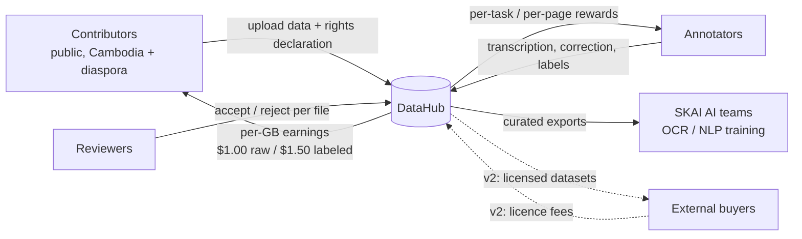
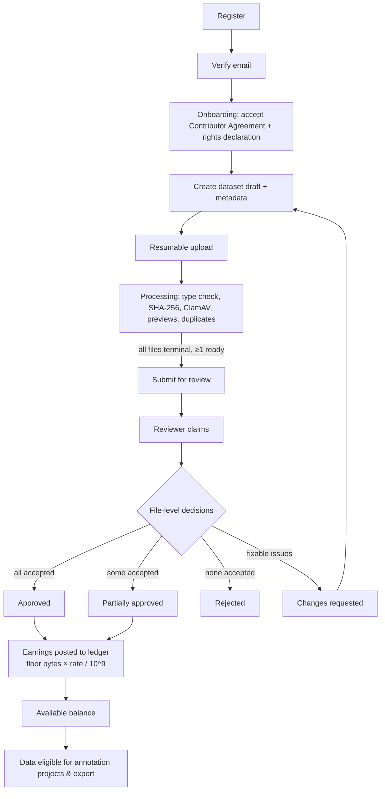
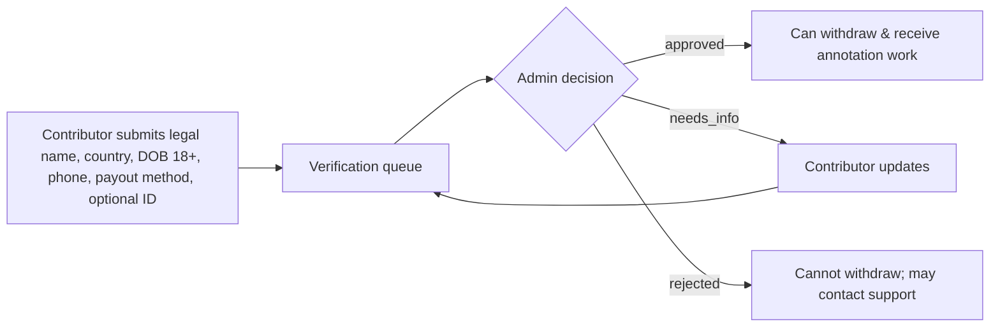
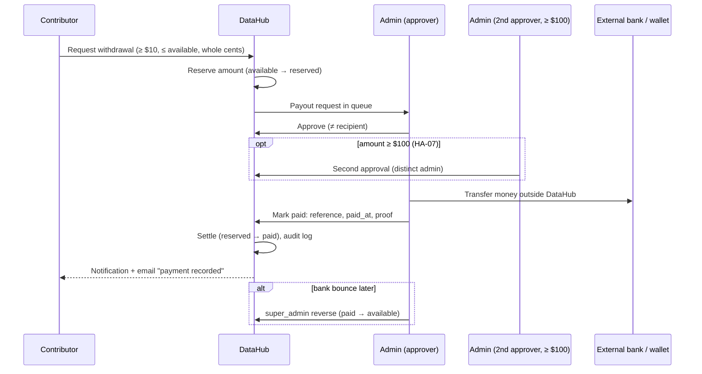
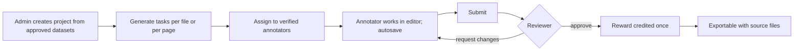

# DataHub — Business Requirements Document (BRD)

## Document control

| Field | Value |
|---|---|
| Document | BRD — Business Requirements Document (mandatory doc #1) |
| Version | 1.0 |
| Date | 2026-10-26 |
| Status | Baseline |
| Owner | Product Manager / Business Analyst (on behalf of SKAI Technology) |
| Approvers | Owner (SKAI Technology); CTO role |
| Canonical source | [`../ENGINEERING_BASELINE.md`](../ENGINEERING_BASELINE.md) wins on any conflict until amended via `DECISION_LOG.md` |

## Header block

**Purpose.** State *why* DataHub exists, what business outcomes it must produce, how the data-acquisition economics work, and the business requirements (BR-01 … BR-34) that every downstream document (PRD, SRS, architecture, tests) must trace back to.

**Scope.** Business view of DataHub v1 (MVP): a single-buyer platform on which SKAI Technology acquires Khmer-first documents and datasets from the public, reviews them, pays for accepted data, runs annotation work on it, and exports it for internal AI training. The external buyer marketplace is out of scope for v1 but must remain possible (BR-33). Technical design is out of scope (see SAD/HLD).

**Assumptions.** A-01 (single organisation buyer, no external buyers in v1), A-02 (Khmer + English content, English UI with message catalogue), A-03 (≤ 2,000 users, ≤ 20 TB year 1), A-04 (USD, integer micro-USD), A-05 (payout methods), A-06 (min $10 / max $5,000 withdrawal), A-07 (hold period 0 days), A-08 (eligibility review gates withdrawals and annotation), A-09 (upload prerequisites), A-10 (fail-closed malware scanning), A-12 (any SMTP provider), A-14 (annotation rewards), A-15 (retention defaults). Additional business planning assumptions are listed in §10 and labelled **P-xx**; they are estimates for budgeting, not system rules.

**Decisions.** Confirmed by owner (MASTER_PROMPT Part 3): open registration with email verification; contributor eligibility review; $1.00 per accepted GB raw and $1.50 per accepted GB labeled (decimal GB); manual payouts only; integrated annotation editor; private data. Recorded design decisions with business impact: ledger in micro-USD (A-04); payouts in whole cents; dual approval at $100 (HA-07, default); labeled-upgrade differential payment ON by default (HA-08).

**Dependencies.** ENGINEERING_BASELINE.md; MASTER_PROMPT.md Parts 2–4, 9–14; downstream: PRD.md, SRS.md, PRODUCT_ROADMAP.md, PRICING_PAYOUT_POLICY.md, DATA_PRIVACY_OWNERSHIP.md, RISK_REGISTER.md. Human approvals HA-01 … HA-08.

**Acceptance criteria for this document.**
1. Contains every section required by MASTER_PROMPT doc #1 (executive summary → business acceptance criteria).
2. Every business requirement has a unique `BR-nn` ID and is traced to at least one SRS requirement (SRS §3 and REQUIREMENTS_TRACEABILITY.md).
3. Economics use concrete numbers consistent with baseline pricing ($1.00/$1.50 per 10⁹ bytes) and storage cost assumptions.
4. All items requiring legal/financial/owner sign-off are referenced as HA-xx, none silently assumed.
5. No placeholders or TBDs other than HA-xx items.

---

## 1. Executive summary

SKAI Technology (Phnom Penh, Cambodia) builds Khmer-first AI — OCR for printed and handwritten Khmer, Khmer NLP, and bilingual Khmer–English models. The main constraint on these models is the lack of large, lawfully sourced, well-described Khmer document corpora: Khmer script (with stacked consonants, COENG sequences, no inter-word spaces and many legacy non-Unicode fonts) is badly represented in public datasets.

**DataHub** is a web platform on which anyone can register, declare that they have the rights to share documents and datasets, upload them, and get paid **only for data that SKAI reviewers have accepted**. The prices are **$1.00 per accepted GB of raw data** and **$1.50 per accepted GB of clean/labeled data** (1 GB = 1,000,000,000 bytes). Accepted data then feeds an **integrated annotation workflow**: transcription, text correction, classification, metadata labeling and page-level labels. SKAI assigns this work to vetted annotators and pays them separately per task or per page.

All money is tracked in an append-only double-entry ledger in integer micro-USD. Payouts are **manual**. A contributor requests a withdrawal, an administrator approves it and makes the transfer outside DataHub (Cambodian bank transfer, ABA Pay, Wise, PayPal), then records the payment reference and proof. DataHub never moves money by itself in v1.

For year 1 the planning target is about **10 TB of accepted data** and **150,000 annotated pages**, from up to **2,000 registered users**, with a total direct operating budget of about **$43k** (§10). The platform is built as a modular monolith so that a v2 **external buyer marketplace** can be added without major redesign.

## 2. Business objectives

| ID | Objective | Measure (year 1, see §14) |
|---|---|---|
| OBJ-1 | Build a lawful, provenance-tracked Khmer-first document corpus for SKAI's OCR/NLP work. | ≥ 10 TB accepted; ≥ 70 % of accepted bytes contain Khmer script. |
| OBJ-2 | Pay contributors fairly, transparently and only for accepted, unique data. | 0 duplicate payments; 0 ledger reconciliation mismatches; payout turnaround ≤ 5 business days (median). |
| OBJ-3 | Produce high-quality labeled data (transcriptions, corrections, labels) at lower cost than outsourcing. | ≥ 150,000 annotated pages; ≥ 80 % first-pass annotation approval; all-in cost ≤ $0.20 per approved page. |
| OBJ-4 | Keep acquisition cost predictable and auditable. | Fully loaded cost ≤ $1.90 per accepted raw GB and ≤ $2.65 per accepted labeled GB (§10.3). |
| OBJ-5 | Protect contributors, data subjects and SKAI from legal, security and fraud risk. | 0 confirmed malware-accepted files; 0 critical security findings open at launch; HA-01 … HA-04 approved before public launch. |
| OBJ-6 | Create a reusable platform that can later sell or license data to external buyers. | v2 marketplace feasible without schema redesign of identity, datasets, ledger (architecture review sign-off). |

## 3. Business model

### 3.1 v1 — single-buyer acquisition platform (A-01)
- **Buyer:** SKAI Technology only. DataHub is a cost centre whose output is training data; v1 has no external revenue.
- **Supply side:** members of the public (contributors) sell a **perpetual, worldwide, non-exclusive licence** (draft model, **HA-02**) to accepted data. Contributors are paid per accepted GB at the pricing rule that applies when the review is finalized.
- **Labour side:** vetted annotators earn per-task or per-page rewards (A-14). This annotation labour is accounted for separately from dataset purchases (separate system wallet `system_annotation_labor`).
- **Quality gate:** in-house reviewers (SKAI staff or contracted) accept or reject data at file level. Only accepted, eligible, non-duplicate bytes earn money.
- **Settlement:** manual transfers recorded in DataHub. Financial liability is created only when a review is finalized or an annotation is approved.

### 3.2 v2 — two-sided marketplace (future, reserved)
- A `buyer` role and `orders` module (A-01) would let approved external organisations (universities, NGOs, AI companies) license curated Khmer datasets.
- Revenue options to be evaluated: per-GB licence fee, subscription access to curated collections, or revenue share paid back to original contributors. Any resale needs contributor licence terms that allow sublicensing (**HA-02**) and legal review (**HA-03**).

## 4. Target contributors and customers

| Segment | Description | Typical data | Expected share of accepted bytes |
|---|---|---|---|
| University students & lecturers | Phnom Penh, Siem Reap and Battambang universities; mobile-first, often on 4G. | Lecture notes, theses (with rights), scanned textbooks they own rights to, handwritten notes. | 25 % |
| Archivists & librarians | Pagoda libraries, provincial archives, NGO document centres, private collectors. | Large TIFF/PDF scans of historical prints, palm-leaf manuscript photographs, newspapers. | 35 % |
| Small businesses & government-adjacent offices | Printing houses, translation agencies, notaries (with consent and redaction). | Forms, receipts, public notices, bilingual documents. | 15 % |
| Independent data creators | Freelancers producing clean/labeled text corpora, typists. | Clean Khmer text (TXT/DOCX), JSONL corpora, CSV word lists. | 20 % |
| Khmer diaspora | Overseas Cambodians (US, France, Australia) holding family/community archives. | Scanned books, letters (with consent), community publications. | 5 % |
| Annotators (labour) | Vetted Khmer typists, linguistics students. | — (perform tasks) | n/a |
| **Customer (v1)** | SKAI AI/ML teams (internal). | Consume exports. | n/a |
| **Customers (v2)** | External researchers, NGOs, AI companies. | Licensed curated datasets. | n/a |

## 5. Stakeholders

| Stakeholder | Interest | Responsibility in DataHub | Role(s) |
|---|---|---|---|
| Owner / SKAI management | ROI, legal safety, data volume | Approves pricing, HA items, budget | `super_admin` |
| CTO | Architecture, security, delivery | Owns baseline, ADRs, release gate | `super_admin` |
| Operations admins | Smooth daily operation | Verify users, manage datasets, payouts, support inbox, exports | `admin` |
| Finance officer | Correct, auditable money flows | Approves/records payouts, reviews reconciliation, tax (HA-04) | `admin` (finance duties) |
| Reviewers / linguists | Clear queues, good tools | Review datasets and annotations, record quality | `reviewer` |
| Annotators | Fair tasks, timely rewards | Complete assigned tasks | `annotator` (+`contributor`) |
| Contributors | Easy upload, transparent earnings, prompt payment | Upload rightful data, respond to feedback | `contributor` |
| Legal counsel | Compliance | HA-01 … HA-04 | — |
| Data subjects (people named in documents) | Privacy | Takedown requests via `/public/contact` | — |
| SKAI ML engineers | Clean, well-described data | Consume exports via admins | — (v1) |
| Hosting/SMTP/storage providers | Contracts | Infrastructure (HA-05) | — |

## 6. Business problems

| ID | Problem | Consequence today |
|---|---|---|
| P-1 | Khmer documents are scattered across physical archives, personal devices and closed institutions. | SKAI models are trained on small, biased corpora. |
| P-2 | Holders of data have no simple, trustworthy way to sell it or be paid. | Ad-hoc purchases through chat apps with no provenance, rights evidence or audit trail. |
| P-3 | Paying by file count or upload size invites gaming (duplicates, padded archives, junk). | Overpayment and wasted review time. |
| P-4 | Manual spreadsheets for earnings and payouts are error-prone and cannot be audited. | Double payments, disputes, no reconciliation. |
| P-5 | Transcription/correction work is outsourced at high cost without version history or QA. | Inconsistent Khmer Unicode (legacy fonts, wrong COENG order), rework. |
| P-6 | Accepting documents without rights checks and malware scanning creates legal and security exposure. | Copyright/privacy claims, compromised machines. |

## 7. Value proposition

| For | Value |
|---|---|
| Contributors | Transparent price list ($1.00/$1.50 per accepted GB), live estimate before review, file-level feedback, a wallet that shows pending/available/reserved/paid balances, withdrawals to local methods (ABA Pay, Cambodian banks) from $10. |
| Annotators | Steady paid tasks, a Khmer-aware editor with autosave and version history, clear reviewer feedback, rewards credited automatically on approval. |
| Reviewers | One workspace with previews, duplicate warnings, checklist and quality scores, bulk actions and a payable amount calculated by the system. |
| SKAI (owner) | Lawful, provenance-tracked Khmer data at a predictable cost per accepted GB, labeled data from the same pipeline, exports ready for ML, and a full audit trail. |
| Future buyers (v2) | Curated, licensed and documented Khmer datasets. |

## 8. Platform scope

### 8.1 In scope (v1)
1. Registration, email verification, login, password reset, sessions, MFA for admins.
2. Onboarding (contributor agreement + rights declaration) and contributor eligibility verification.
3. Dataset creation, metadata, resumable multipart uploads (file ≤ 5 GB, dataset ≤ 50 GB), ZIP expansion, processing (type sniffing, SHA-256, ClamAV, previews, duplicate detection).
4. Dataset review with file-level decisions, quality scores, feedback; decisions approve / partial / reject / request changes.
5. Pricing rules with versioning; earnings calculation; append-only double-entry ledger; wallets.
6. Manual payout workflow with reservation, approval (dual above $100), mark-paid with reference/proof, failure, cancellation and reversal; super-admin adjustments.
7. Annotation projects, task generation, assignment, three-panel editor, autosave, versioning, review and rewards.
8. Messaging (contributor ↔ admin support, dataset-linked conversations), in-app and email notifications, real-time updates.
9. Admin: user management, verification queue, dataset search, takedowns, exports, analytics, audit logs, settings, roles, pricing.
10. Retention, deletion requests and takedown workflow.

### 8.2 Out of scope (v1) — see PRODUCT_ROADMAP.md post-MVP
External buyer marketplace and orders; automatic payouts or payment-provider APIs; bounding-box/region annotation (data model reserved); audio/video transcription; OCR machine pre-labeling; LibreOffice page rendering for DOC/DOCX (A-11); Khmer UI translation (strings are catalogue-ready, A-02); native mobile apps; third-party KYC providers; multi-currency.

## 9. Business processes

### 9.1 End-to-end data acquisition

### 9.2 Contributor verification

### 9.3 Manual payout

### 9.4 Annotation production

### 9.5 Support, takedown and export
- **Support:** a contributor opens a conversation (optionally linked to a dataset). Admins answer from the support inbox, and statuses move `open` ⇄ `awaiting_user` → `closed`.
- **Takedown:** a rights holder or data subject submits `/public/contact` with the takedown category. An admin investigates and may take down the dataset (`taken_down`, with reason). Exports and annotation tasks that use the dataset stop, and any payment correction goes through an adjustment (super_admin). The legal procedure is in DATA_PRIVACY_OWNERSHIP.md (HA-01/HA-03).
- **Export:** an admin selects datasets by filters, the export runs as a background job, and a time-limited download URL (5 min) is issued. The package expires after 7 days, and every export is audit-logged.

## 10. Revenue and cost assumptions

> Planning assumptions **P-xx** are estimates for the year-1 budget. They are **not** enforced by the system and the owner may revise them without a code change. Prices ($1.00/$1.50) are confirmed for v1 (HA-06 governs later changes).

### 10.1 Planning assumptions
| ID | Assumption | Value |
|---|---|---|
| P-01 | Accepted data, year 1 | 10,000 GB (6,000 GB raw, 4,000 GB labeled) |
| P-02 | Acceptance rate (accepted bytes ÷ submitted processed bytes) | 65 % |
| P-03 | Reviewer loaded labour cost (Cambodia, skilled staff) | $6.00 / hour |
| P-04 | Average dataset review effort | 6 min per accepted raw GB; 8 min per accepted labeled GB (sampling + bulk actions) |
| P-05 | Object storage (Cloudflare R2 standard) | $15 / TB-month ($0.015 / GB-month); R2 egress free |
| P-06 | Storage overhead for previews, versioning, backups | +20 % of stored bytes |
| P-07 | Rejected data held before purge | 90 days (A-15) |
| P-08 | Compute/processing (hashing, scan, previews) amortised | $0.02 / GB processed |
| P-09 | Average payout amount; admin handling time; transfer fee absorbed | $40; 5 min per payout; $0.50 average fee |
| P-10 | Annotation volume and reward | 150,000 pages; $0.08 per page (transcription/correction blended) |
| P-11 | Annotation review effort | 30 s per page (sample + full review on flagged pages) |
| P-12 | Base infrastructure (app VM 8 vCPU/32 GB, managed Postgres or VM disk, Redis, backups, monitoring) | $200 / month |
| P-13 | Transactional email (SMTP provider) | $15 / month |
| P-14 | Benchmark: commissioning professional Khmer transcription externally | $0.40 per page |

### 10.2 Year-1 direct operating budget
| Cost line | Calculation | USD |
|---|---|---:|
| Raw data purchases | 6,000 GB × $1.00 | 6,000 |
| Labeled data purchases | 4,000 GB × $1.50 | 6,000 |
| Dataset review labour | (6,000 × 6 min + 4,000 × 8 min) = 68,000 min ≈ 1,133 h × $6 | 6,800 |
| Annotation rewards | 150,000 pages × $0.08 | 12,000 |
| Annotation review labour | 150,000 × 0.5 min = 1,250 h × $6 | 7,500 |
| Payout operations | ≈ 600 payouts ($24,000 dataset + annotation earnings ÷ $40 avg) × (5 min × $6/60 + $0.50 fee) = 600 × $1.00 | 600 |
| Object storage | average 10 TB stored over the year incl. overhead ≈ 10 TB × $15 × 12 | 1,800 |
| Base infrastructure | $200 × 12 | 2,400 |
| Email | $15 × 12 | 180 |
| **Total** | | **≈ 43,280** |

Development effort for v1 (≈ 285 person-days, PRODUCT_ROADMAP.md) is a capital cost outside this table.

### 10.3 Unit cost per accepted GB
| Component | Raw ($/GB) | Labeled ($/GB) |
|---|---:|---:|
| Purchase price | 1.000 | 1.500 |
| Review labour (P-03, P-04) | 0.600 | 0.800 |
| Storage 12 months incl. overhead (0.015 × 12 × 1.2) | 0.216 | 0.216 |
| Storage of rejected bytes (0.54 GB rejected per accepted GB × 0.015 × 3 months) | 0.024 | 0.024 |
| Processing (1.54 GB processed per accepted GB × $0.02) | 0.031 | 0.031 |
| Payout overhead (≈ $1.00 per $40 paid) | 0.025 | 0.038 |
| **Fully loaded** | **≈ 1.90** | **≈ 2.61** |

The targets in OBJ-4 are ≤ $1.90 raw and ≤ $2.65 labeled. **Review labour is the largest cost after the purchase price.** For that reason the product invests in reviewer productivity: bulk file decisions, automatic duplicate flags, server-computed payable amounts and previews prepared before claim.

### 10.4 Annotation unit economics
All-in cost per approved page = $0.08 reward + $0.05 review labour (30 s × $6/h) + ≈ $0.01 rework allowance (20 % returned once) ≈ **$0.14**. Commissioning externally (P-14) costs **$0.40**, a saving of about 65 % on 150,000 pages (≈ $39k avoided cost). This is the main value DataHub returns in v1.

### 10.5 Value / revenue view
- **v1:** no external revenue. Value = avoided acquisition and outsourcing cost plus model improvement. Indicatively, $39k is avoided on annotation alone (§10.4), and no comparable lawful Khmer corpus can be bought at all.
- **v2 (indicative, requires HA-02/HA-03):** if 20 % of accepted labeled data could be licensed to external buyers at $10–$20 per GB per licence, 800 GB × $15 = $12k per licence cycle. These figures are not used for v1 budgeting.

## 11. Data acquisition economics

1. **Pay only for accepted, unique bytes.** `file_earning_micros = floor(accepted_bytes × rate_micros_per_gb / 1_000_000_000)` per file. Rates are 1,000,000 micros/GB (raw) and 1,500,000 micros/GB (labeled). Example: an accepted 2,345,678,901-byte PDF scan, raw → floor(2,345,678,901 × 1,000,000 / 10⁹) = 2,345,678 micros = **$2.34** (displayed rounded down to cents).
2. **Archive bytes are not paid.** A ZIP container never earns. Each extracted member is assessed as a normal file, so compression ratio cannot inflate pay and padding junk files is rejected at review.
3. **Duplicates are not paid twice.** An exact SHA-256 match to any previously accepted file earns 0. Near-duplicates are flagged and the reviewer decides. The raw→labeled upgrade earns only the difference ($0.50/GB at current rates) and only when the reviewer ticks "labeled upgrade" (HA-08).
4. **Size incentive versus value.** Paying per GB favours large scans over compact clean text. A 300-page clean Khmer TXT corpus may be only 2 MB and earn $0.003. This is intentional for v1 simplicity and price transparency. Labeled/clean text is paid at the higher rate, and high-value small text corpora are mainly acquired through **annotation projects** (paid per page/task) rather than per-GB purchase. The owner may revisit per-GB pricing after 6 months of data (HA-06).
5. **Junk-scan risk.** Per-GB pricing invites inflated resolution (for example 1,200-dpi blank pages). Mitigations: reviewer reason codes (`low_value`, `blank_or_near_blank`, `excessive_resolution`), quality scores, and the right to reject or partially accept. These codes are defined in DATA_QUALITY_REVIEW.md.
6. **Budget control.** Admins can see estimated liability (Σ estimates of submitted datasets) and approved liability (ledger) on the finance overview, and can slow intake by pausing review claims. Prices are changed only by super_admin through versioned pricing rules (HA-06).
7. **Cash exposure.** Liability arises only at review finalization. Cash leaves only on manual payout. Minimum withdrawal $10 and maximum $5,000 per request (A-06), at most 1 open payout per user, and dual approval ≥ $100 limit fraud exposure.

## 12. Operational constraints

| ID | Constraint |
|---|---|
| OC-01 | Payouts are manual. Admin staff time scales with payout count (≈ 5 min each). Target ≤ 60 payouts per week per finance admin. |
| OC-02 | Review capacity: one full-time reviewer reviews about 70 accepted GB per 7-hour day at P-04 rates. Intake above about 1,500 GB/month needs a second reviewer. |
| OC-03 | Hosting in a single region (Singapore or EU edge) with object storage on R2/S3. Cambodian users on mobile networks need resumable uploads (16 MiB parts). |
| OC-04 | Small ops team: no 24/7 on-call. Availability target is 99.5 % monthly (≈ 3.6 h downtime), RPO 24 h, RTO 4 h. |
| OC-05 | Legal texts (HA-01), licence model (HA-02), personal-data rules (HA-03) and tax/KYC (HA-04) must be approved before public launch. A closed pilot with invited users is allowed before then, using clearly marked test data and no real payouts without approval. |
| OC-06 | Cambodian public holidays (Khmer New Year mid-April, Pchum Ben, Water Festival) reduce review and payout throughput. SLAs are stated in business days. |
| OC-07 | Storage ceiling 20 TB in year 1 (A-03). Per-user unreviewed quota 200 GB. |
| OC-08 | USD only (A-04). Contributors bear currency conversion by their own bank/wallet. |
| OC-09 | Production credentials, domain and SMTP must be supplied by the owner (HA-05). |

## 13. Business risks

| ID | Risk | Likelihood | Impact | Mitigation | Owner |
|---|---|:-:|:-:|---|---|
| R-01 | Copyrighted or unlawfully obtained documents are uploaded and paid for. | High | High | Rights declaration at onboarding and per dataset; reviewer checklist; takedown workflow; non-exclusive licence (HA-02); ability to take down and adjust. | Legal / admins |
| R-02 | Personal or sensitive data (ID cards, medical records) is uploaded. | Medium | High | `contains_personal_data` flag; reviewer reason codes; restricted exports; retention rules; HA-03. | Legal / reviewers |
| R-03 | Duplicate or recycled content is paid twice (including across accounts). | High | Medium | Global SHA-256 exact-duplicate exclusion; near-duplicate flags; labeled-upgrade rule; one person = one account in the agreement; verification of identity before payout. | Product |
| R-04 | Payout fraud (fake accounts, account takeover, insider payout to self). | Medium | High | Verification before withdrawals; admin MFA; separation of duties; dual approval ≥ $100; unique payment references; audit log. | Finance |
| R-05 | Review backlog makes contributors wait and churn. | Medium | Medium | Queue age metric; target ≤ 5 business days; bulk tools; add reviewers when the queue exceeds 300 GB. | Ops |
| R-06 | Per-GB pricing attracts low-value high-resolution junk. | High | Medium | Reason codes, quality scores, partial acceptance, owner price review after 6 months (HA-06). | Owner |
| R-07 | Malware in uploads compromises staff machines. | Medium | High | ClamAV fail-closed; previews rendered server-side; downloads as attachments only; files never executed. | Security |
| R-08 | Cost overrun on storage (rejected data and previews). | Low | Low | Retention purge (rejected 90 days); storage alerts at 80 % of budgeted TB. | Ops |
| R-09 | Tax or regulatory obligations on payments (HA-04) are discovered late. | Medium | High | Legal review before launch; ledger and exports support per-user annual statements. | Finance |
| R-10 | Annotator quality in Khmer Unicode (legacy font habits, wrong COENG order) is poor. | Medium | Medium | Guidelines; verbatim storage + normalised export; reviewer scoring; feedback loops. | Annotation lead |
| R-11 | Lack of contributors outside Phnom Penh. | Medium | Medium | Outreach to universities, pagodas, NGOs; low minimum withdrawal ($10); ABA Pay support. | Owner |
| R-12 | Key-person dependency on a small admin team. | Medium | Medium | Runbooks; role separation; ≥ 2 admins with `payout.approve` at launch. | Owner |

These business risks are the seed of `RISK_REGISTER.md` (R-01 … R-12). Technical risks continue from R-13 in that register.

## 14. Success metrics (year 1, measured from DataHub analytics and the ledger)

| Metric | Target | Source |
|---|---|---|
| Registered users | 2,000 | `users` |
| Email-verified users | ≥ 80 % of registrations | `users.status` |
| Verified contributors (`approved`) | ≥ 400 | `contributor_verifications` |
| Accepted data | ≥ 10 TB (≥ 70 % Khmer-language bytes) | `dataset_file_reviews` + metadata |
| Acceptance rate (bytes) | ≥ 60 % | review summary |
| Median time submitted → review finalized | ≤ 5 business days | `dataset_reviews` |
| Median payout turnaround (requested → paid) | ≤ 5 business days | `payout_requests` |
| Duplicate payments / double credits | 0 | ledger idempotency + audits |
| Nightly reconciliation mismatches | 0 unresolved > 24 h | `finance.reconcile` |
| Upload success (files ≤ 5 GB, resumable path) | ≥ 99 % | upload_sessions |
| Annotated pages approved | ≥ 150,000 | `annotation_reviews` |
| First-pass annotation approval rate | ≥ 80 % | `annotation_reviews` |
| Support first response | ≤ 1 business day (median) | `conversations` |
| Fully loaded cost per accepted GB | ≤ $1.90 raw / ≤ $2.65 labeled | finance overview + timesheets |
| Availability | ≥ 99.5 % monthly | uptime monitor |
| Contributor satisfaction (in-app survey after first payout) | ≥ 4.0 / 5 | survey (post-MVP) |

## 15. Business requirements

Priority: **M** = Must (MVP), **S** = Should (MVP if capacity), **C** = Could (post-MVP candidate).

| ID | Business requirement | Priority | Source |
|---|---|:-:|---|
| BR-01 | Anyone may register. Use requires email verification and acceptance of the Contributor Agreement and rights declaration before uploading. | M | Part 3; A-09 |
| BR-02 | Contributor eligibility (identity, age 18+, payout method) is reviewed by admins and gates withdrawals and annotation assignment, not uploads. | M | Part 3; A-08 |
| BR-03 | Admins can suspend and reactivate accounts for violations. Suspended users cannot transact. | M | Part 3 |
| BR-04 | Role-based access with roles contributor, annotator, reviewer, admin, super_admin. One account may hold several roles, and permissions are enforced server-side. | M | Part 4 |
| BR-05 | Contributors can upload the listed formats (PDF, DOCX, DOC, TXT, RTF, ODT, JPG/JPEG, PNG, TIFF, BMP, CSV, JSON, JSONL, XML, XLSX, ZIP, admin-approved others) through resumable uploads up to 5 GB per file and 50 GB per dataset, with progress tracking. | M | Part 3, 9 |
| BR-06 | Uploaded files are never executed. File type is verified by content, every file is malware-scanned fail-closed, and archives are safely expanded. | M | Part 3, 9; A-10 |
| BR-07 | Uploaded data is private. Contributors see only their own datasets, annotators only assigned tasks, reviewers only their queues, and admins control broader access and exports. | M | Part 3 |
| BR-08 | Each dataset records metadata (title, description, language, category, data class, source/provenance, licence, personal-data flag) and the contributor's rights declaration. | M | Part 16 |
| BR-09 | Every dataset is reviewed before any payment, with file-level decisions and outcomes approve, partially approve, reject or request changes. Review history is preserved. | M | Part 10 |
| BR-10 | Contributors receive quality feedback (per-file reasons, comments, quality scores, overall feedback). | M | Part 2, 10 |
| BR-11 | Pricing is $1.00 per accepted GB raw and $1.50 per accepted GB labeled (10⁹ bytes). Rates are versioned and the rate applied at finalization is stored. | M | Part 3; HA-06 |
| BR-12 | Only accepted, unique, eligible content earns. Rejected files, disallowed content, exact duplicates of previously accepted files, archive containers and unscanned or infected files earn nothing. | M | Part 3; §8.3 |
| BR-13 | Raw and labeled versions of the same data never earn twice, except through the documented labeled-upgrade differential (HA-08). | M | Part 5 #6; §8.4 |
| BR-14 | All earnings, payouts and corrections are recorded in an append-only, double-entry, idempotent ledger. Users see estimated, pending, available, reserved, paid, adjustments and lifetime approved figures. | M | Part 11; §8.5–8.6 |
| BR-15 | Payouts are manual: request → reservation → admin approval → external transfer → recorded reference/proof → notification. DataHub never initiates real transfers in v1. | M | Part 3, 11 |
| BR-16 | Payout controls: min $10, max $5,000, whole cents, one open request per user, verified contributors only, dual approval at or above $100, and no one approves or pays their own payout. | M | A-06; HA-07; §8.7 |
| BR-17 | Failed payments, cancellations, bounced payments (reversal) and manual corrections (super_admin adjustments with reason) are supported and auditable. | M | Part 11 |
| BR-18 | Admins can create annotation projects from approved data, with instructions, annotation types (transcription, text correction, classification, metadata, page label), task unit, rewards and deadlines, and can assign, reassign, monitor and close them. | M | Part 12 |
| BR-19 | Annotators work in an integrated three-panel editor with autosave, draft recovery, version history, conflict protection and full Khmer Unicode fidelity. | M | Part 12 |
| BR-20 | Reviewers review annotations (compare versions, comment, score, approve or request changes). Approved annotations are exportable with their source files. | M | Part 12 |
| BR-21 | Annotation labour is paid per task or per page, separately from dataset purchases, exactly once per approved task. | M | Part 5 #6, 12 |
| BR-22 | Contributors and annotators can message admins (support inbox, dataset-linked conversations, read status, attachments, search). | M | Part 13 |
| BR-23 | Users receive in-app notifications for the listed key events, and email for important ones, without needing the browser open. | M | Part 13 |
| BR-24 | Admins can search and filter all datasets and export raw and/or labeled data with metadata and annotations as background jobs with expiring private downloads. Every export is logged. | M | Part 14 |
| BR-25 | Admins see financial and operational analytics (intake, acceptance, liabilities, payouts, annotation throughput, queues). | M | Part 2 |
| BR-26 | Every state transition and sensitive action is audit-logged. Super_admins can view audit and security logs. | M | Part 4, 9 |
| BR-27 | Super_admins manage admins, roles, pricing rules and system settings. | M | Part 4 |
| BR-28 | Takedown, account deletion and retention workflows exist and follow the retention defaults (A-15) pending legal review. | M | Part 16; A-15 |
| BR-29 | The product is Khmer-first: Khmer content is stored and displayed correctly (Noto Sans Khmer, verbatim transcription), and the UI is catalogue-ready for a Khmer translation. | M | A-02 |
| BR-30 | Security and privacy: admin MFA, rate limiting, encryption in transit and at rest, CSRF/XSS protection, secrets management. Legal approvals HA-01 … HA-04 are required before public launch. | M | Part 16 |
| BR-31 | Reliability: 99.5 % monthly availability, RPO 24 h, RTO 4 h, tested backups and restore. | M | Part 17; §14 |
| BR-32 | The UI is accessible (WCAG 2.2 AA) and responsive on desktop, tablet and mobile. The annotation editor is optimised for desktop. | M | Part 15 |
| BR-33 | The architecture allows a later external buyer marketplace (buyer role, orders) without redesign of identity, dataset or ledger. | S | Part 2; A-01 |
| BR-34 | Operating cost is observable: admins can see per-period accepted GB, liabilities, payouts and storage usage, so that unit cost targets (§10.3) can be tracked. | S | §10 |

## 16. Business acceptance criteria

The owner accepts DataHub v1 for public launch when **all** of the following hold. Each is checked against real execution and recorded in `RELEASE_READINESS.md`.

| ID | Criterion | Evidence |
|---|---|---|
| BAC-01 | A new user can register, verify email, complete onboarding, upload a mixed dataset (PDF + images + ZIP), and see processing results and an earnings estimate. | Playwright E2E Scenario 1 run on staging. |
| BAC-02 | A reviewer can partially approve a dataset. The contributor's available balance equals the exact `floor` sum of accepted file bytes × rate, and repeating the finalize call creates no second credit. | E2E Scenarios 1 & 7; ledger query. |
| BAC-03 | An exact duplicate of a previously accepted file is flagged and earns 0. | E2E Scenario 5. |
| BAC-04 | A verified contributor can request a $10–$5,000 payout. An admin other than the recipient approves it, a second admin approves it for ≥ $100, the payment reference and proof are recorded, and the contributor sees the paid transaction. No real money is sent in testing. | E2E Scenario 2 with test accounts. |
| BAC-05 | A document can be assigned, transcribed in Khmer (COENG sequences preserved byte-for-byte), approved by a reviewer, rewarded once and exported with its source. | E2E Scenario 3; byte comparison. |
| BAC-06 | Unauthorized access to another contributor's dataset is denied at the API. | E2E Scenario 4 + authorization test suite. |
| BAC-07 | A 2 GB upload interrupted mid-transfer resumes and completes with a matching SHA-256. | E2E Scenario 6. |
| BAC-08 | A database backup restores in an isolated environment, and the ledger reconciliation passes. | Scenario 8 restore drill record. |
| BAC-09 | Nightly reconciliation reports 0 mismatches over a 7-day staging soak. | `finance.reconcile` output. |
| BAC-10 | HA-01 … HA-05 are resolved and recorded in DECISION_LOG.md. HA-06 … HA-08 are confirmed or changed by the owner. | Signed decisions. |
| BAC-11 | No open critical or high security findings. Automated accessibility checks (axe) report 0 serious/critical violations on core pages. | Security & a11y reports. |
| BAC-12 | Admin dashboards show the success metrics in §14 for the pilot period. | Analytics screenshot/report. |

## 17. Traceability

Every BR-nn above is decomposed into SRS requirements (see SRS.md, the "Source" column), and REQUIREMENTS_TRACEABILITY.md maps BR → FR/NFR/SEC → design → TC-xx. PRD.md describes the features that realise the BRs.
