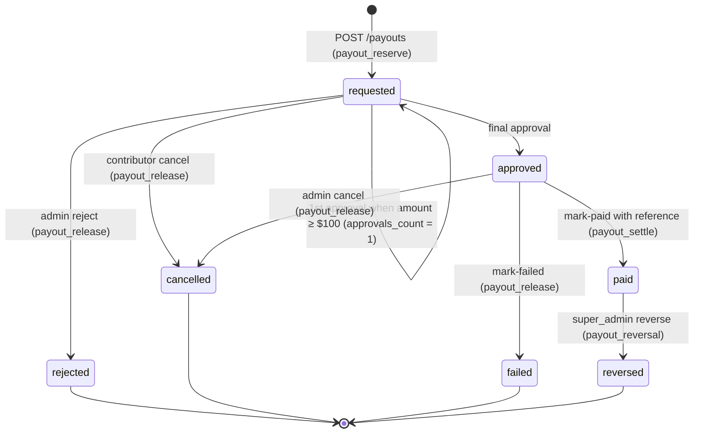

# DataHub — Pricing and Payout Policy

## 0. Document header

| Field | Content |
|---|---|
| **Purpose** | Defines exactly how DataHub (operated by SKAI Technology, Cambodia) prices accepted data, calculates contributor earnings, records them in the wallet ledger, and pays them out manually. It also covers corrections, disputes and the controls that prevent double payment. This is the reference for the `finance` module, the review finalize logic, and the finance test cases. |
| **Scope** | Dataset purchase earnings (raw and labeled), annotation labour rewards (accounting only; reward amounts are set per project), wallet buckets, withdrawal requests, manual payout operations, adjustments, reversals, disputes and financial audit. Excluded: automatic money transfer (not in v1), buyer-side orders (v2, A-01), tax withholding (HA-04). |
| **Assumptions** | A-01 (single operator), A-04 (USD, integer micro-USD, whole-cent payouts), A-05 (payout methods), A-06 (min $10 / max $5,000), A-07 (hold period 0 days by default), A-08 (verification gates withdrawals), A-10 (fail-closed scanning), A-14 (annotation reward per task/page), A-15 (financial records retained 7 years). |
| **Decisions** | Raw $1.00/GB, labeled $1.50/GB, decimal GB (10⁹ bytes); floor per file in micro-USD; rate is snapshotted on `earning_records` at finalize; append-only double-entry ledger (baseline §8.5); one open payout per user; dual approval at or above $100.00 (HA-07); labeled-upgrade differential ON by default (HA-08); annotation rewards are journaled from `system_annotation_labor` and never mixed with dataset purchase earnings. |
| **Dependencies** | `docs/ENGINEERING_BASELINE.md` §1, §2, §6, §7, §8, §9, §10, §12; Data Quality & Review Specification (`docs/05-data-annotation/DATA_QUALITY_REVIEW.md`) for accept/reject decisions; Data Privacy, Ownership & Licensing Policy (`docs/05-data-annotation/DATA_PRIVACY_OWNERSHIP.md`) for the licence that payment buys; Data Retention & Deletion Policy for record retention; Database Schema Documentation (doc 12) for table definitions. |
| **Acceptance criteria** | (1) Each rule below is implementable using only integer arithmetic. (2) Each worked example can be reproduced to the micro by a unit test. (3) Every money movement maps to exactly one journal kind with an idempotency key. (4) No path lets a retried request, a concurrent request, or a re-submitted file be paid twice. (5) Clauses that depend on HA items are marked as such. |

**Document control**

| Version | Date | Status | Owner | Change |
|---|---|---|---|---|
| v1.0 | 2026-10-26 | Baseline | Product owner + Finance lead | First baseline, aligned with Engineering Baseline v1.0 |

Rule identifiers in this document use the prefix `PP-nn`. Test cases (`TC-FIN-nnn`, `TC-PAY-nnn`) reference them.

---

## 1. Price list (v1)

| Data class | Rate (USD per accepted GB) | Stored as `rate_micros_per_gb` | Applies to |
|---|---|---|---|
| `raw` | $1.00 | `1000000` | Unlabeled documents: scans, photos, born-digital files, text dumps, spreadsheets. |
| `labeled` | $1.50 | `1500000` | Data supplied with accurate, aligned labels or clean text: transcriptions matching page images, corrected OCR text, classified documents, structured annotation files. The reviewer must confirm the labels are accurate and usable (see DATA_QUALITY_REVIEW.md §4). |

- **PP-01** 1 GB = **1,000,000,000 bytes** (decimal). GiB (2³⁰) is never used in pricing or in contributor-facing figures.
- **PP-02** The currency is USD only (A-04). All amounts are stored as integer **micro-USD** (`*_micros`, BIGINT; 1 USD = 1,000,000 micros).
- **PP-03** These prices are confirmed for v1. Any change after public launch needs owner approval (HA-06) and is made only by adding a new `pricing_rules` row (§6).
- **PP-04** The public pricing page (`GET /public/pricing`) shows the rule currently in force and any announced future rule, with its `effective_from` date.

## 2. Accepted-bytes calculation

### 2.1 What "accepted bytes" means

- **PP-05** `accepted_bytes` for a file is the stored byte size of that file object (`dataset_files.size_bytes`), as verified after upload by the processing pipeline (S3 `HeadObject` size equal to the bytes that were hashed).
- **PP-06** For a member extracted from a ZIP, `accepted_bytes` is the **uncompressed** size of the extracted member object. The ZIP container's own bytes are **never** payable (§3.2).
- **PP-07** Derived artefacts are never counted: previews, extracted text, thumbnails, generated manifests, annotations and metadata.

### 2.2 Formula (integer only)

For every file with review decision `accepted` that is eligible (§3) in a **finalized** review with decision `approve` or `partial`:

```
file_earning_micros = floor(accepted_bytes × applicable_rate_micros_per_gb / 1_000_000_000)
dataset_earning_micros = Σ file_earning_micros          (floor applied per file, then summed)
displayed_usd_cents   = floor(amount_micros / 10_000)   (always round DOWN for display)
```

- **PP-08** Only Python `int` arithmetic is used (no `float`, no `Decimal` with context rounding). In SQL, use `bigint`/`numeric` integer division only for read-only reports, never for authoritative amounts.
- **PP-09** Flooring is applied **per file**. The documented loss is less than 1 micro-USD per file, which is at most $0.002 for a 2,000-file dataset. This is accepted so that each file's earning is independently reproducible.
- **PP-10** Display always rounds **down** to whole cents. The ledger keeps full micro precision, so sub-cent remainders stay in the contributor's balance and count towards future withdrawals.
- **PP-11** Datasets whose decision is `reject` or `request_changes` produce no earnings. Earnings are created exactly once, at finalize (baseline §9: finalized states are terminal for earnings).

### 2.3 Worked examples

All examples use v1 rates: raw 1,000,000 and labeled 1,500,000 micros per GB.

**Example 1: single raw file.** 734,003,200 accepted bytes, raw.
`734,003,200 × 1,000,000 / 1,000,000,000 = 734,003.2` → floor → **734,003 micros** → displayed **$0.73**.

**Example 2: the same file, labeled.**
`734,003,200 × 1,500,000 / 1,000,000,000 = 1,101,004.8` → floor → **1,101,004 micros** → displayed **$1.10**.

**Example 3: tiny files and the floor.**
| accepted_bytes | raw micros | labeled micros |
|---|---|---|
| 999 | `floor(0.999)` = 0 | `floor(1.4985)` = 1 |
| 1,000 | 1 | `floor(1.5)` = 1 |
| 10,000 | 10 | 15 |

**Example 4: partially approved raw dataset `DS-2026-000123`.**

| File | Type | Bytes | Review / eligibility | Earning (raw) |
|---|---|---|---|---|
| A `ledger_1960.pdf` | pdf | 2,000,000,000 | accepted | 2,000,000 |
| B `blurry_scan.jpg` | jpg | 523,456,789 | rejected `illegible` | 0 |
| C `gazette_vol2.tiff` | tiff | 1,250,000,001 | accepted | `floor(1,250,000.001)` = 1,250,000 |
| D `copy_of_A.pdf` | pdf | 1,048,576 | exact duplicate of a previously accepted file (auto-ineligible) | 0 |
| E `forms.zip` | zip (container) | 900,000,000 | container, never payable | 0 |
| E1 `forms/receipt_001.png` (member) | png | 600,000,000 (uncompressed) | accepted | 600,000 |
| E2 `forms/receipt_002.png` (member) | png | 700,000,000 (uncompressed) | accepted | 700,000 |
| **Total** | | accepted payable bytes 4,550,000,001 | decision `partial` | **4,550,000 micros = $4.55** |

**Example 5: Example 4 had the dataset been confirmed `labeled`.**
A 3,000,000 + C `floor(1,875,000.0015)` = 1,875,000 + E1 900,000 + E2 1,050,000 = **6,825,000 micros** → displayed **$6.82** (6.825 is floored to cents; the 0.5 cent stays in the ledger).

**Example 6: labeled upgrade (§5.4).** File F, 3,000,000,000 bytes, was paid earlier at the raw rate (3,000,000 micros). It is resubmitted in a labeled dataset and the reviewer ticks "labeled upgrade":
`floor(3,000,000,000 × (1,500,000 − 1,000,000) / 1,000,000,000)` = **1,500,000 micros ($1.50)**. If the reviewer does not tick the box, F earns 0.

## 3. Eligible and ineligible data

### 3.1 Eligible (payable) files: all conditions must hold (PP-12)

1. `dataset_files.processing_status = 'ready'`.
2. `scan_status = 'clean'` (fail-closed: `error`, `pending`, `infected` are never payable; A-10).
3. The file-level decision in the finalized review is `accepted`.
4. The file is not an archive container (`zip`).
5. No exact duplicate exists (`dataset_duplicates.kind = 'exact'`) of any **previously accepted** file, belonging to any user including the same contributor. The only exception is the labeled upgrade in §5.4.
6. Within the same finalize, the file is the first occurrence of its sha256 (lowest file ordinal). Later copies in the same dataset earn 0 (§4.2).
7. The dataset is finalized with decision `approve` or `partial` and was not `withdrawn` or `taken_down` before finalize.
8. For extensions allowed only through `extra_allowed_extensions` ("other"), the reviewer has explicitly accepted the file (baseline §7: "reviewer decides").

### 3.2 Ineligible: always 0 (PP-13)

| Category | Examples / rule |
|---|---|
| Rejected content | Any file the reviewer rejects, with any reason code (catalogue in DATA_QUALITY_REVIEW.md §8). |
| Failed or unsafe files | `failed` (`type_mismatch`, `disallowed_type`, `nested_archive`, corrupt), `quarantined`, `infected`, scan `error`. |
| Containers | ZIP files themselves. Their **members** are normal files and are judged one by one. |
| Nested archives | ZIP members that are archives (not expanded, marked `failed: nested_archive`). |
| Duplicates | Exact duplicates of previously accepted content; extra copies within a dataset. |
| Disallowed or abusive content | Malware, padded or inflated files (reason `size_inflation`), files that break the rights declaration, illegal content. |
| Derived artefacts | Previews, extracted text, manifests, annotations, metadata. |
| Withdrawn or deleted | Files removed from the dataset before submission, and datasets withdrawn before finalize. |

### 3.3 Estimated earnings are not earnings

- **PP-14** The "Estimated" figure (baseline §8.6) is Σ bytes of processed, clean, non-duplicate, non-container files in datasets that are not yet finalized × the **current** rate for the declared data class. It is never written to the ledger. The UI always labels it "estimate — final amount is set at review".

## 4. Duplicate handling

### 4.1 Detection
- Every file (including ZIP members) is SHA-256-hashed during processing. `processing.detect_duplicates` upserts `dataset_duplicates(file_id, matched_file_id, kind)`. `kind` is either `exact` (same sha256) or `near` (similarity heuristics, e.g. the same perceptual hash of the page image or the same normalised text).
- **PP-15** **Exact duplicate of previously accepted content.** The file is automatically ineligible and the reviewer sees it pre-marked `rejected / duplicate`. The reviewer can override this only for the labeled-upgrade case (§5.4).
- **PP-16** **Exact duplicate of content that has not been accepted** (for example, also pending in another dataset). It is flagged. The first finalize that accepts the content wins. Any later finalize sees that content as "previously accepted", and the earning engine recomputes eligibility at finalize under lock (§11), so the reviewer's view at claim time is never trusted.
- **PP-17** **Near duplicates** are flagged for the reviewer, who decides. If accepted, they are paid in full.

### 4.2 Within-dataset duplicates
- **PP-18** When two or more files in the same dataset share a sha256, only the first (lowest `ordinal`, then earliest `created_at`) can be accepted. The others are pre-marked `rejected / duplicate`, and the earning engine pays each sha256 at most once per finalize.

### 4.3 Hard database guarantee
- **PP-19** `earning_records` stores `content_sha256` and `pricing_tier` (`raw` or `labeled`, meaning the cumulative tier reached by that content). A partial unique index `UNIQUE (content_sha256, pricing_tier) WHERE amount_micros > 0` makes a second raw payment or a second labeled payment for the same bytes impossible, even if application logic fails. This is a required addition to the Database Schema Documentation.

## 5. Raw vs labeled data

### 5.1 Declaration and confirmation
- The contributor declares `data_class` when creating the dataset. At finalize the reviewer confirms or changes it (`PATCH /reviews/{id}` → `data_class`). The finalized value is the one priced.
- **PP-20** Labeled requires labels that are accurate, aligned to their source files, and in a documented format (manifest/sidecar JSON, CSV mapping, or paired text files). If the reviewer judges the labels unusable, the reviewer either downgrades the dataset to `raw` (and must record this in the feedback) or requests changes.

### 5.2 Mixed datasets
- **PP-21** `data_class` is set **per dataset**, not per file. A contributor with both labeled and unlabeled material must split it into two datasets. A reviewer who finds a mixed dataset requests changes (reason `metadata_mismatch`) or downgrades it to `raw`.

### 5.3 No double compensation
- **PP-22** Raw and labeled versions of the same underlying bytes are never both paid in full. Identity is the file's sha256. A labeled dataset that contains the same image files as an earlier raw dataset, plus a new labels file, earns at the labeled rate **only for the new labels file**, and earns for the image files only through the upgrade rule in §5.4.

### 5.4 Labeled upgrade differential (HA-08, default ON)

- **PP-23** A file whose sha256 has already been paid earns **0**, unless all of these hold:
  1. the setting `labeled_upgrade_enabled = true` (default);
  2. the new dataset is finalized as `labeled`;
  3. the highest **effective rate** previously paid for that sha256 is below the labeled rate in force now;
  4. the reviewer ticks "labeled upgrade" on that file (`labeled_upgrade = true` in `PUT /reviews/{id}/files/{file_id}`), confirming that the new submission adds accurate labels for it.
- Then `file_earning_micros = floor(accepted_bytes × max(0, labeled_rate − prior_effective_rate) / 1e9)`.
- `prior_effective_rate` is the maximum `effective_rate_micros_per_gb` across earlier `earning_records` for that sha256 with `amount_micros > 0`. An upgrade record stores `applied_rate` = the difference and `effective_rate` = the full labeled rate, so a second upgrade attempt computes a difference of 0.
- The upgrade may be paid to a **different contributor** from the original raw contributor (for example, someone who transcribed a public scan). The reviewer must check that this contributor holds rights to the labels (see DATA_PRIVACY_OWNERSHIP.md §2).
- ⚖️ **Owner approval required (HA-08):** keep the differential policy, or disable upgrades (`labeled_upgrade_enabled = false`, so upgrades earn 0 and labels are paid only through annotation projects).

## 6. Price versioning

- **PP-24** Prices live in `pricing_rules(id, data_class, rate_micros_per_gb, effective_from, effective_to NULL, reason, created_by, created_at)`. A unique constraint on `(data_class, effective_from)` plus an exclusion constraint prevents overlapping periods per class.
- **PP-25** Rules are **never updated or deleted**. A change inserts a new rule whose `effective_from` is in the future, and closes the previous rule's `effective_to` at the same instant. Only `super_admin` (`pricing.manage`) can do this, MFA is required, and an audit row is written.
- **PP-26** **Applicable rate** = the rule in force for the finalized `data_class` at the review's `finalized_at` timestamp (UTC). Submission time does not matter.
- **PP-27** At finalize, every `earning_records` row snapshots: `pricing_rule_id`, `data_class`, `rate_micros_per_gb` (rule rate), `applied_rate_micros_per_gb` (rule rate, or the difference for upgrades), `effective_rate_micros_per_gb`, `accepted_bytes`, `content_sha256`, `pricing_tier`, `is_labeled_upgrade`, `amount_micros`, `journal_id`. Later rule changes never change historical records.
- **PP-28** Price **decreases** are announced to contributors at least **30 days** before `effective_from` (through email and in-app notification). Increases can take effect immediately. Neither is applied retroactively.

## 7. Wallets, buckets and the ledger

### 7.1 Buckets (contributor-facing)

| Figure | Source | Meaning |
|---|---|---|
| Estimated | computed, not in ledger | Projection for datasets not yet finalized (§3.3). |
| Pending | `pending` bucket | Approved earnings still in the hold period (`earning_hold_days`, default 0, A-07). Not withdrawable. |
| Available | `available` bucket | Withdrawable money. |
| Reserved | `reserved` bucket | Locked by an open payout request (`requested` or `approved`). |
| Paid | `paid` bucket | Cumulative money confirmed as sent. |
| Adjustments | Σ adjustment journals | Manual credits minus manual debits, each with a reason. |
| Approved earnings (lifetime) | Σ `dataset_earning` + `annotation_reward` journals | Everything ever earned. Shown split into "Dataset purchases" and "Annotation work". |

- **PP-29** With hold days at 0, earnings credit `available` directly. With hold days above 0, they credit `pending`, and the hourly `finance.release_pending` job moves each matured earning to `available` with an `earning_release` journal (key `earning_release:{journal_id}`).

### 7.2 Ledger structure (baseline §8.5)

- `ledger_journals`: one header per business event, holding `kind`, `source_type`, `source_id`, `idempotency_key` (unique), `created_by`, `memo`, `created_at`.
- `wallet_transactions`: the lines (`journal_id`, `wallet_id`, `bucket`, `amount_micros`). The **sum of lines per journal must be 0** (deferred constraint trigger). UPDATE/DELETE on journals and lines is blocked by trigger: the ledger is append-only, and every correction is a new journal.
- Wallets: one `user` wallet per user, plus the system wallets `system_dataset_purchases`, `system_annotation_labor`, `system_adjustments` and `system_payouts_settled` (the last is reserved for v2 and unused in v1). System wallets use bucket `main`. Their balances go negative by design: they mirror what the platform owes.

### 7.3 Journal kinds

| Kind | Lines (X > 0) | Trigger | Idempotency key | Who |
|---|---|---|---|---|
| `dataset_earning` | user.available (or pending) +X; system_dataset_purchases.main −X | Review finalize with approve/partial and Σ > 0 | `dataset_review:{review_id}:earning` | reviewer/admin (finalize) |
| `annotation_reward` | user.available (or pending) +X; system_annotation_labor.main −X | Annotation review approve | `annotation_review:{review_id}:reward` | reviewer/admin |
| `earning_release` | user.pending −X; user.available +X | Hold period ended | `earning_release:{source_journal_id}` | system |
| `payout_reserve` | user.available −X; user.reserved +X | `POST /payouts` accepted | `payout:{payout_id}:reserve` | contributor |
| `payout_release` | user.reserved −X; user.available +X | Payout rejected / cancelled / failed | `payout:{payout_id}:release` | admin or contributor |
| `payout_settle` | user.reserved −X; user.paid +X | Mark-paid | `payout:{payout_id}:settle` | admin (`payout.record_payment`) |
| `payout_reversal` | user.paid −X; user.available +X | A paid payout later bounced | `payout:{payout_id}:reversal` | super_admin |
| `adjustment_credit` | user.available +X; system_adjustments.main −X | Manual correction | `adjustment:{adjustment_id}` | super_admin (`finance.adjust`) |
| `adjustment_debit` | user.available −X; system_adjustments.main +X | Manual correction | `adjustment:{adjustment_id}` | super_admin (`finance.adjust`) |

- **PP-30** A finalize whose total earning is 0 writes `earning_records` rows with `amount_micros = 0` for audit, but **no journal** (journals with zero lines are not allowed).
- **PP-31** Cached balances on `wallets` are updated in the same database transaction as the lines. The nightly `finance.reconcile` job recomputes Σ lines per (wallet, bucket), compares the result with the cache, checks that every journal balances, and checks that Σ over all wallets = 0. Any mismatch raises an alert and shows on `GET /admin/finance/reconciliation`. **Payouts are paused** (approve and mark-paid return `409 reconciliation_mismatch`) until a super_admin acknowledges the mismatch.

### 7.4 Separation of annotation rewards from dataset purchases

- **PP-32** Annotation labour rewards come from `system_annotation_labor` with kind `annotation_reward`, and their source is `annotation_reviews` / `annotation_rewards`. Dataset purchase earnings come from `system_dataset_purchases` with kind `dataset_earning`, and their source is `dataset_reviews` / `earning_records`. A single journal never contains both. Reports, analytics and the contributor's earnings page always show the two streams separately.
- **PP-33** Reward amounts come from the project (`reward_per_task_micros`, and optionally `reward_per_page_micros × pages`; A-14) and are snapshotted on `annotation_rewards`. They are paid once per approved task: `annotation_rewards.annotation_review_id` is unique, and `request_changes` pays nothing.
- **PP-34** Both streams land in the same user wallet's `available` bucket and can be withdrawn together. The separation is in accounting (source wallet, journal kind, source records), not in the payout. Annotating a dataset never changes that dataset's purchase price, and dataset earnings never depend on annotation.

## 8. Withdrawal requests

### 8.1 Eligibility (PP-35, all must hold; checked server-side)

| Rule | Value / check | Error code |
|---|---|---|
| Permission | `payout.request` (contributor or annotator) | `forbidden` |
| Verified contributor | latest `contributor_verifications.status = 'approved'` (A-08) | `verification_required` |
| Account state | `users.status = 'active'` | `account_inactive` |
| Payout method | at least one saved method; the request names one of the user's methods | `payout_method_required` |
| Minimum | amount ≥ `payout_min_micros` (default 10,000,000 = $10.00, A-06) | `amount_below_minimum` |
| Maximum | amount ≤ `payout_max_micros` (default 5,000,000,000 = $5,000.00) | `amount_above_maximum` |
| Whole cents | `amount_micros % 10_000 == 0` | `amount_not_whole_cents` |
| Balance | amount ≤ available (checked **after** the row lock) | `insufficient_funds` |
| One open request | no other payout in `requested` or `approved` (partial unique index) | `open_payout_exists` |
| Idempotency | `Idempotency-Key` header required; same key + same body returns the original payout; same key + a different body returns `409 idempotency_conflict` | — |

### 8.2 Request flow
1. Contributor submits `POST /payouts {amount_micros, payout_method_id}` with `Idempotency-Key`.
2. In one transaction: lock the wallet `FOR UPDATE`, run all checks, insert `payout_requests` (status `requested`, with a snapshot of the method details), post the `payout_reserve` journal, and write audit + notification outbox rows.
3. The contributor can cancel while the status is `requested` (`POST /payouts/{id}/cancel`), which posts `payout_release`.
4. The UI offers "Withdraw all available (whole cents)", which uses `floor(available / 10_000) × 10_000` capped at the maximum. Example: available 57,432,100 micros ($57.4321) gives a maximum request of $57.43 (57,430,000). A request of $57.44 fails with `insufficient_funds`.

### 8.3 Payout status machine (baseline §9)



## 9. Payout approval and separation of duties

- **PP-36** Approvers need `payout.approve`, an active MFA-verified session, and must not be the recipient.
- **PP-37** **Dual approval (HA-07).** If `amount_micros ≥ payout_dual_approval_threshold_micros` (default 100,000,000 = **$100.00**, inclusive), two **distinct** approvers are required. `payout_approvals(payout_id, approver_id)` is unique. The first approval keeps the status `requested` with `approvals_count = 1`, and the second moves it to `approved`. Below the threshold, one approval is enough.
- **PP-38** The person recording the payment (`payout.record_payment`) must not be the recipient. **Recommended control, not enforced in v1:** for payouts that needed dual approval, the recorder should be one of the approvers, and the external transfer should be released by someone who holds the bank-portal credentials.

| Action | Contributor (recipient) | Admin A | Admin B | Super admin |
|---|---|---|---|---|
| Request / cancel own payout | ✓ | — | — | — |
| Approve | ✗ own | ✓ (1st) | ✓ (2nd, ≠ A) | ✓ (≠ recipient) |
| Reject / cancel (admin) | ✗ own | ✓ | ✓ | ✓ |
| Mark paid / failed | ✗ own | ✓ | ✓ | ✓ |
| Reverse a paid payout | ✗ | ✗ | ✗ | ✓ (≠ recipient) |
| Manual adjustment | ✗ | ✗ | ✗ | ✓ (never on own wallet) |
| Change pricing | ✗ | ✗ | ✗ | ✓ |

- An admin who is also a contributor can never act on their own payouts, adjustments or reviews. Services enforce this by comparing `actor.id` with `payout.user_id`, and a violation returns `403 separation_of_duties`.

## 10. Manual payout procedure (admin runbook)

DataHub never moves money (Part 3). The administrator transfers money outside DataHub and records the result. Target service levels: first decision within **5 business days** of the request, and payment within **10 business days**.

1. **Open the queue.** Go to `Admin → Payouts` and filter by `status=requested`, oldest first.
2. **Check the recipient.** Verification must be `approved`, the account `active`, and the legal name on the verification must match the account holder in the payout-method snapshot. If the payout method was added or changed within the last **72 hours**, confirm the change with the contributor through an in-app message before approving (this guards against account-takeover fraud).
3. **Check the balance history.** Open the wallet ledger. Check that the reserved amount equals the request, and that the earnings trace to finalized reviews or approved annotation reviews. Investigate any adjustment credits in the last 30 days.
4. **Decide.**
   - Approve with `POST /admin/payouts/{id}/approve`. At or above $100, a second, different admin approves.
   - Or reject with `POST /admin/payouts/{id}/reject {reason_code, comment}`. Reasons: `verification_mismatch`, `suspected_fraud`, `method_invalid`, `account_under_review`, `other`. The comment is mandatory and shown to the contributor. The reserve is released.
5. **Transfer externally.** Using the snapshotted method (bank transfer / ABA Pay / Wise / PayPal / other), send exactly the requested **USD** amount. If the rail requires KHR, convert at the provider's rate. The recorded amount is still the USD amount, and the conversion rate goes in the notes. The platform pays its own sending fees. Receiving-side and intermediary fees are the recipient's responsibility, and the policy page discloses this.
6. **Record payment.** `POST /admin/payouts/{id}/mark-paid {payment_reference, paid_at, notes}` plus optional `POST /admin/payouts/{id}/proof` (PDF/PNG/JPG ≤ 10 MB, stored privately under `finance/payout-proofs/`, scanned). `payment_reference` must be non-empty and **unique per payout method type**. A reused bank reference returns `409 duplicate_payment_reference`.
7. **System records it.** Status moves to `paid`, the `payout_settle` journal is posted, a `payout_records` row is created (unique per payout), and the audit row and the contributor's notification (in-app + email) are written.
8. **File evidence.** Keep the bank or provider confirmation in the provider portal as well. DataHub's proof upload is the in-system copy for audit.

## 11. Double-payment prevention (summary of controls)

| Risk | Control |
|---|---|
| Finalize retried, double-clicked or replayed | `Idempotency-Key` on finalize; journal key `dataset_review:{review_id}:earning` unique; `earning_records (source_type, source_id, file_id)` unique; review status guard (`in_progress` → `finalized` only once, `UPDATE … WHERE status='in_progress'`). |
| Same bytes paid in two datasets (race between two reviewers) | At finalize, sha256 values are sorted and `pg_advisory_xact_lock(hashtextextended(sha256, 0))` is taken for each one, then eligibility is re-queried inside the transaction; the partial unique index `(content_sha256, pricing_tier) WHERE amount_micros > 0` acts as the backstop. |
| Annotation approval retried | `annotation_rewards.annotation_review_id` unique; journal key `annotation_review:{review_id}:reward`. |
| Two withdrawals spending the same balance | `SELECT … FROM wallets WHERE id = :id FOR UPDATE` before the balance check; CHECK constraint so available and reserved cannot go negative; partial unique index allowing one open payout per user. |
| Withdrawal POST retried | `payout_requests (user_id, client_idempotency_key)` unique. |
| Payout settled twice | `payout_records.payout_id` unique; journal key `payout:{id}:settle`; status guard `approved` → `paid`. |
| Same external transfer recorded for two payouts | `payment_reference` unique per method. |
| Wallet cache drift | Nightly reconciliation; payouts pause on mismatch (PP-31). |
| Ledger tampering | UPDATE/DELETE triggers; audit log of every finance action; `audit.read` only for super_admin. |

## 12. Rejected payouts, payment errors and corrections

### 12.1 Rejected payouts
- A rejection is final for that request. The reserved amount returns to available (`payout_release`). The contributor sees the reason code and comment and can submit a new request after fixing the cause.

### 12.2 Payment errors before "paid"
- **PP-39** If the transfer fails (bank rejection, wrong account, provider error) before mark-paid, the admin uses `POST /admin/payouts/{id}/mark-failed {reason, provider_reference?}`. The status moves `approved` → `failed` and `payout_release` returns the funds to available. The contributor is notified to check or update the payout method and then submits a new request.
- **Never** mark a payout `paid` "provisionally". Mark-paid only after the admin has the provider's confirmation (Part 11).

### 12.3 Payment found failed after "paid" (reversal)
- **PP-40** If a payout marked `paid` later bounces (funds returned to SKAI), a **super_admin** uses `POST /admin/payouts/{id}/reverse {reason, evidence}`. The status moves `paid` → `reversed` and `payout_reversal` moves the money from paid back to available. The original `payout_records` row stays, and the reversal is a new journal.

### 12.4 Adjustments (manual corrections)
- **PP-41** Only `super_admin` with `finance.adjust` creates `payout_adjustments` (`POST /admin/adjustments {user_id, direction: credit|debit, amount_micros, reason_code, reason_text, related_entity}`). Reason text of at least 20 characters is mandatory, and a reason code is required from: `review_error`, `pricing_error`, `duplicate_payment_recovery`, `takedown_recovery`, `goodwill`, `migration`, `other`.
- A debit cannot exceed the current available balance, because negative balances are not allowed. If the amount owed is larger (for example, an external double transfer that was not recovered), the super admin:
  1. debits up to the available balance;
  2. records the outstanding amount in the adjustment's `reason_text` and opens a support conversation with the contributor;
  3. sets the contributor's verification to `needs_info`, which blocks further withdrawals (A-08), until the remainder is repaid externally or offset by later debits.
- Adjustments never edit earning records or reviews. A review that was finalized wrongly is corrected **only** through adjustments that reference the review ID.

## 13. Refunds and disputes

- **Contributor disputes an earning** (for example, a file wrongly rejected): the contributor opens a support conversation within **60 days** of finalize. An admin with a reviewer who was not the original reviewer re-examines the file. If the dispute is upheld, a super_admin posts an `adjustment_credit` with reason `review_error`, calculated with the formula and rate snapshot of the **original** finalize. The finalized review itself is not reopened.
- **Contributor disputes a payout** (says money was not received): the admin checks the provider records. If the transfer failed, it is handled under §12.3. If the transfer succeeded, the admin shares the reference with the contributor and closes the case.
- **Platform claim against a contributor** (content later found to infringe rights, contain undisclosed personal data, or duplicate the contributor's own earlier submission): after an upheld takedown (DATA_PRIVACY_OWNERSHIP.md §12), a super_admin may post an `adjustment_debit` (reason `takedown_recovery`) for the earnings attributable to the affected files, limited as in §12.4. ⚖️ **LEGAL REVIEW REQUIRED (HA-01):** clawback of amounts already paid out must rest on a Contributor Agreement clause.
- There are **no refunds to buyers** in v1 (there are no buyers; A-01).
- Annotation reward disputes follow the same steps, using `annotation_reward` source records.

## 14. Financial auditability

- Every money movement is one journal with `source_type` / `source_id`, so it can be traced to a review, an annotation review, a payout or an adjustment. Every state change writes `audit_logs` (actor, action, before/after, IP, request_id).
- Admin views: `GET /admin/ledger` (filter by user, kind, date; CSV export with `finance.read`), `GET /admin/finance/overview` (totals per stream: dataset purchases, annotation labour, adjustments, paid, reserved, liabilities), and `GET /admin/finance/reconciliation`.
- **Month-end close** (finance lead): (1) reconciliation is green; (2) Σ `payout_records` for the month equals the provider statements; (3) every adjustment has a reason and a super_admin actor; (4) export the ledger CSV and keep it with the accounting records.
- Retention: journals, lines, earning records, payout records, approvals, adjustments, proofs and their audit logs are kept for **7 years** (A-15) and survive account anonymisation (DATA_RETENTION_DELETION.md §6).

## 15. Tax notice (HA-04)

> ⚖️ **LEGAL REVIEW REQUIRED (HA-04).** In v1, DataHub **does not withhold tax** and does not issue tax forms. Amounts shown are gross. Contributors are responsible for declaring and paying any tax due on their income in their country of residence. SKAI Technology may later introduce withholding, KYC thresholds or reporting required under Cambodian tax law (for example, withholding on payments to resident individuals) or under foreign law. If so, the policy changes are announced at least 30 days in advance and are not applied retroactively to payouts already paid.

This notice appears on the payout request page and in the Contributor Agreement.

## 16. Configurable settings (`system_settings`)

| Key | Default | Changed by |
|---|---|---|
| `payout_min_micros` | 10000000 | super_admin |
| `payout_max_micros` | 5000000000 | super_admin |
| `payout_dual_approval_threshold_micros` | 100000000 | super_admin (HA-07) |
| `earning_hold_days` | 0 | super_admin |
| `labeled_upgrade_enabled` | true | super_admin (HA-08) |
| Pricing | via `pricing_rules` only | super_admin (HA-06) |

Every settings change is audited with before and after values.
