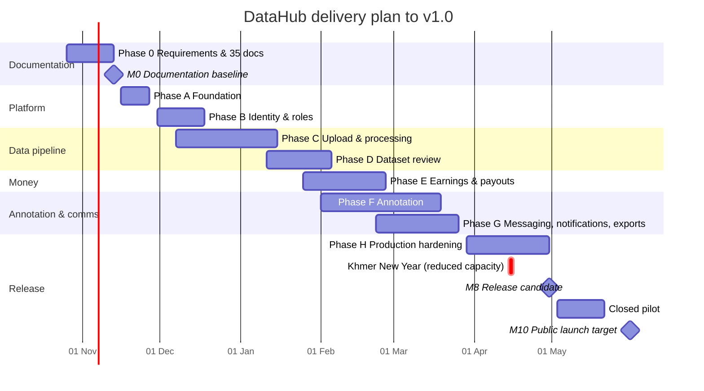
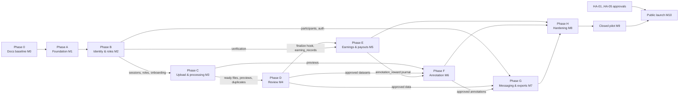
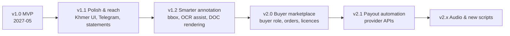

# DataHub — Product Roadmap

## Document control

| Field | Value |
|---|---|
| Document | Product Roadmap (mandatory doc #4) |
| Version | 1.0 |
| Date | 2026-10-26 |
| Status | Baseline |
| Owner | Product Manager with CTO role |
| Approvers | Owner (SKAI Technology) |
| Canonical source | [`../ENGINEERING_BASELINE.md`](../ENGINEERING_BASELINE.md) |

## Header block

**Purpose.** Sequence the delivery of DataHub from documentation (Phase 0) through implementation Phases A–H (MASTER_PROMPT Part 19), the closed pilot and public launch, and then post-MVP releases. For each phase it gives dependencies, priorities, milestones, deliverables, effort, risks and release criteria.

**Scope.** All work needed to reach a production-ready v1.0 (MVP) and the planned releases v1.1, v1.2, v2.0 and v2.x. Dates are planning targets. A phase finishes when its acceptance gate is met, not when its date arrives.

**Assumptions.** A-01 … A-15 (baseline). Additional planning assumptions:
- **Team:** 2 backend engineers (BE), 2 frontend engineers (FE), 0.5 QA engineer, 0.5 DevOps/SRE, with the PM/CTO roles part-time. That is 5.0 delivery FTE.
- **Working calendar:** 5-day weeks. Cambodian public holidays reduce capacity (International New Year 1 Jan, Victory Day 7 Jan, Khmer New Year 14–16 Apr 2027, Visak Bochea, Royal Ploughing Ceremony).
- Effort figures are in **person-days (pd)** of engineering, QA and DevOps, and include automated tests written in the same phase (MASTER_PROMPT Part 20: tests are written throughout, not at the end).

**Decisions.**
- Documentation gate first: no application code before the 35-document baseline passes review (MASTER_PROMPT Part 1).
- Phases overlap only where the dependency graph (§3) allows.
- Public launch requires HA-01 … HA-05 resolved. A closed pilot with invited test accounts and marked test data may run before that, with no real payouts.
- The MVP scope is the Must set in PRD §13. Should items slip to v1.1 only with PM + CTO sign-off.

**Dependencies.** BRD.md (BR-xx), PRD.md (features F1–F15, MoSCoW), SRS.md (FR/NFR/SEC ranges), ENGINEERING_BASELINE.md, MASTER_PROMPT Parts 19, 20, 22, 23, 25. Human approvals HA-01 … HA-08.

**Acceptance criteria for this document.**
1. Covers Phase 0 and A–H with dependencies (Mermaid), priorities, milestones, deliverables, risks, release criteria and person-day estimates.
2. Phase deliverables map to SRS requirement ranges.
3. MVP scope and post-MVP roadmap are consistent with PRD §13–§14.
4. Each phase acceptance gate matches MASTER_PROMPT Part 19.

---

## 1. Summary timeline

| Phase | Name | Planned window | Effort (pd) | Milestone |
|---|---|---|---:|---|
| 0 | Requirements & documentation | 2026-10-26 → 2026-11-13 | 30 | **M0** Documentation baseline approved |
| A | Foundation | 2026-11-16 → 2026-11-27 | 15 | **M1** Stack runs end-to-end |
| B | Identity & roles | 2026-11-30 → 2026-12-18 | 25 | **M2** API-enforced permissions |
| C | Dataset upload & processing | 2026-12-07 → 2027-01-15 | 40 | **M3** Real files uploaded, processed, retrieved securely |
| D | Dataset review | 2027-01-11 → 2027-02-05 | 25 | **M4** Accepted/rejected sizes correct |
| E | Earnings & payments | 2027-01-25 → 2027-02-26 | 35 | **M5** Financial ops atomic & idempotent |
| F | Annotation | 2027-02-01 → 2027-03-19 | 45 | **M6** Document assigned → annotated → reviewed → exported |
| G | Communication & exports | 2027-02-22 → 2027-03-26 | 30 | **M7** Messaging works; secure exports |
| H | Production hardening | 2027-03-29 → 2027-04-30 | 40 | **M8** Release candidate v1.0-rc1 meets release criteria |
| — | Closed pilot (staging/prod, invited users, no real payouts until HA-04/05) | 2027-05-03 → 2027-05-21 | ops | **M9** Pilot exit review |
| — | Public launch v1.0 | target 2027-05-31 | — | **M10** GA (requires HA-01 … HA-05) |
| | **Total to v1.0** | ≈ 31 weeks | **285** | |

## 2. Priorities

1. **Correctness of money and access before features.** Phases B (permissions) and E (ledger) carry the strictest gates. No later phase may bypass `require(permission)` or post money outside the ledger service.
2. **The data pipeline is the critical path.** Uploads → processing → review → earnings (C → D → E) deliver the core business value (BR-05 … BR-14).
3. **Annotation is the second value stream.** It starts once previews exist (C) and needs approved data (D) and the reward ledger (E).
4. **Communication and exports** (G) are needed to operate at scale but are not on the money path, so they can run in parallel.
5. **Hardening is not optional.** Security, performance, accessibility and restore testing (H) gate the release.

## 3. Dependencies

| Phase | Hard dependencies | Can start early with |
|---|---|---|
| A | M0 | — |
| B | A (DB, migrations, app factory, CSRF/session foundation) | — |
| C | B: sessions, `require()`, onboarding gate FR-USER-02 | Storage/ClamAV containers built in A; worker skeleton |
| D | C: files reach `ready`, previews, duplicate rows | Review UI shell against fixtures from the C test suite |
| E | D: finalize transaction hook; B: verification (FR-VER) | Ledger core (journals, triggers, wallets) can be built from week 2 of D |
| F | C previews; D approved datasets; E reward journal | Editor UI (FE) from the start of F while BE builds projects/tasks |
| G | B (auth), D/F (data to export) | Messaging/notifications can start once B is done (FE capacity permitting) |
| H | E, F, G feature-complete | Load-test scripts and restore drill scripts prepared during G |

External dependencies: **HA-05** (hosting account, domain, DNS, SMTP and storage credentials, Sentry DSN) is needed by the start of Phase H for staging/production parity. **HA-01 … HA-04** must be resolved before M10. **HA-06 … HA-08** need owner confirmation before M10, and the defaults are implemented.

## 4. Phases in detail

### Phase 0: Requirements analysis & documentation (30 pd)
- **Deliverables:** the 35 mandatory documents (8 categories), ENGINEERING_BASELINE.md, PROJECT_STATUS.md, REQUIREMENTS_TRACEABILITY.md, DECISION_LOG.md, RISK_REGISTER.md, RELEASE_READINESS.md, and an implementation task breakdown.
- **Effort split:** CTO/architect 10, BA/PM 8, UX 6, QA 3, DevOps 3.
- **Gate (M0):** every document has its required sections and no placeholders. SRS IDs trace to BRD and are referenced by test cases. A consistency review against the baseline (ports, statuses, endpoints, money units) passes.

### Phase A: Foundation (15 pd), Must
- **Deliverables:** monorepo layout (BL §4); `compose.yaml` with web 3410, api 8410, postgres 5440, redis 6390, S3 9410/9411, clamav, mailpit 8425/1035, worker, beat (all with health checks); FastAPI app factory, settings, structlog with request_id, error envelope; SQLAlchemy + Alembic baseline migration; Celery app with 4 queues; S3 client and bucket bootstrap; Next.js 15 app shell with Tailwind 4, shadcn/ui, fonts (Inter + Noto Sans Khmer), light/dark; `/healthz`, `/readyz`, `/metrics`; CI pipeline (format, lint, type-check, unit tests, migration check, build).
- **SRS:** NFR-AVL-04, NFR-INT-05/06/07/08, NFR-OBS-01/02, SEC-12 (dev equivalents), SEC-19.
- **Effort split:** BE 7, FE 4, DevOps 4.
- **Gate (M1):** `docker compose up` brings every service to healthy state; API reaches DB, Redis, S3 and clamd; web proxies `/api/*`; CI is green.

### Phase B: Identity & roles (25 pd), Must
- **Deliverables:** registration, email verification (Mailpit), login/logout, sessions list/revoke, password reset/change, CSRF, rate limiting, admin TOTP MFA with recovery codes; roles/permissions seed (BL §6) and `require()`; profiles, onboarding/agreements, payout methods, verification submission and admin decision; `scripts/create-admin`; auth pages 9–14, profile/settings 25–26, admin users 28–30; authorization matrix test harness.
- **SRS:** FR-AUTH-01…14, FR-USER-01…08, FR-VER-01…07, FR-ADM-01…04, FR-ADM-09, SEC-01…08, SEC-21, FR-AUD-01…03 (framework).
- **Effort split:** BE 13, FE 9, QA 3.
- **Gate (M2):** permissions are enforced by the API. The authorization matrix test passes for all implemented endpoints × 6 caller types. Lockout, MFA and session expiry are tested.

### Phase C: Dataset upload & processing (40 pd), Must
- **Deliverables:** dataset CRUD and metadata; multipart upload API (init, part URLs, status, complete, abort), expiry beat; upload UI (multi-file, folder, drag-drop, progress, speed, ETA, retry, resume via IndexedDB, cancel); processing pipeline (libmagic, SHA-256, ClamAV fail-closed, ZIP expansion with limits, previews via pypdfium2/Pillow/text extractors, Khmer ratio); exact and near duplicate detection; file endpoints with presigned URLs; contributor pages 16–19.
- **SRS:** FR-DS-01…11, 13, 14; FR-UPL-01…12; FR-PROC-01…13; NFR-UPL-01…05; NFR-PERF-02; SEC-09, 10, 11, 16.
- **Effort split:** BE 20, FE 14, QA 4, DevOps 2.
- **Gate (M3):** real files (PDF, TIFF, DOCX, CSV, ZIP, EICAR test file) can be uploaded, processed and securely retrieved. The EICAR file is quarantined. A zip bomb is refused. A 2 GB upload interrupted mid-way resumes with matching SHA-256 (Scenario 6). Another user's file returns 404 (Scenario 4).

### Phase D: Dataset review (25 pd), Must
- **Deliverables:** review queue and claim (concurrency-safe); review workspace (previews, file navigation, metadata, duplicate warnings, checklist, scores, comments, history, summary with payable amount); per-file and bulk decisions; finalize (approve/partial/reject/request changes) and release; contributor feedback views; resubmission versions; pages 33, 34, 56, 57, 60 and contributor dataset details feedback.
- **SRS:** FR-REV-01…14, FR-DS-08, FR-DS-11, NFR-PERF-06.
- **Effort split:** BE 11, FE 11, QA 3.
- **Gate (M4):** accepted and rejected sizes are calculated correctly, including duplicates excluded and in-dataset duplicates. Only one of two concurrent claims succeeds. Finalize decision-consistency rules are enforced. Separation of duties is tested.

### Phase E: Earnings & payments (35 pd), Must
- **Deliverables:** pricing rules (versioned, exclusion constraint); ledger (journals, lines, triggers, wallets, cached balances, `FOR UPDATE`); earnings at finalize (idempotent); hold/release job; wallet and earnings pages (20); payouts (request with Idempotency-Key, reservation, cancel, approve with dual approval, reject, mark paid with proof, mark failed, cancel, reverse); adjustments; finance overview, ledger explorer, reconciliation job; pages 21, 22, 40–43.
- **SRS:** FR-FIN-01…15, FR-PAY-01…14, NFR-INT-01…03, FR-USER-05.
- **Effort split:** BE 20, FE 10, QA 5.
- **Gate (M5):** financial operations are correct, atomic and idempotent. Property tests cover the formula. Repeated finalize creates no duplicate journals (Scenario 7). 50 parallel payout requests never overspend. Dual approval and self-approval checks pass. Reconciliation reports 0 mismatches after a randomized workload. Scenario 2 passes.

### Phase F: Annotation (45 pd), Must
- **Deliverables:** projects wizard; source selection; task generation (file/page); assignment, bulk assign, unassign; three-panel editor (zoom, pan, rotate, page nav, transcription/correction, metadata, labels, notes, reviewer comments); autosave, `If-Match` conflict handling, local draft recovery, version history/restore, shortcuts; Khmer byte-exact storage tests; submit validation; review queue, claim, side-by-side diff, approve/request changes, rewards; deadlines/overdue; project close; pages 35–39, 49–55, 58–59.
- **SRS:** FR-ANN-01…18, FR-FIN-15, NFR-ACC-06.
- **Effort split:** BE 18, FE 22, QA 5.
- **Gate (M6):** a real Khmer document can be assigned, annotated, reviewed and exported (Scenario 3, using the export path from G or a pre-release export script in F). The COENG/ZWSP round-trip is byte-identical. A two-tab concurrent edit yields 409 with no lost data.

### Phase G: Communication & exports (30 pd), Must
- **Deliverables:** conversations, messages, read state, search, attachments with scanning, WebSocket gateway (`redis.asyncio` pub/sub) with polling fallback, support inbox; notifications (in-app + email outbox, preferences); exports (selection by filters, manifest, annotations JSONL, ZIP parts, presigned downloads, expiry, audit); admin dataset search; analytics overview; admin dashboard queues; takedown/deletion request handling; settings UI; audit log viewer; pages 23, 24, 31, 32, 44–48, public pages 1–8 content.
- **SRS:** FR-MSG-01…08, FR-NOTIF-01…06, FR-EXP-01…07, FR-ADM-05…08, FR-ADM-10…12, FR-DS-12, FR-AUD-03…05, NFR-INT-09, NFR-PERF-05.
- **Effort split:** BE 14, FE 12, QA 4.
- **Gate (M7):** users can communicate in real time with authorization enforced (a non-participant gets 404). Admins can securely export approved data, the link expires after 5 min and the export after 7 days, and the audit log records the export.

### Phase H: Production hardening (40 pd), Must
- **Deliverables:** security testing to ASVS L2 and remediation; dependency, container and secret scans clean; load test (200 concurrent users, 50 concurrent uploads) and tuning; accessibility audit (axe + manual screen reader) and fixes; upload soak test (7 days, ≥ 99 %); backup automation, encrypted offsite copies, restore drill (Scenario 8, RTO ≤ 4 h); monitoring dashboards and alerts; runbooks (MASTER_PROMPT Part 24); production deployment automation (Caddy, secrets, firewall); staging deployment with full E2E suite; RELEASE_READINESS.md evidence.
- **SRS:** SEC-13…22, NFR-PERF-01…05, NFR-AVL-01…05, NFR-ACC-01…07, NFR-OBS-03…05, NFR-INT-10.
- **Effort split:** BE 10, FE 8, QA 10, DevOps 12.
- **Gate (M8):** the documented release criteria (§6) are satisfied on staging and recorded with evidence.

### Effort summary

| Phase | BE | FE | QA | DevOps | Docs/arch | Total pd |
|---|---:|---:|---:|---:|---:|---:|
| 0 | — | — | 3 | 3 | 24 | 30 |
| A | 7 | 4 | — | 4 | — | 15 |
| B | 13 | 9 | 3 | — | — | 25 |
| C | 20 | 14 | 4 | 2 | — | 40 |
| D | 11 | 11 | 3 | — | — | 25 |
| E | 20 | 10 | 5 | — | — | 35 |
| F | 18 | 22 | 5 | — | — | 45 |
| G | 14 | 12 | 4 | — | — | 30 |
| H | 10 | 8 | 10 | 12 | — | 40 |
| **Total** | **113** | **90** | **37** | **21** | **24** | **285** |

Capacity check: from A to H (≈ 24 weeks) the team has 2 BE × 120 = 240 BE-days available against 113 planned, so slack absorbs holidays, review rework and estimation error (contingency ≈ 30 % is built into the calendar windows rather than the pd figures). FE has 240 available against 90 planned. The planned BE/FE utilisation of about 45 % reflects the dependency chain, not idle time: spare capacity goes to tests, code review, documentation updates and bug fixing in earlier phases. If the calendar must shrink, the first lever is to run F and G fully in parallel with a third engineer.

## 5. MVP scope (v1.0)

MVP = all **Must** requirements in SRS.md (FR, NFR and SEC), which equals PRD §13 "Must":
- Accounts, admin MFA, onboarding, verification, payout methods, deletion requests.
- Datasets with resumable uploads (≤ 5 GB/file, ≤ 50 GB/dataset), safe processing, previews, exact-duplicate exclusion.
- File-level review with all four decisions, quality scores and feedback.
- Versioned pricing ($1.00 raw / $1.50 labeled per accepted GB), double-entry ledger, wallets, reconciliation.
- Manual payouts with dual approval at or above $100, failure, cancellation, reversal and adjustments.
- Annotation (transcription, text correction, classification, metadata, page labels) with a three-panel editor, autosave, versions, review and rewards.
- Messaging, notifications (in-app + email), exports, admin analytics, settings, audit.
- WCAG 2.2 AA, 99.5 % availability target, RPO 24 h / RTO 4 h.

Should items ship in v1.0 if their phase gate is met on time. Otherwise they move to v1.1 with sign-off recorded in DECISION_LOG.md.

## 6. Release criteria

### 6.1 v1.0-rc (M8: end of Phase H)
1. All Must requirements verified by their stated method, with evidence in REQUIREMENTS_TRACEABILITY.md.
2. E2E Scenarios S1–S8 (SRS §12) pass on staging.
3. Authorization matrix test passes for 100 % of endpoints (NFR-INT-10).
4. Load test meets NFR-PERF-01 (p95 < 300 ms at 200 concurrent users) and NFR-UPL-04.
5. 7-day staging soak: upload success ≥ 99 %, 0 reconciliation mismatches, 0 unhandled worker failures left in `failed` without an alert.
6. Restore drill completed within 4 h with integrity verification.
7. axe: 0 serious/critical violations. Manual screen-reader checks pass for the five key flows.
8. No open critical/high security findings. Dependency and container scans are clean or carry documented exceptions.
9. Monitoring dashboards and all NFR-OBS-04 alerts are tested by fault injection.
10. No open release-blocking bugs (severity 1–2).

### 6.2 Pilot exit (M9)
- ≥ 20 invited contributors and ≥ 5 annotators complete real flows on the production stack with clearly marked test data.
- Payouts are exercised end to end **without sending real money**, unless HA-04/HA-05 are approved and the owner explicitly authorises real pilot payouts.
- Pilot issues are triaged and every severity 1–2 issue is fixed.
- Support first-response median ≤ 1 business day during the pilot.

### 6.3 Public launch v1.0 GA (M10)
- RC criteria still hold on production. Production smoke test passes. Rollback rehearsed.
- **HA-01** (legal texts), **HA-02** (licence model), **HA-03** (personal-data rules), **HA-04** (tax/KYC) and **HA-05** (production accounts/credentials) are approved and recorded in DECISION_LOG.md.
- **HA-06** (pricing), **HA-07** (dual-approval threshold) and **HA-08** (labeled-upgrade policy) are confirmed or changed by the owner.
- Business acceptance criteria BAC-01 … BAC-12 (BRD §16) are signed off by the owner.
- Production URL tested successfully. DataHub is not declared live before then (MASTER_PROMPT Part 23).

## 7. Delivery risks

| ID | Risk | Phase | Likelihood | Impact | Mitigation |
|---|---|---|:-:|:-:|---|
| DR-01 | Multipart resume edge cases (ETag mismatch, expired part URLs, IndexedDB loss) delay Phase C. | C | Medium | High | Prototype resumable upload in week 1 of C. Use `ListParts` as source of truth. Fault-injection tests (proxy drops) from day 1. |
| DR-02 | Preview rendering of large or odd PDFs/TIFFs exhausts worker memory. | C | Medium | Medium | Pixel/page caps, per-file timeout, `preview_status = unavailable` fallback (FR-PROC-09). Separate `processing` queue concurrency. |
| DR-03 | Ledger concurrency bugs (deadlocks, double reserve). | E | Low | Critical | Single ledger service, lock ordering by wallet id, property-based and parallel tests, nightly reconciliation from day 1 of E. |
| DR-04 | Khmer text handling regressions (normalisation applied by mistake, fonts clipping). | F | Medium | High | Byte-exact round-trip tests with a COENG/ZWSP corpus. Visual regression of the editor. Khmer-speaking reviewer acceptance. |
| DR-05 | Editor scope creep (regions/bbox requests) during F. | F | High | Medium | `bbox` explicitly v1.2. Changes go through the decision log. |
| DR-06 | HA-05 credentials late, blocking production-like staging. | H | Medium | High | Request HA-05 at M5. Use self-hosted SeaweedFS + Mailpit staging as an interim. Keep infra-as-code ready. |
| DR-07 | Legal approvals (HA-01 … HA-04) slip past M8. | Launch | High | High | Engage counsel at M0 with drafts. Pilot proceeds without real payouts. Launch date moves rather than compromising. |
| DR-08 | Reduced capacity around Khmer New Year during hardening. | H | High | Low | Already in the calendar. Schedule the restore drill and load test outside 13–17 Apr 2027. |
| DR-09 | ClamAV signature updates or memory (≈ 1.2 GB+) on small hosts. | A/H | Medium | Medium | Size the worker host ≥ 4 GB RAM for clamd. Freshclam health alert. Fail-closed keeps safety. |
| DR-10 | Key-person dependency (2 BE engineers own the ledger and uploads). | All | Medium | High | Pair on ledger/upload modules. LLD and runbooks kept current. Code review by both BEs. |

These delivery risks keep their `DR-xx` IDs and are registered in `RISK_REGISTER.md` §2 (baseline AM-12). Business risks from BRD §13 are numbered `BRISK-xx` and mapped to register entries `R-xx`; `R-xx` IDs exist only in `RISK_REGISTER.md`.

## 8. Post-MVP roadmap

| Release | Target | Theme | Scope | Prerequisites |
|---|---|---|---|---|
| **v1.1** | 2027-Q3 (≈ 8 weeks after GA) | Polish & reach | Khmer UI translation (catalogue already in place); Telegram notification channel; support reply templates; saved admin filters and CSV export of admin tables; per-user annual earnings statements (supports HA-04 outcomes); contributor satisfaction survey; any Should items deferred from v1.0; per-GB price review after 6 months of data (HA-06) | v1.0 GA; translation vendor; Telegram bot policy review |
| **v1.2** | 2027-Q4 | Smarter annotation | Bounding boxes / image regions (using reserved `bbox` type and `regions` field); OCR-assisted pre-transcription using SKAI models (annotators correct instead of type); inter-annotator agreement sampling; LibreOffice-based DOC/DOCX page rendering in a sandboxed worker | v1.1; SKAI OCR model API; sandbox design ADR |
| **v2.0** | 2028-H1 | External buyer marketplace | `buyer` role and onboarding (organisation KYC); curated catalogue of licensed collections with datasheets; `orders` module, quotes, invoices; licence agreements per order; buyer-scoped expiring downloads; optional contributor revenue share recorded in the ledger (new journal kinds); cash accounting using `system_payouts_settled` | HA-02 licence terms that allow sublicensing; HA-03 legal review; payment collection provider decision; tax registration |
| **v2.1** | 2028-H2 | Payout automation | Provider-API payouts (e.g. Wise Business API, Cambodian bank/ABA integrations where available) with the same approval gates, idempotent provider calls, webhook reconciliation; KHR display currency | Owner and finance approval; provider contracts; new HA items for automated money movement |
| **v2.x** | 2029 | New modalities | Audio transcription (speech datasets, waveform editor); video; third-party KYC provider; regional expansion (Lao, Thai scripts) | Storage/compute budget review; annotation guideline extensions |

## 9. Roadmap governance

- PROJECT_STATUS.md is updated at every milestone with the phase gate evidence.
- Scope changes go through DECISION_LOG.md. A change that alters a Must requirement needs PM + CTO approval, and owner approval if it touches money, legal or pricing.
- At each milestone the PM re-forecasts remaining phases using actual person-days and updates the Gantt in this document. History is preserved in git, and the version number is incremented on material change.
