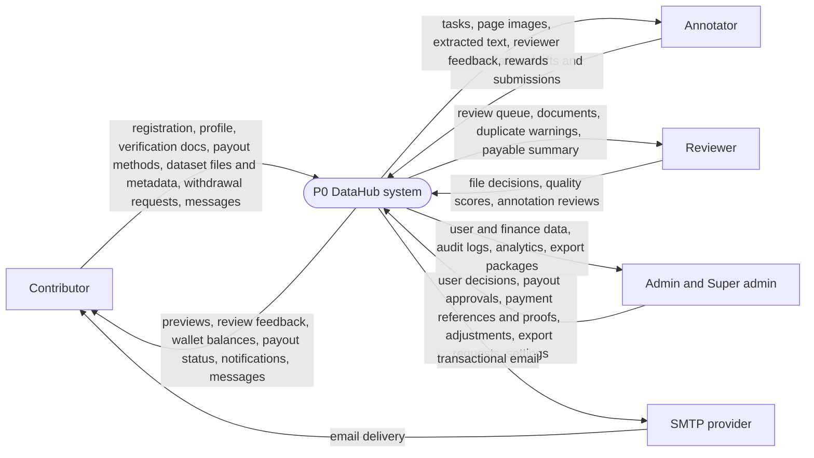
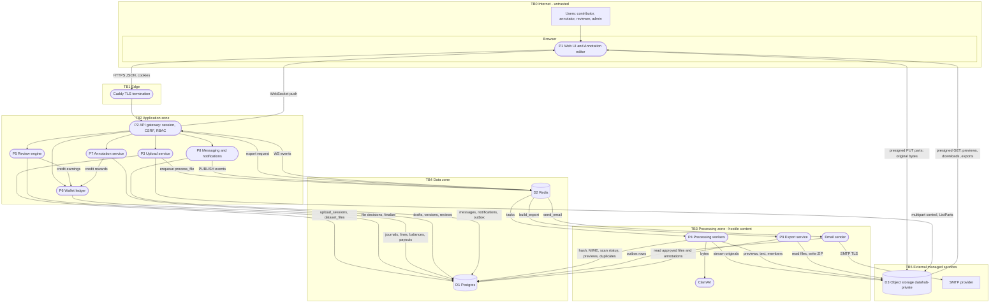
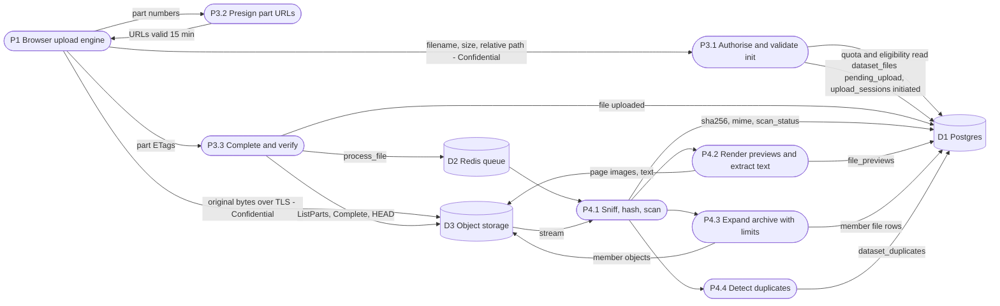
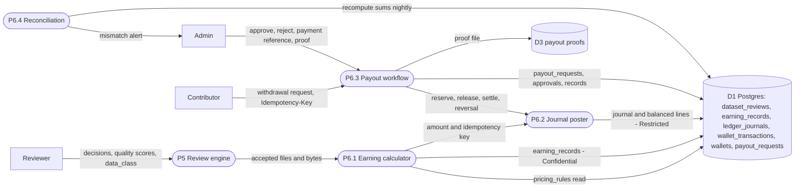
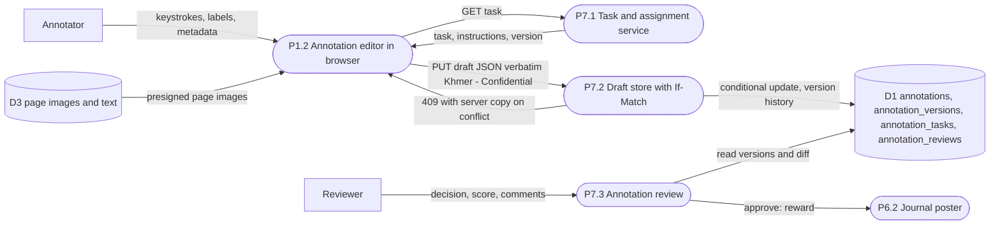
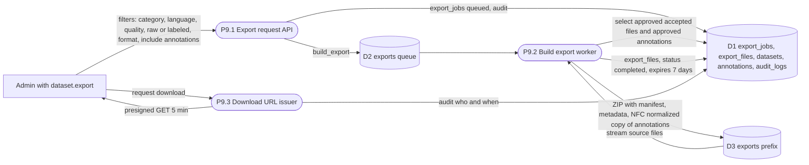

# DataHub — Data Flow Diagrams (DFD)

## Document control

| Field | Value |
|---|---|
| Document ID | DH-ARCH-DFD |
| Version | 1.0 |
| Date | 2026-10-26 |
| Status | Baseline |
| Owner | CTO role |
| Canonical source | [`../ENGINEERING_BASELINE.md`](../ENGINEERING_BASELINE.md) |
| Related | [SAD](SAD.md) §7 trust zones · [HLD](HLD.md) · [SDD](SDD.md) · `../06-testing-security/THREAT_MODEL.md` · `../05-data-annotation/DATA_PRIVACY_OWNERSHIP.md` · `../05-data-annotation/DATA_RETENTION_DELETION.md` |

## Header

- **Purpose.** Show how data moves through DataHub — browser, backend API, file storage, processing workers, database, annotation editor, review engine, wallet ledger and export service — and where it crosses trust boundaries, with a classification for every store and flow. This is the input to the threat model (STRIDE per element) and to privacy/retention policies.
- **Scope.** All v1 data flows at level 0 (context) and level 1 (major processes), plus detail views for upload/processing, review→ledger, annotation and export. Excludes CI/CD and backup pipelines (covered in DOCKER_CICD.md and BACKUP_DISASTER_RECOVERY.md).
- **Assumptions.** A-02 (verbatim Khmer transcription), A-04 (micro-USD), A-05 (payout method details admin-visible JSON), A-08 (verification data), A-10 (fail-closed scanning), A-13 (UTC), A-15 (retention).
- **Decisions.** ADR-0005, ADR-0006 (browser ↔ storage direct flows), ADR-0007 (only server-rendered derivatives reach the viewer), ADR-0008 (session tokens never stored in clear), ADR-0009 (ledger), ADR-0012 (outbox), ADR-0015 (realtime).
- **Dependencies.** [SAD.md](SAD.md) trust zones Z0–Z5; baseline §§6, 8, 10, 12, 13.
- **Acceptance criteria.**
  1. Level 0 and level 1 DFDs include every element listed in MASTER Part 5 item 13.
  2. Every trust boundary is drawn and listed with its controls.
  3. Every data store has a classification (public/internal/confidential/restricted).
  4. Every flow crossing a boundary is listed with classification and protection.
  5. Mermaid diagrams render.

---

## 1. Notation

| DFD element | Mermaid shape | Example |
|---|---|---|
| External entity | Rectangle | `Contributor` |
| Process | Rounded rectangle | `P2 Upload service` |
| Data store | Cylinder | `D1 Postgres` |
| Trust boundary | Subgraph | `TB2 Application zone` |

Process numbers `P1…P9` and store numbers `D1…D4` are stable identifiers reused by THREAT_MODEL.md.

## 2. Data classification

| Class | Definition | Handling | Examples in DataHub |
|---|---|---|---|
| **Public** | Intended for anyone | No restriction; cacheable | Pricing (`GET /public/pricing`), supported formats, marketing pages, legal texts |
| **Internal** | Operational data without personal or content value | Authenticated staff/services only; not in client bundles | Aggregated analytics, system settings, job records, structured logs without PII, metrics |
| **Confidential** | Personal data or customer content; disclosure harms users or the Platform | Authenticated + authorised per resource; TLS in transit; provider encryption at rest; presigned URLs ≤ 15 min; excluded from logs | Uploaded documents and archive members, previews and extracted text, dataset metadata, annotations, reviews and feedback, messages and attachments, user profiles (name, email, phone, country), notifications, earning records, wallet balances, exports, audit logs |
| **Restricted** | Secrets or high-risk personal/financial data; compromise enables fraud or account takeover | Need-to-know (specific permission + MFA for admins); never logged; hashed or encrypted where applicable; access audited | Password hashes (Argon2id), session token hashes, CSRF secrets, TOTP secrets and recovery codes, verification ID documents and date of birth, payout method details (bank account, wallet IDs), payment references and proofs, ledger lines, S3/SMTP/DB credentials, `SECRET_KEY` |

Rules: data inherits the highest class of its inputs (e.g. an export containing documents is Confidential; an admin report containing payout methods is Restricted). Restricted fields are excluded from Sentry events, structured logs and error `details`.

## 3. Level 0 — Context DFD

## 4. Level 1 — System DFD with trust boundaries

## 5. Level 1 detail views

### 5.1 Upload and processing (P1, P3, P4)

### 5.2 Review engine to wallet ledger (P5, P6)

### 5.3 Annotation editor (P1, P7)

### 5.4 Export service (P9)

## 6. Trust boundaries

| Boundary | Between | Crossing flows | Controls |
|---|---|---|---|
| TB0 → TB1 | Browser and Caddy | All HTTP/WS traffic | TLS 1.2+, HSTS, request size limits, security headers (CSP, X-Content-Type-Options, Referrer-Policy, frame-ancestors none) |
| TB1 → TB2 | Caddy and web/API | Proxied requests | Internal network only; API trusts `X-Forwarded-For` only from Caddy; rate limiting; session + CSRF + RBAC + resource checks |
| TB0 → TB5 | Browser and object storage | Presigned PUT parts, presigned GET | Signature scoped to one key/part/method; 15 min (PUT) / 5 min (GET); server-generated keys; bucket private; CORS limited to app origin; `Content-Disposition: attachment` on downloads |
| TB2 → TB3 | API and workers | Task messages via Redis | Messages carry IDs only (no file content, no secrets); JSON serializer; workers re-read state from DB |
| TB3 internal | Worker and hostile file content | Streams from S3 | Magic-byte detection, size/ratio/depth limits, defusedxml, render limits, task time limits, `noexec` scratch, no execution of content, ClamAV fail-closed |
| TB2/TB3 → TB4 | Services and data stores | SQL, Redis commands | Least-privilege DB roles, Redis password, no published ports in prod |
| TB2/TB3 → TB5 | Services and managed services | S3 API, SMTP | TLS, bucket-scoped credentials, SMTP credentials in secrets, no PII to Sentry |

## 7. Flow inventory (boundary-crossing flows)

| ID | Flow | From → To | Class | Protection |
|---|---|---|---|---|
| F01 | Credentials at login | Browser → API | Restricted | TLS; Argon2id; never logged; rate-limited |
| F02 | Session cookie `dh_session` | Browser ↔ API | Restricted | HttpOnly, Secure, SameSite=Lax; DB stores SHA-256 only |
| F03 | TOTP code / recovery code | Browser → API | Restricted | TLS; single-use recovery codes hashed |
| F04 | Profile and verification data | Browser → API → D1/D3 | Restricted (ID docs, DOB) / Confidential | `user.verify` permission + admin MFA to view; audit on access |
| F05 | Payout method details | Browser → API → D1 | Restricted | Admin-visible only; masked in contributor UI after save; never sent to any external system automatically |
| F06 | Original file bytes | Browser → D3 | Confidential | Presigned PUT, TLS, private bucket |
| F07 | File stream to worker | D3 → P4 | Confidential, hostile | Internal endpoint; limits and fail-closed scan |
| F08 | Previews and text | D3 → Browser | Confidential | Authorised `GET /files/{id}/preview/{page}` → presigned 5 min |
| F09 | Review decisions and finalize | Browser → API → D1 | Confidential | `dataset.review`, assignee check, no self-review, Idempotency-Key |
| F10 | Ledger journal lines | P6 → D1 | Restricted | Append-only triggers, balanced journals, unique keys, reconcile |
| F11 | Withdrawal request | Browser → API → D1 | Restricted | `payout.request`, verified contributor, wallet lock, Idempotency-Key |
| F12 | Payment reference and proof | Admin browser → API → D1/D3 | Restricted | `payout.record_payment`, MFA, recorder ≠ recipient, proof scanned and private |
| F13 | Annotation drafts | Editor → API → D1 | Confidential | `annotation.work`, active assignee, If-Match |
| F14 | Messages and attachments | Browser → API → D1/D3 | Confidential | Participant check; attachments ≤ 10 MB scanned before visible |
| F15 | Realtime events | API → Browser (WS) | Confidential | Cookie auth + Origin check; per-user channels; payload minimal |
| F16 | Email content | Worker → SMTP → user | Confidential | TLS to provider; no document content or secrets in email; links to app only |
| F17 | Export package | D3 → Admin browser | Confidential | `dataset.export` + MFA; presigned 5 min; expires 7 days; audit of who/when/which datasets |
| F18 | Error events | Services → Sentry | Internal | PII scrubbing, no request bodies, no cookies |

## 8. Data stores

| Store | Contents | Class (highest) | Encryption at rest | Retention (A-15) |
|---|---|---|---|---|
| D1 Postgres | All entities, ledger, audit, outbox | Restricted | Encrypted volume (VM disk encryption / managed DB) | Financial and audit 7 years; security events 1 year; others per DATA_RETENTION_DELETION.md |
| D2 Redis | Task messages (IDs), rate-limit counters, pub/sub transient events | Internal | Not persisted beyond AOF (optional) | Minutes to hours |
| D3 Object storage `datahub-private` | Originals, members, previews, attachments, verification docs, payout proofs, exports | Restricted (ID docs, proofs) / Confidential | Provider SSE (R2/S3); versioning on | Rejected 90 days; drafts 30 days; abandoned uploads 24 h; exports 7 days |
| D4 Backups | `pg_dump` archives in separate bucket | Restricted | Provider SSE + client-side encryption of dumps | 30 daily + 12 monthly (per BACKUP_DISASTER_RECOVERY.md) |
