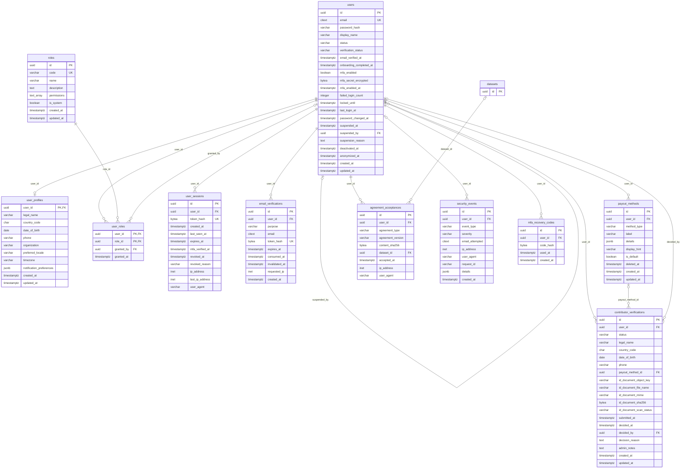
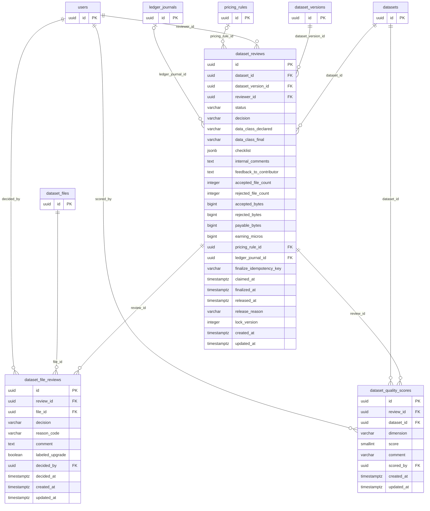
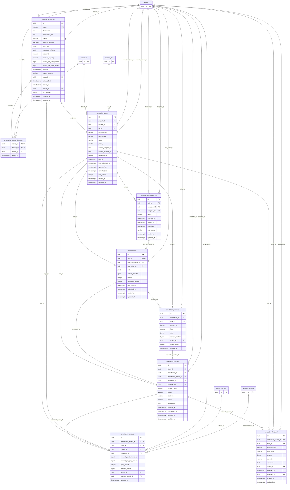
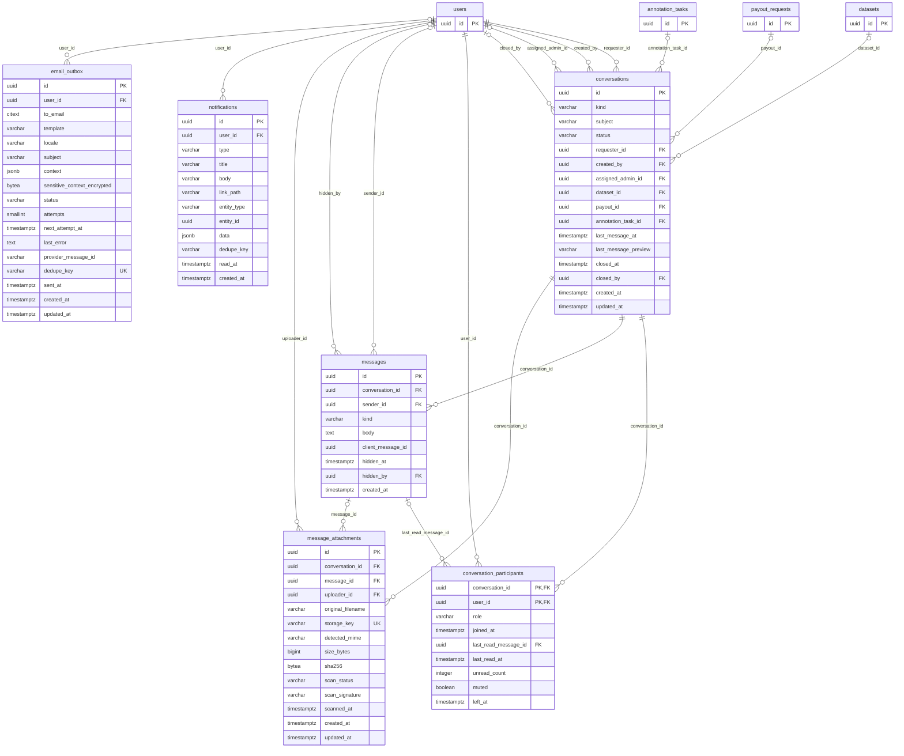
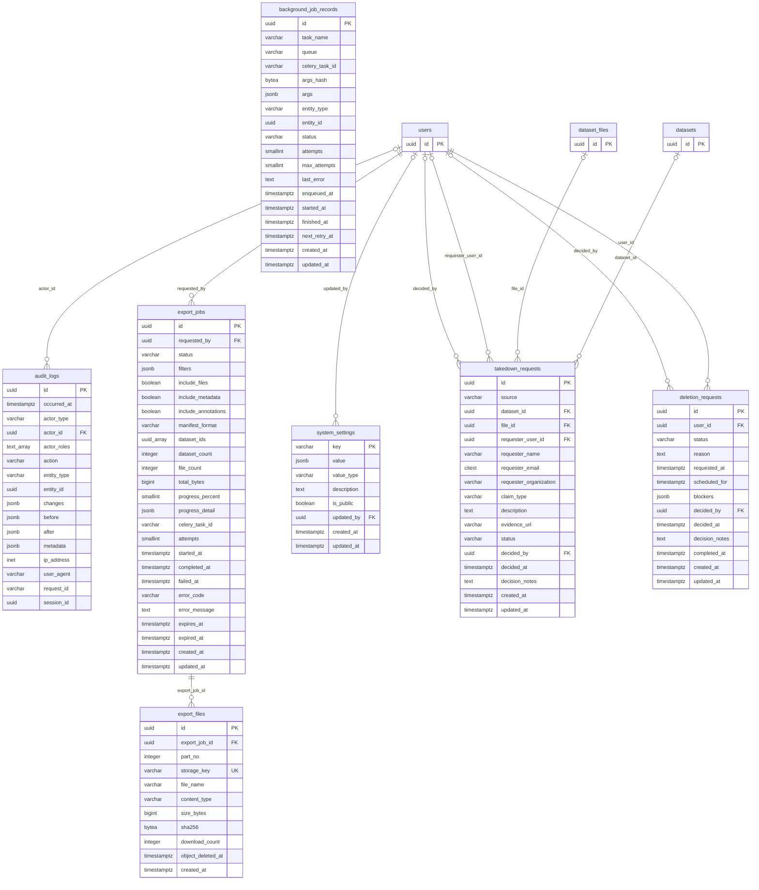

# DataHub — Entity Relationship Diagram (ERD)

## Document control

| Field | Value |
|---|---|
| Document | `docs/02-system-architecture/ERD.md` (mandatory document #11) |
| Version | v1.0 |
| Date | 2026-10-26 |
| Status | Baseline |
| Owner | CTO role (data architecture) |
| Canonical source | `docs/ENGINEERING_BASELINE.md` §10; column-level contract in `DATABASE_SCHEMA.md` v1.0 |
| Change control | Diagrams are regenerated from `DATABASE_SCHEMA.md` whenever a table or FK changes; both documents change in the same pull request. |

## Purpose

Give a complete, visual model of every DataHub database entity and every foreign-key relationship, split by domain for readability, plus one overview diagram showing how the domains connect.

## Scope

- All 54 tables of baseline §10: identity (11), datasets (9), review (3), finance (9), annotation (9), communication (6), operations (7).
- Domain diagrams show **every column** (type, PK/FK/UK markers) of the domain's tables and every FK relationship originating in that domain; tables owned by other domains appear as stubs (primary key only).
- The overview diagram shows all 54 entities (primary keys only) and all structural relationships; actor references (`*_by` columns and `audit_logs.actor_id`, all pointing to `users`) are omitted there for legibility but appear in the domain diagrams.
- Constraints other than PK/FK/unique (CHECKs, partial unique indexes, exclusion constraint, triggers) are specified in `DATABASE_SCHEMA.md` §4–§6, not drawn here.

## Assumptions

| ID | Assumption |
|---|---|
| A-04 | (baseline) Money is integer micro-USD (`bigint *_micros`). |
| A-13 | (baseline) All timestamps are `timestamptz` UTC. |
| A-ERD-01 | Readers render the diagrams with Mermaid ≥ 10 (GitHub, GitLab, VS Code, `@mermaid-js/mermaid-cli`). All diagrams in this document were rendered without errors by `@mermaid-js/mermaid-cli` 11 on 2026-10-26. |

## Decisions

| ID | Decision |
|---|---|
| D-ERD-01 | Mermaid attribute types are single words: parameterised SQL types are shown without their parameters (`varchar(32)` → `varchar`, `char(2)` → `char`, `numeric(5,4)` → `numeric`) and arrays as `<type>_array` (`text[]` → `text_array`). Exact types live in `DATABASE_SCHEMA.md`. |
| D-ERD-02 | Cardinality notation is derived mechanically from the FK definition: NOT NULL FK → parent `\|\|`, nullable FK → parent `\|o`; FK covered by a unique constraint → child `o\|` (zero-or-one), otherwise `o{` (zero-or-many). Relationship labels are the FK column name. |
| D-ERD-03 | Polymorphic references (`ledger_journals.source_type/source_id`, `notifications.entity_type/entity_id`, `audit_logs.entity_type/entity_id`, `background_job_records.entity_type/entity_id`, `payout_adjustments.related_type/related_id`) are **not** FKs and are not drawn; their integrity is guaranteed by typed FKs on the source side (e.g. `dataset_reviews.ledger_journal_id`, `earning_records.journal_id`, `payout_requests.*_journal_id`) as documented in `DATABASE_SCHEMA.md`. |
| D-ERD-04 | Key markers: `PK` primary key (composite keys mark each column), `FK` foreign key, `UK` column with its own unique constraint (partial unique indexes over several columns are not marked). |

## Dependencies

- `docs/ENGINEERING_BASELINE.md` v1.0 §8.5 (ledger), §10 (tables and key constraints).
- `DATABASE_SCHEMA.md` v1.0 (authoritative columns, types and constraints).
- `LLD.md` v1.0 (module ownership of tables).

## Acceptance criteria

1. Each of the 54 tables in baseline §10 appears with all of its columns in exactly one domain diagram and as an entity in the overview diagram.
2. Every column marked `FK` in `DATABASE_SCHEMA.md` has a relationship line in its domain diagram.
3. All eight Mermaid blocks render without syntax errors.
4. No entity, column or relationship appears here that is absent from `DATABASE_SCHEMA.md`.

---

## 1. Domain map

| Domain | Owning module(s) | Tables |
|---|---|---|
| Identity | `identity` | `users`, `user_profiles`, `roles`, `user_roles`, `user_sessions`, `email_verifications`, `contributor_verifications`, `payout_methods`, `agreement_acceptances`, `security_events`, `mfa_recovery_codes` |
| Datasets | `datasets` (rows written by `processing` tasks via datasets service functions) | `datasets`, `dataset_versions`, `dataset_files`, `dataset_metadata`, `upload_sessions`, `upload_parts`, `dataset_licenses`, `dataset_duplicates`, `file_previews` |
| Review | `review` | `dataset_reviews`, `dataset_file_reviews`, `dataset_quality_scores` |
| Finance | `finance` | `pricing_rules`, `wallets`, `ledger_journals`, `wallet_transactions`, `earning_records`, `payout_requests`, `payout_approvals`, `payout_records`, `payout_adjustments` |
| Annotation | `annotation` | `annotation_projects`, `annotation_project_datasets`, `annotation_tasks`, `annotation_assignments`, `annotations`, `annotation_versions`, `annotation_reviews`, `annotation_feedback`, `annotation_rewards` |
| Communication | `messaging` | `conversations`, `conversation_participants`, `messages`, `message_attachments`, `notifications`, `email_outbox` |
| Operations | `core` (audit, job records), `exports`, `admin`, `identity` (deletion requests) | `audit_logs`, `export_jobs`, `export_files`, `system_settings`, `background_job_records`, `takedown_requests`, `deletion_requests` |

### 1.1 Key relationship notes

- `users` is the hub: every actor and owner FK references it with `ON DELETE RESTRICT`; users are anonymised, never deleted.
- `datasets` → `dataset_versions` (one per submit) → `dataset_reviews` (one per claim; at most one `in_progress` per dataset and one `finalized` per version) → `dataset_file_reviews` (one per file per review).
- `dataset_files.parent_file_id` is a self-reference: archive members point at their ZIP container.
- `dataset_duplicates` relates two `dataset_files` rows (`file_id`, `matched_file_id`).
- Finance: `ledger_journals` 1–N `wallet_transactions` N–1 `wallets`; each journal balances to zero (trigger). `earning_records` link review evidence (`dataset_reviews`/`annotation_reviews`, `dataset_files`) to the credit journal (`journal_id`) and the optional release journal (`release_journal_id`).
- `payout_requests` reference up to four journals (reserve, release, settle, reversal); `payout_approvals` (≤ 2) and `payout_records` (≤ 1) hang off a request.
- Annotation: `annotation_projects` N–M `datasets` via `annotation_project_datasets`; `annotation_tasks` reference a `dataset_files` row (and page); `annotations` is 1–1 with a task; `annotation_versions`, `annotation_reviews`, `annotation_feedback`; `annotation_rewards` is 1–1 with an approving `annotation_reviews` row and points to its `ledger_journals` and `earning_records` rows.

---

## 2. Overview diagram (all entities)

```mermaid
erDiagram
    users {
        uuid id PK
    }
    user_profiles {
        uuid user_id PK, FK
    }
    roles {
        uuid id PK
    }
    user_roles {
        uuid user_id PK, FK
        uuid role_id PK, FK
    }
    user_sessions {
        uuid id PK
    }
    email_verifications {
        uuid id PK
    }
    contributor_verifications {
        uuid id PK
    }
    payout_methods {
        uuid id PK
    }
    agreement_acceptances {
        uuid id PK
    }
    security_events {
        uuid id PK
    }
    mfa_recovery_codes {
        uuid id PK
    }
    datasets {
        uuid id PK
    }
    dataset_versions {
        uuid id PK
    }
    dataset_files {
        uuid id PK
    }
    dataset_metadata {
        uuid id PK
    }
    upload_sessions {
        uuid id PK
    }
    upload_parts {
        uuid upload_session_id PK, FK
        integer part_number PK
    }
    dataset_licenses {
        uuid id PK
    }
    dataset_duplicates {
        uuid id PK
    }
    file_previews {
        uuid id PK
    }
    dataset_reviews {
        uuid id PK
    }
    dataset_file_reviews {
        uuid id PK
    }
    dataset_quality_scores {
        uuid id PK
    }
    pricing_rules {
        uuid id PK
    }
    wallets {
        uuid id PK
    }
    ledger_journals {
        uuid id PK
    }
    wallet_transactions {
        uuid id PK
    }
    earning_records {
        uuid id PK
    }
    payout_requests {
        uuid id PK
    }
    payout_approvals {
        uuid id PK
    }
    payout_records {
        uuid id PK
    }
    payout_adjustments {
        uuid id PK
    }
    annotation_projects {
        uuid id PK
    }
    annotation_project_datasets {
        uuid project_id PK, FK
        uuid dataset_id PK, FK
    }
    annotation_tasks {
        uuid id PK
    }
    annotation_assignments {
        uuid id PK
    }
    annotations {
        uuid id PK
    }
    annotation_versions {
        uuid id PK
    }
    annotation_reviews {
        uuid id PK
    }
    annotation_feedback {
        uuid id PK
    }
    annotation_rewards {
        uuid id PK
    }
    conversations {
        uuid id PK
    }
    conversation_participants {
        uuid conversation_id PK, FK
        uuid user_id PK, FK
    }
    messages {
        uuid id PK
    }
    message_attachments {
        uuid id PK
    }
    notifications {
        uuid id PK
    }
    email_outbox {
        uuid id PK
    }
    audit_logs {
        uuid id PK
    }
    export_jobs {
        uuid id PK
    }
    export_files {
        uuid id PK
    }
    system_settings {
        varchar key PK
    }
    background_job_records {
        uuid id PK
    }
    takedown_requests {
        uuid id PK
    }
    deletion_requests {
        uuid id PK
    }
    users ||--o| user_profiles : "user_id"
    users ||--o{ user_roles : "user_id"
    roles ||--o{ user_roles : "role_id"
    users ||--o{ user_sessions : "user_id"
    users ||--o{ email_verifications : "user_id"
    users ||--o{ contributor_verifications : "user_id"
    payout_methods |o--o{ contributor_verifications : "payout_method_id"
    users ||--o{ payout_methods : "user_id"
    users ||--o{ agreement_acceptances : "user_id"
    datasets |o--o{ agreement_acceptances : "dataset_id"
    users |o--o{ security_events : "user_id"
    users ||--o{ mfa_recovery_codes : "user_id"
    users ||--o{ datasets : "owner_id"
    datasets ||--o{ dataset_versions : "dataset_id"
    datasets ||--o{ dataset_files : "dataset_id"
    dataset_files |o--o{ dataset_files : "parent_file_id"
    datasets ||--o{ dataset_metadata : "dataset_id"
    datasets ||--o{ upload_sessions : "dataset_id"
    dataset_files ||--o| upload_sessions : "file_id"
    users ||--o{ upload_sessions : "user_id"
    upload_sessions ||--o{ upload_parts : "upload_session_id"
    datasets ||--o{ dataset_licenses : "dataset_id"
    agreement_acceptances |o--o{ dataset_licenses : "agreement_acceptance_id"
    dataset_files ||--o{ dataset_duplicates : "file_id"
    dataset_files ||--o{ dataset_duplicates : "matched_file_id"
    dataset_files ||--o{ file_previews : "file_id"
    datasets ||--o{ dataset_reviews : "dataset_id"
    dataset_versions ||--o{ dataset_reviews : "dataset_version_id"
    users ||--o{ dataset_reviews : "reviewer_id"
    pricing_rules |o--o{ dataset_reviews : "pricing_rule_id"
    ledger_journals |o--o{ dataset_reviews : "ledger_journal_id"
    dataset_reviews ||--o{ dataset_file_reviews : "review_id"
    dataset_files ||--o{ dataset_file_reviews : "file_id"
    dataset_reviews ||--o{ dataset_quality_scores : "review_id"
    datasets ||--o{ dataset_quality_scores : "dataset_id"
    users |o--o| wallets : "owner_user_id"
    users ||--o{ ledger_journals : "user_id"
    ledger_journals ||--o{ wallet_transactions : "journal_id"
    wallets ||--o{ wallet_transactions : "wallet_id"
    users ||--o{ earning_records : "user_id"
    dataset_reviews |o--o{ earning_records : "dataset_review_id"
    annotation_reviews |o--o{ earning_records : "annotation_review_id"
    datasets |o--o{ earning_records : "dataset_id"
    dataset_files |o--o{ earning_records : "file_id"
    annotation_tasks |o--o{ earning_records : "annotation_task_id"
    pricing_rules |o--o{ earning_records : "pricing_rule_id"
    ledger_journals |o--o{ earning_records : "journal_id"
    ledger_journals |o--o{ earning_records : "release_journal_id"
    users ||--o{ payout_requests : "user_id"
    wallets ||--o{ payout_requests : "wallet_id"
    payout_methods ||--o{ payout_requests : "payout_method_id"
    ledger_journals ||--o{ payout_requests : "reserve_journal_id"
    ledger_journals |o--o{ payout_requests : "release_journal_id"
    ledger_journals |o--o{ payout_requests : "settle_journal_id"
    ledger_journals |o--o{ payout_requests : "reversal_journal_id"
    payout_requests ||--o{ payout_approvals : "payout_id"
    users ||--o{ payout_approvals : "approver_id"
    payout_requests ||--o| payout_records : "payout_id"
    users ||--o{ payout_adjustments : "user_id"
    wallets ||--o{ payout_adjustments : "wallet_id"
    ledger_journals ||--o| payout_adjustments : "journal_id"
    annotation_projects ||--o{ annotation_project_datasets : "project_id"
    datasets ||--o{ annotation_project_datasets : "dataset_id"
    annotation_projects ||--o{ annotation_tasks : "project_id"
    datasets ||--o{ annotation_tasks : "dataset_id"
    dataset_files ||--o{ annotation_tasks : "file_id"
    users |o--o{ annotation_tasks : "current_assignee_id"
    users |o--o{ annotation_tasks : "current_reviewer_id"
    annotation_tasks ||--o{ annotation_assignments : "task_id"
    users ||--o{ annotation_assignments : "annotator_id"
    annotation_tasks ||--o| annotations : "task_id"
    annotation_assignments ||--o{ annotations : "last_assignment_id"
    users ||--o{ annotations : "last_editor_id"
    annotations ||--o{ annotation_versions : "annotation_id"
    annotation_tasks ||--o{ annotation_versions : "task_id"
    users ||--o{ annotation_versions : "author_id"
    annotation_tasks ||--o{ annotation_reviews : "task_id"
    annotations ||--o{ annotation_reviews : "annotation_id"
    annotation_versions ||--o{ annotation_reviews : "annotation_version_id"
    users ||--o{ annotation_reviews : "annotator_id"
    users ||--o{ annotation_reviews : "reviewer_id"
    annotation_reviews ||--o{ annotation_feedback : "annotation_review_id"
    annotation_tasks ||--o{ annotation_feedback : "task_id"
    users ||--o{ annotation_feedback : "author_id"
    annotation_reviews ||--o| annotation_rewards : "annotation_review_id"
    annotation_tasks ||--o| annotation_rewards : "task_id"
    annotation_projects ||--o{ annotation_rewards : "project_id"
    users ||--o{ annotation_rewards : "annotator_id"
    ledger_journals |o--o{ annotation_rewards : "journal_id"
    earning_records ||--o{ annotation_rewards : "earning_record_id"
    users ||--o{ conversations : "requester_id"
    users |o--o{ conversations : "assigned_admin_id"
    datasets |o--o{ conversations : "dataset_id"
    payout_requests |o--o{ conversations : "payout_id"
    annotation_tasks |o--o{ conversations : "annotation_task_id"
    conversations ||--o{ conversation_participants : "conversation_id"
    users ||--o{ conversation_participants : "user_id"
    messages |o--o{ conversation_participants : "last_read_message_id"
    conversations ||--o{ messages : "conversation_id"
    users |o--o{ messages : "sender_id"
    conversations ||--o{ message_attachments : "conversation_id"
    messages |o--o{ message_attachments : "message_id"
    users ||--o{ message_attachments : "uploader_id"
    users ||--o{ notifications : "user_id"
    users |o--o{ email_outbox : "user_id"
    export_jobs ||--o{ export_files : "export_job_id"
    datasets |o--o{ takedown_requests : "dataset_id"
    dataset_files |o--o{ takedown_requests : "file_id"
    users |o--o{ takedown_requests : "requester_user_id"
    users ||--o{ deletion_requests : "user_id"
```

---

## 3. Identity domain

---

## 4. Datasets domain

```mermaid
erDiagram
    datasets {
        uuid id PK
        uuid owner_id FK
        varchar title
        text description
        varchar data_class
        varchar category
        varchar primary_language
        text_array languages
        text_array tags
        text source_description
        varchar status
        integer current_version_no
        integer file_count
        bigint total_bytes
        bigint accepted_bytes
        bigint rejected_bytes
        bigint earning_micros
        smallint quality_score
        timestamptz rights_declared_at
        timestamptz submitted_at
        timestamptz finalized_at
        timestamptz withdrawn_at
        timestamptz taken_down_at
        uuid taken_down_by FK
        text takedown_reason
        timestamptz objects_purged_at
        integer lock_version
        timestamptz created_at
        timestamptz updated_at
    }
    dataset_versions {
        uuid id PK
        uuid dataset_id FK
        integer version_no
        uuid submitted_by FK
        timestamptz submitted_at
        text change_note
        integer file_count
        bigint total_bytes
        jsonb snapshot
        timestamptz created_at
    }
    dataset_files {
        uuid id PK
        uuid dataset_id FK
        uuid parent_file_id FK
        varchar member_path
        varchar original_filename
        varchar relative_path
        varchar storage_key UK
        varchar extension
        varchar declared_mime
        varchar detected_mime
        varchar format
        bigint size_bytes
        bytea sha256
        bigint simhash
        bigint phash
        varchar processing_status
        varchar scan_status
        varchar scan_signature
        varchar scan_engine_version
        timestamptz scanned_at
        varchar failure_code
        text failure_detail
        boolean is_container
        integer page_count
        boolean previewable
        boolean annotatable
        varchar text_object_key
        jsonb extracted_metadata
        smallint processing_attempts
        timestamptz uploaded_at
        timestamptz processing_started_at
        timestamptz processed_at
        timestamptz removed_at
        timestamptz object_purged_at
        timestamptz created_at
        timestamptz updated_at
    }
    dataset_metadata {
        uuid id PK
        uuid dataset_id FK
        varchar key
        varchar value_type
        text value_text
        bigint value_integer
        numeric value_number
        boolean value_boolean
        date value_date
        jsonb value_json
        timestamptz created_at
        timestamptz updated_at
    }
    upload_sessions {
        uuid id PK
        uuid dataset_id FK
        uuid file_id FK, UK
        uuid user_id FK
        varchar s3_upload_id
        varchar storage_key
        varchar original_filename
        bigint declared_size_bytes
        varchar declared_mime
        bigint part_size_bytes
        integer part_count
        varchar client_fingerprint
        varchar status
        timestamptz expires_at
        timestamptz completed_at
        timestamptz aborted_at
        varchar abort_reason
        timestamptz created_at
        timestamptz updated_at
    }
    upload_parts {
        uuid upload_session_id PK, FK
        integer part_number PK
        varchar etag
        bigint size_bytes
        timestamptz uploaded_at
    }
    dataset_licenses {
        uuid id PK
        uuid dataset_id FK
        varchar license_code
        varchar license_version
        varchar grant_type
        varchar territory
        boolean contributor_is_rights_holder
        varchar rights_holder_name
        varchar source_url
        varchar attribution_text
        uuid agreement_acceptance_id FK
        uuid accepted_by FK
        timestamptz accepted_at
        timestamptz effective_from
        timestamptz revoked_at
        text revocation_reason
        timestamptz created_at
        timestamptz updated_at
    }
    dataset_duplicates {
        uuid id PK
        uuid file_id FK
        uuid matched_file_id FK
        varchar kind
        varchar method
        numeric similarity
        smallint hamming_distance
        boolean same_dataset
        boolean matched_was_accepted
        boolean matched_owner_is_same
        timestamptz detected_at
    }
    file_previews {
        uuid id PK
        uuid file_id FK
        varchar kind
        integer page_number
        varchar storage_key UK
        varchar mime_type
        integer width_px
        integer height_px
        bigint size_bytes
        timestamptz created_at
    }
    users {
        uuid id PK
    }
    agreement_acceptances {
        uuid id PK
    }
    users ||--o{ datasets : "owner_id"
    users |o--o{ datasets : "taken_down_by"
    datasets ||--o{ dataset_versions : "dataset_id"
    users ||--o{ dataset_versions : "submitted_by"
    datasets ||--o{ dataset_files : "dataset_id"
    dataset_files |o--o{ dataset_files : "parent_file_id"
    datasets ||--o{ dataset_metadata : "dataset_id"
    datasets ||--o{ upload_sessions : "dataset_id"
    dataset_files ||--o| upload_sessions : "file_id"
    users ||--o{ upload_sessions : "user_id"
    upload_sessions ||--o{ upload_parts : "upload_session_id"
    datasets ||--o{ dataset_licenses : "dataset_id"
    agreement_acceptances |o--o{ dataset_licenses : "agreement_acceptance_id"
    users ||--o{ dataset_licenses : "accepted_by"
    dataset_files ||--o{ dataset_duplicates : "file_id"
    dataset_files ||--o{ dataset_duplicates : "matched_file_id"
    dataset_files ||--o{ file_previews : "file_id"
```

---

## 5. Review domain

---

## 6. Finance domain

```mermaid
erDiagram
    pricing_rules {
        uuid id PK
        varchar data_class
        bigint rate_micros_per_gb
        char currency
        timestamptz effective_from
        timestamptz effective_to
        text reason
        uuid created_by FK
        timestamptz created_at
    }
    wallets {
        uuid id PK
        varchar kind
        uuid owner_user_id FK, UK
        varchar system_code UK
        char currency
        bigint pending_micros
        bigint available_micros
        bigint reserved_micros
        bigint paid_micros
        bigint journal_count
        timestamptz last_journal_at
        timestamptz created_at
        timestamptz updated_at
    }
    ledger_journals {
        uuid id PK
        varchar kind
        varchar idempotency_key UK
        varchar source_type
        uuid source_id
        uuid user_id FK
        bigint amount_micros
        char currency
        varchar description
        uuid created_by FK
        varchar request_id
        timestamptz created_at
    }
    wallet_transactions {
        uuid id PK
        uuid journal_id FK
        smallint line_no
        uuid wallet_id FK
        varchar bucket
        bigint amount_micros
        bigint balance_after_micros
        timestamptz created_at
    }
    earning_records {
        uuid id PK
        uuid user_id FK
        varchar source_type
        uuid source_id
        uuid dataset_review_id FK
        uuid annotation_review_id FK
        uuid dataset_id FK
        uuid file_id FK
        uuid annotation_task_id FK
        bytea sha256
        varchar data_class
        bigint accepted_bytes
        uuid pricing_rule_id FK
        bigint rate_micros_per_gb
        bigint previously_paid_rate_micros_per_gb
        boolean is_labeled_upgrade
        bigint amount_micros
        varchar zero_reason
        uuid journal_id FK
        varchar credited_bucket
        timestamptz hold_until
        timestamptz released_at
        uuid release_journal_id FK
        timestamptz created_at
        timestamptz updated_at
    }
    payout_requests {
        uuid id PK
        uuid user_id FK
        uuid wallet_id FK
        uuid payout_method_id FK
        varchar method_type
        jsonb method_snapshot
        bigint amount_micros
        char currency
        varchar status
        smallint approvals_required
        smallint approvals_count
        varchar client_idempotency_key
        bytea request_fingerprint
        varchar contributor_note
        text admin_note
        timestamptz requested_at
        timestamptz approved_at
        timestamptz rejected_at
        uuid rejected_by FK
        text rejection_reason
        timestamptz cancelled_at
        uuid cancelled_by FK
        text cancel_reason
        timestamptz failed_at
        uuid failed_by FK
        text failure_reason
        timestamptz paid_at
        timestamptz reversed_at
        uuid reversed_by FK
        text reversal_reason
        uuid reserve_journal_id FK
        uuid release_journal_id FK
        uuid settle_journal_id FK
        uuid reversal_journal_id FK
        integer lock_version
        timestamptz created_at
        timestamptz updated_at
    }
    payout_approvals {
        uuid id PK
        uuid payout_id FK
        uuid approver_id FK
        smallint approval_no
        varchar note
        timestamptz session_mfa_verified_at
        timestamptz created_at
    }
    payout_records {
        uuid id PK
        uuid payout_id FK, UK
        varchar method_type
        varchar payment_reference
        bigint amount_micros
        bigint external_fee_micros
        timestamptz paid_at
        uuid recorded_by FK
        text notes
        varchar proof_object_key
        varchar proof_file_name
        varchar proof_mime
        bigint proof_size_bytes
        bytea proof_sha256
        varchar proof_scan_status
        uuid proof_uploaded_by FK
        timestamptz proof_uploaded_at
        timestamptz created_at
        timestamptz updated_at
    }
    payout_adjustments {
        uuid id PK
        uuid user_id FK
        uuid wallet_id FK
        varchar direction
        bigint amount_micros
        varchar reason_code
        text reason
        varchar related_type
        uuid related_id
        uuid journal_id FK, UK
        varchar client_idempotency_key
        uuid created_by FK
        timestamptz created_at
    }
    users {
        uuid id PK
    }
    dataset_reviews {
        uuid id PK
    }
    annotation_reviews {
        uuid id PK
    }
    datasets {
        uuid id PK
    }
    dataset_files {
        uuid id PK
    }
    annotation_tasks {
        uuid id PK
    }
    payout_methods {
        uuid id PK
    }
    users |o--o{ pricing_rules : "created_by"
    users |o--o| wallets : "owner_user_id"
    users ||--o{ ledger_journals : "user_id"
    users |o--o{ ledger_journals : "created_by"
    ledger_journals ||--o{ wallet_transactions : "journal_id"
    wallets ||--o{ wallet_transactions : "wallet_id"
    users ||--o{ earning_records : "user_id"
    dataset_reviews |o--o{ earning_records : "dataset_review_id"
    annotation_reviews |o--o{ earning_records : "annotation_review_id"
    datasets |o--o{ earning_records : "dataset_id"
    dataset_files |o--o{ earning_records : "file_id"
    annotation_tasks |o--o{ earning_records : "annotation_task_id"
    pricing_rules |o--o{ earning_records : "pricing_rule_id"
    ledger_journals |o--o{ earning_records : "journal_id"
    ledger_journals |o--o{ earning_records : "release_journal_id"
    users ||--o{ payout_requests : "user_id"
    wallets ||--o{ payout_requests : "wallet_id"
    payout_methods ||--o{ payout_requests : "payout_method_id"
    users |o--o{ payout_requests : "rejected_by"
    users |o--o{ payout_requests : "cancelled_by"
    users |o--o{ payout_requests : "failed_by"
    users |o--o{ payout_requests : "reversed_by"
    ledger_journals ||--o{ payout_requests : "reserve_journal_id"
    ledger_journals |o--o{ payout_requests : "release_journal_id"
    ledger_journals |o--o{ payout_requests : "settle_journal_id"
    ledger_journals |o--o{ payout_requests : "reversal_journal_id"
    payout_requests ||--o{ payout_approvals : "payout_id"
    users ||--o{ payout_approvals : "approver_id"
    payout_requests ||--o| payout_records : "payout_id"
    users ||--o{ payout_records : "recorded_by"
    users |o--o{ payout_records : "proof_uploaded_by"
    users ||--o{ payout_adjustments : "user_id"
    wallets ||--o{ payout_adjustments : "wallet_id"
    ledger_journals ||--o| payout_adjustments : "journal_id"
    users ||--o{ payout_adjustments : "created_by"
```

---

## 7. Annotation domain

---

## 8. Communication domain

---

## 9. Operations domain

---

## 10. Entity checklist

| # | Entity | Domain | Columns | PK |
|---|---|---|---|---|
| 1 | `users` | identity | 22 | `id` |
| 2 | `user_profiles` | identity | 11 | `user_id` |
| 3 | `roles` | identity | 8 | `id` |
| 4 | `user_roles` | identity | 4 | `user_id, role_id` |
| 5 | `user_sessions` | identity | 12 | `id` |
| 6 | `email_verifications` | identity | 10 | `id` |
| 7 | `contributor_verifications` | identity | 20 | `id` |
| 8 | `payout_methods` | identity | 10 | `id` |
| 9 | `agreement_acceptances` | identity | 9 | `id` |
| 10 | `security_events` | identity | 10 | `id` |
| 11 | `mfa_recovery_codes` | identity | 5 | `id` |
| 12 | `datasets` | datasets | 29 | `id` |
| 13 | `dataset_versions` | datasets | 10 | `id` |
| 14 | `dataset_files` | datasets | 36 | `id` |
| 15 | `dataset_metadata` | datasets | 12 | `id` |
| 16 | `upload_sessions` | datasets | 19 | `id` |
| 17 | `upload_parts` | datasets | 5 | `upload_session_id, part_number` |
| 18 | `dataset_licenses` | datasets | 18 | `id` |
| 19 | `dataset_duplicates` | datasets | 11 | `id` |
| 20 | `file_previews` | datasets | 10 | `id` |
| 21 | `dataset_reviews` | review | 27 | `id` |
| 22 | `dataset_file_reviews` | review | 11 | `id` |
| 23 | `dataset_quality_scores` | review | 9 | `id` |
| 24 | `pricing_rules` | finance | 9 | `id` |
| 25 | `wallets` | finance | 13 | `id` |
| 26 | `ledger_journals` | finance | 12 | `id` |
| 27 | `wallet_transactions` | finance | 8 | `id` |
| 28 | `earning_records` | finance | 25 | `id` |
| 29 | `payout_requests` | finance | 37 | `id` |
| 30 | `payout_approvals` | finance | 7 | `id` |
| 31 | `payout_records` | finance | 19 | `id` |
| 32 | `payout_adjustments` | finance | 13 | `id` |
| 33 | `annotation_projects` | annotation | 21 | `id` |
| 34 | `annotation_project_datasets` | annotation | 4 | `project_id, dataset_id` |
| 35 | `annotation_tasks` | annotation | 18 | `id` |
| 36 | `annotation_assignments` | annotation | 11 | `id` |
| 37 | `annotations` | annotation | 12 | `id` |
| 38 | `annotation_versions` | annotation | 10 | `id` |
| 39 | `annotation_reviews` | annotation | 15 | `id` |
| 40 | `annotation_feedback` | annotation | 13 | `id` |
| 41 | `annotation_rewards` | annotation | 12 | `id` |
| 42 | `conversations` | communication | 16 | `id` |
| 43 | `conversation_participants` | communication | 9 | `conversation_id, user_id` |
| 44 | `messages` | communication | 9 | `id` |
| 45 | `message_attachments` | communication | 14 | `id` |
| 46 | `notifications` | communication | 12 | `id` |
| 47 | `email_outbox` | communication | 17 | `id` |
| 48 | `audit_logs` | operations | 16 | `id` |
| 49 | `export_jobs` | operations | 25 | `id` |
| 50 | `export_files` | operations | 11 | `id` |
| 51 | `system_settings` | operations | 8 | `key` |
| 52 | `background_job_records` | operations | 18 | `id` |
| 53 | `takedown_requests` | operations | 17 | `id` |
| 54 | `deletion_requests` | operations | 13 | `id` |
