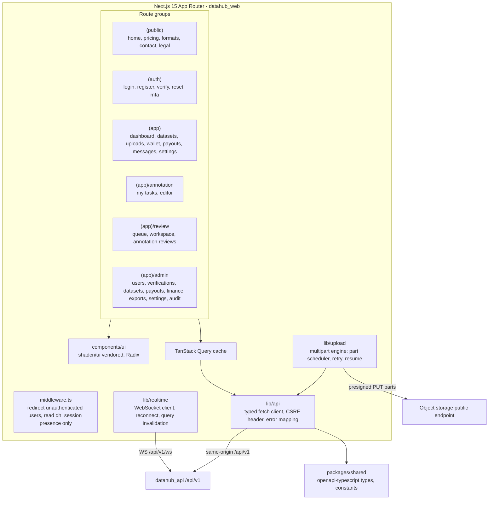
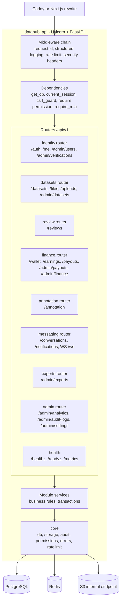
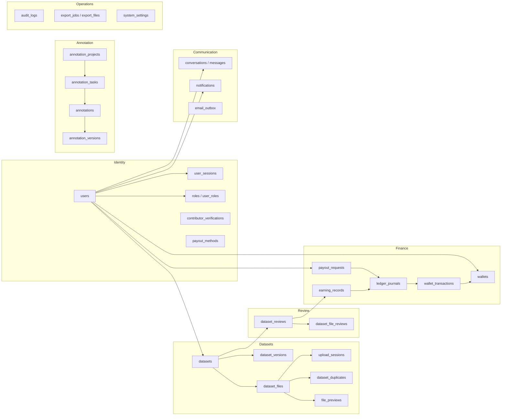
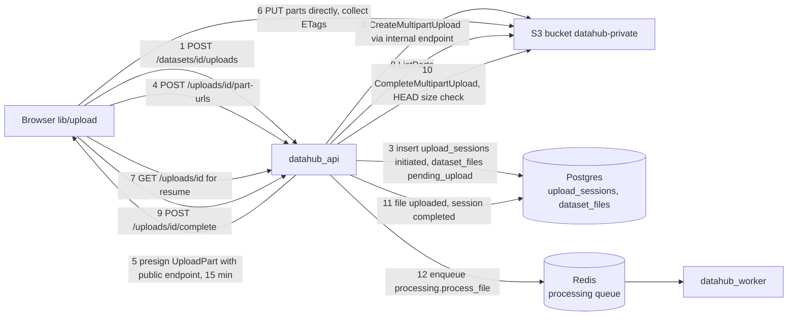
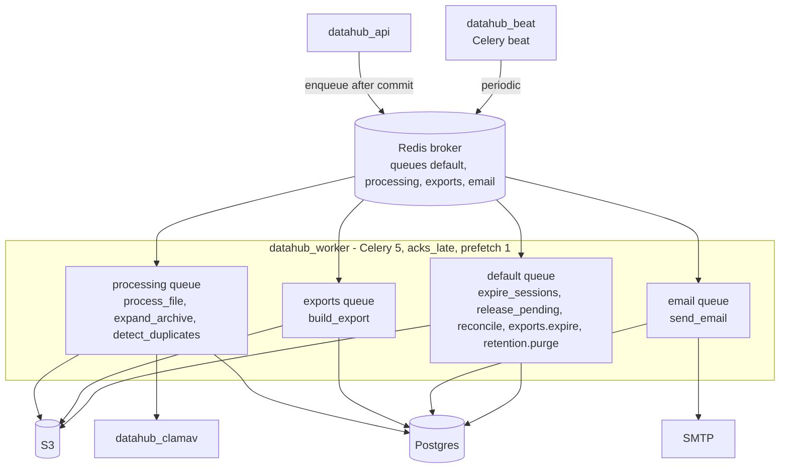
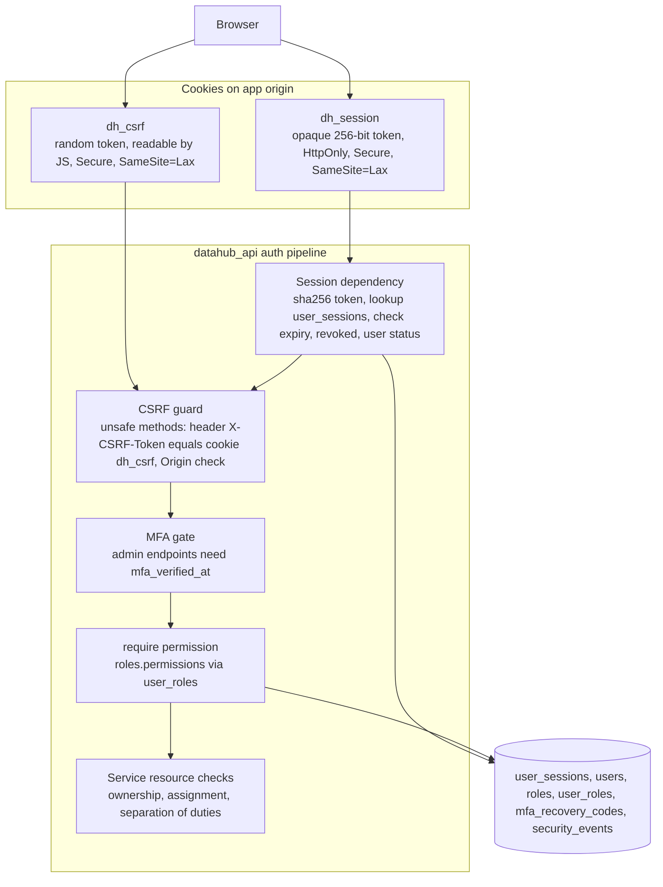
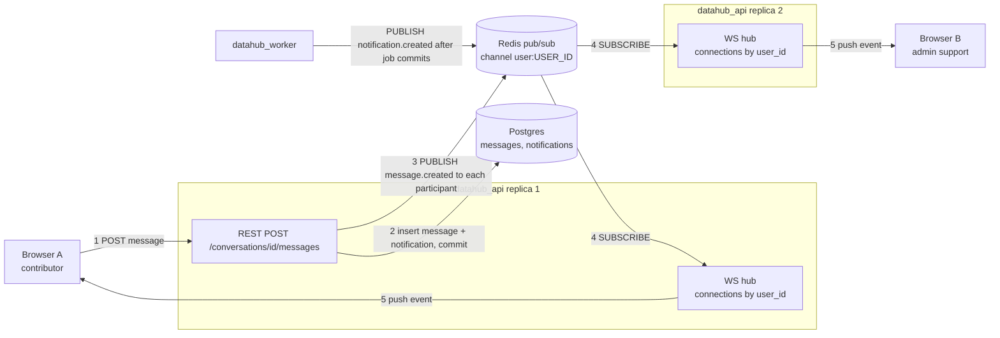
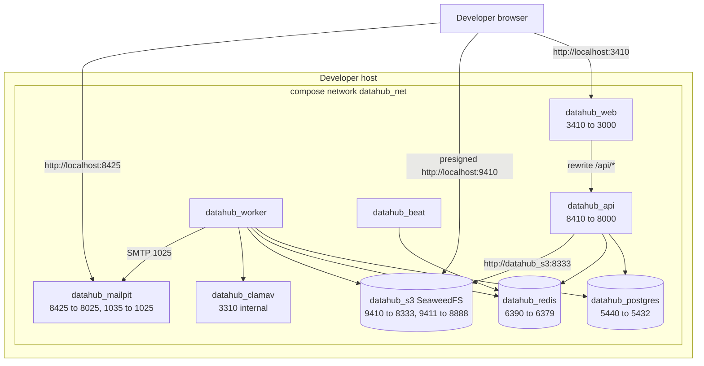
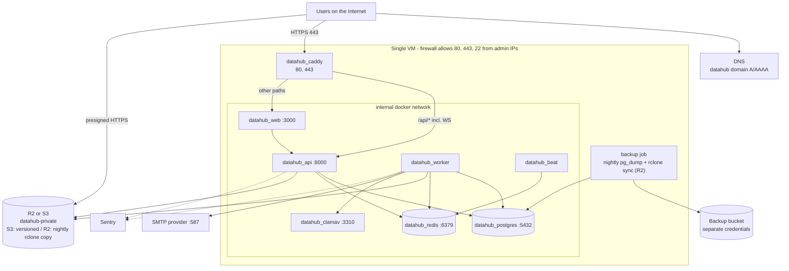

# DataHub — High-Level Design (HLD)

## Document control

| Field | Value |
|---|---|
| Document ID | DH-ARCH-HLD |
| Version | 1.1 (baseline §16 AM-01, AM-06, AM-10, AM-13 applied) |
| Date | 2026-10-26 |
| Status | Baseline |
| Owner | CTO role |
| Canonical source | [`../ENGINEERING_BASELINE.md`](../ENGINEERING_BASELINE.md) |
| Related | [SAD](SAD.md) · [SDD](SDD.md) · [DFD](DFD.md) · [ADR index](ADR/README.md) · LLD.md · `../04-backend-api/FILE_UPLOAD_STORAGE.md` · `../04-backend-api/AUTH_AUTHORIZATION.md` |

## Header

- **Purpose.** Give the high-level design of each subsystem — frontend, API, database, object storage, workers, authentication, realtime messaging and infrastructure — as diagrams plus the minimum prose needed to read them, bridging the SAD (why/what) and the LLD/SDD (how/when).
- **Scope.** Structural design of all v1 subsystems and their network topology in dev and prod. Detailed class/function design is in LLD.md; runtime sequences are in [SDD.md](SDD.md).
- **Assumptions.** A-02 (Khmer + English UTF-8), A-03 (scale), A-09 (upload preconditions), A-10 (fail-closed scanning), A-11 (no LibreOffice previews), A-12 (SMTP), A-13 (UTC), A-15 (retention).
- **Decisions.** ADR-0002 (FastAPI + sync SQLAlchemy), ADR-0003 (Next.js same-origin `/api`), ADR-0004 (Celery), ADR-0005 (S3-compatible storage), ADR-0006 (direct-to-S3 multipart), ADR-0007 (server-side rendering of pages), ADR-0008 (cookie sessions + CSRF), ADR-0013 (single VM + Caddy), ADR-0014 (RBAC), ADR-0015 (WebSocket + Redis pub/sub).
- **Dependencies.** Baseline §§3–7, 9, 12, 13; [SAD.md](SAD.md) component catalogue and trust zones.
- **Acceptance criteria.**
  1. One diagram per subsystem listed in MASTER Part 5 item 8 (frontend, API, DB, object storage, workers, auth, realtime, infrastructure).
  2. Object storage design shows the separate internal and public S3 endpoints and the presigned multipart flow.
  3. Port table matches baseline §5 exactly.
  4. All Mermaid diagrams render.

---

## 1. Frontend (`apps/web`)

### 1.1 Structure

### 1.2 Design rules

- **Rendering:** Server Components render layout shells and public pages; authenticated data screens are Client Components using TanStack Query against `/api/v1` (same origin, so the `dh_session` cookie is sent automatically). Server-side fetches (e.g. `GET /auth/me` in a layout) forward the incoming `Cookie` header to the internal API URL `http://datahub_api:8000`.
- **Middleware** only checks the presence of `dh_session` to redirect to `/login`; it never trusts the cookie for authorisation — the API decides.
- **CSRF:** `lib/api` reads the `dh_csrf` cookie (not HttpOnly by design) and sends it as `X-CSRF-Token` on POST/PUT/PATCH/DELETE. On first load it calls `GET /auth/csrf` if the cookie is missing.
- **Forms:** React Hook Form + Zod schemas mirroring Pydantic constraints; server errors `{"error":{"code","message","details","request_id"}}` mapped to field errors via `details`.
- **Uploads:** `lib/upload` runs up to 4 concurrent part PUTs per file and 3 files at a time, persists `{upload_id, file fingerprint}` in IndexedDB so a reloaded tab can resume; see §4.3.
- **Document viewer:** `` tiles of server-rendered page images fetched via `GET /files/{id}/preview/{page}` (302 to presigned URL); zoom/pan/rotate done client-side with CSS transforms (ADR-0007).
- **Annotation editor:** three-panel layout; right-panel state in a local reducer with undo/redo; autosave after 5 s idle and on blur using `If-Match` (ADR-0011).
- **i18n:** all strings in a message catalogue (`messages/en.json`), `lang` attributes on Khmer content; Noto Sans Khmer font for `km`.
- **Theming / a11y:** next-themes light/dark; Radix primitives for focus management; WCAG 2.2 AA.

## 2. API (`apps/api`, package `datahub`)

Key points:

- **Sync handlers** (`def`) run in the AnyIO threadpool (default 40 threads per Uvicorn worker); DB pool per process `pool_size=10, max_overflow=10`. The WebSocket handler is `async def` and uses `redis.asyncio` (ADR-0002, ADR-0015).
- **Error model:** domain exceptions (`NotFound`, `Forbidden`, `Conflict`, `ValidationFailed`, `RateLimited`, `PreconditionFailed`) mapped by one exception handler to the standard envelope with `request_id`.
- **Pagination** `?page&page_size` (max 100) → `{"items","page","page_size","total"}`; sorting `?sort=-created_at`.
- **Idempotency:** `Idempotency-Key` accepted on financial POSTs (`POST /payouts`, `POST /reviews/{id}/finalize`, `POST /admin/adjustments`); persisted in the owning table's unique column or derived ledger key, not in Redis.
- **OpenAPI** generated from code is the contract; CI diffs it against `docs/04-backend-api/openapi.yaml`.

## 3. Database (PostgreSQL 17)

Design principles (full schema in DATABASE_SCHEMA.md, full ERD in ERD.md):

- Time-ordered UUID primary keys generated in the app; `created_at`/`updated_at timestamptz` on every table.
- **Integrity in the database:** foreign keys, CHECK constraints on status enums and non-negative cached balances, partial unique indexes (one open payout per user, one active assignment per task), exclusion constraint for non-overlapping `pricing_rules`, deferred constraint trigger enforcing Σ lines = 0 per journal, triggers blocking UPDATE/DELETE on `ledger_journals`, `wallet_transactions`, `audit_logs`.
- **Isolation:** `READ COMMITTED` plus explicit `SELECT … FOR UPDATE` on the aggregate root being changed (wallet, review, payout, task); optimistic `version` column on `annotations`.
- **Migrations:** Alembic, expand/contract; every migration is reversible or documented as one-way; CI runs `upgrade head` → `downgrade -1` → `upgrade head` on a real Postgres.
- **Roles:** application connects as `datahub_app` (DML only); migrations run as `datahub_owner`; a `datahub_readonly` role exists for analytics/replica.

## 4. Object storage

### 4.1 Bucket and key layout

Single private bucket `datahub-private` (public access blocked, no public ACLs, SSE at rest by the provider). Keys are generated by `core.storage`; user-supplied filenames are stored only in `dataset_files.original_filename` and sent back via `Content-Disposition`.

| Prefix | Content | Writer | Retention (A-15) |
|---|---|---|---|
| `datasets/{dataset_id}/files/{file_id}/original` | Uploaded original bytes | Browser via presigned multipart | Life of dataset; rejected 90 days |
| `datasets/{dataset_id}/files/{file_id}/members/{member_file_id}` | Extracted ZIP member | Worker | As parent dataset |
| `previews/{file_id}/page-{n}.webp` / `.png`, `previews/{file_id}/text.txt` | Rendered pages / extracted text | Worker | As file |
| `attachments/{conversation_id}/{attachment_id}` | Message attachments (≤ 10 MB) | API (multipart form) | As conversation |
| `verifications/{user_id}/{verification_id}/{doc_id}` | Optional ID document | API | Restricted; per retention policy |
| `payout-proofs/{payout_id}/{proof_id}` | Payment proof | API | 7 years |
| `exports/{export_job_id}/{export_file_id}.zip` | Export package | Worker | 7 days |
| `quarantine/{file_id}` | Infected originals moved aside | Worker | Until admin decision |

### 4.2 Internal vs public endpoint

`core.storage` creates **two boto3 clients** from settings:

| Setting | Dev value | Prod value | Used for |
|---|---|---|---|
| `S3_ENDPOINT_INTERNAL` | `http://datahub_s3:8333` | R2/S3 endpoint | All server-side operations: CreateMultipartUpload, ListParts, CompleteMultipartUpload, AbortMultipartUpload, HEAD, GET stream, PUT derivatives |
| `S3_ENDPOINT_PUBLIC` | `http://localhost:9410` | R2/S3 endpoint (or custom domain) | **Only for signing** presigned URLs returned to browsers |

The SigV4 signature covers the `Host` header, so a URL signed for `datahub_s3:8333` would be unusable from the browser and a URL rewritten afterwards would fail signature validation; signing with a client configured for the public endpoint solves this without proxies. Bucket CORS allows `PUT` and `GET` from the web origin(s) and exposes the `ETag` header (needed by the client to complete the upload).

### 4.3 Direct-to-S3 multipart upload

- Part size 16 MiB, raised automatically so `part_count ≤ 10,000`. Maximum file (4,000,000,000 B, AM-01) → 239 parts.
- Init validates: A-09 preconditions, extension in allowed list, declared size ≤ `max_file_bytes`, dataset total ≤ `max_dataset_bytes`, user unreviewed storage ≤ `user_pending_quota_bytes`, file count ≤ 2,000, dataset status `draft` or `changes_requested`.
- Complete validates the part list against ListParts and the object size against the declared size (mismatch → abort + `size_mismatch`).
- Abandoned sessions: `uploads.expire_sessions` (beat 15 min) aborts multipart uploads older than 24 h; a bucket lifecycle rule aborts incomplete multipart uploads after 1 day as a backstop.

### 4.4 Downloads and previews

All reads are presigned GETs (5 min) issued after an authorisation check: `GET /files/{id}/preview/{page}` → 302, `POST /files/{id}/download-url` → URL with `response-content-disposition=attachment` and `response-content-type` set to the detected MIME (or `application/octet-stream`), so the browser never renders untrusted content inline from the storage origin.

## 5. Workers

| Task | Queue | Trigger | Time limit (soft/hard) | Retries |
|---|---|---|---|---|
| `processing.process_file(file_id)` | processing | upload complete | 55 / 60 min | 3, exponential backoff 30 s → 8 min |
| `processing.expand_archive(file_id)` | processing | ZIP processed | 110 / 120 min | 3 |
| `processing.detect_duplicates(file_id)` | processing | after hash | 4 / 5 min | 3 |
| `uploads.expire_sessions` | default | beat 15 min | 4 / 5 min | next run |
| `finance.release_pending` | default | beat hourly | 9 / 10 min | next run |
| `admin.requeue_stalled` (AM-10) | default | beat 5 min | 2 / 3 min | next run |
| `finance.reconcile` | default | beat nightly 02:00 UTC | 25 / 30 min | next run |
| `messaging.send_email(outbox_id)` | email | outbox insert | 50 / 60 s | 8, backoff to 1 h |
| `exports.build_export(job_id)` | exports | admin request | 230 / 240 min | 2 |
| `exports.expire`, `retention.purge` | default | beat daily | 55 / 60 min | next run |

Worker settings: `task_acks_late=True`, `task_reject_on_worker_lost=True`, `worker_prefetch_multiplier=1`, JSON serializer only, `visibility_timeout` 5 h (greater than the longest hard limit). Every run writes/updates a `background_job_records` row (task name, args hash, status, attempts, last_error). Processing streams objects in 8 MiB chunks; temp files go to a size-capped `tmpfs`/scratch volume mounted `noexec`.

## 6. Authentication and authorisation

- **Login:** Argon2id verify (constant-time dummy hash for unknown emails) → new session row with `token_hash = sha256(token)`, `ip`, `user_agent`, `expires_at`, `mfa_verified_at = NULL`; session rotated on login, MFA verification and password change. For admin/super_admin with MFA enabled the login response is `{mfa_required: true}` and the session is limited to `/auth/mfa/verify` and `/auth/logout` until `POST /auth/mfa/verify` (TOTP or recovery code) sets `mfa_verified_at`.
- **Throttling:** Redis counters per IP and per account for login, register, forgot-password, verify; progressive lockout recorded in `security_events`.
- **Permissions:** cached per request from the user's roles; role changes take effect on the next request. Permission catalogue and matrix: baseline §6, detailed in AUTH_AUTHORIZATION.md.
- **Separation of duties** is enforced in services: no self-review of datasets/annotations, no approving or paying own payout, dual approval ≥ `payout_dual_approval_threshold_micros`.
- **WebSocket auth** uses the same `dh_session` cookie at upgrade plus an `Origin` allow-list check (CSRF tokens are not available on WS upgrade).

## 7. Realtime messaging

- Postgres is the source of truth; Redis pub/sub is a best-effort fan-out. Events carry IDs plus a small payload; the client invalidates TanStack Query keys or appends the message.
- On (re)connect the client refetches `GET /conversations/{id}/messages?after=<last_id>` and `GET /notifications/unread-count`, so missed events are recovered.
- Server events: `message.created`, `notification.created`, `conversation.updated`. Server pings every 25 s; client reconnects with exponential backoff (1 s → 30 s, jitter).
- Each API process holds one Redis subscription per connected user (`user:{user_id}`); unsubscribes on disconnect. Closing a session (logout/revoke) publishes `session.revoked` on `session:{session_id}` which closes matching sockets.

## 8. Infrastructure topology

### 8.1 Development

### 8.2 Production

## 9. Network ports

| Service | Container | Container port | Dev host port | Prod exposure |
|---|---|---|---|---|
| web | `datahub_web` | 3000 | **3410** | Internal only (via Caddy) |
| api (HTTP + WS) | `datahub_api` | 8000 | **8410** | Internal only (via Caddy `/api/*`) |
| worker | `datahub_worker` | – | – | None |
| beat | `datahub_beat` | – | – | None |
| postgres | `datahub_postgres` | 5432 | **5440** | None |
| redis | `datahub_redis` | 6379 | **6390** | None |
| object storage S3 API | `datahub_s3` | 8333 | **9410** | Managed R2/S3 over 443 |
| object storage filer UI | `datahub_s3` | 8888 | **9411** (dev only) | Not deployed |
| clamav | `datahub_clamav` | 3310 | – (internal) | None |
| mailpit UI / SMTP | `datahub_mailpit` | 8025 / 1025 | **8425** / **1035** | Not deployed (SMTP provider 587) |
| caddy | `datahub_caddy` | 80, 443 | – (prod only) | **80, 443 public** |
| metrics | `datahub_api` `/metrics` | 8000 | via 8410 in dev | Blocked at Caddy; scraped on internal network |
