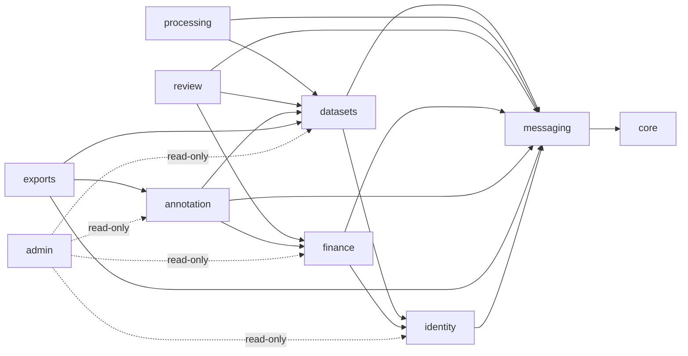
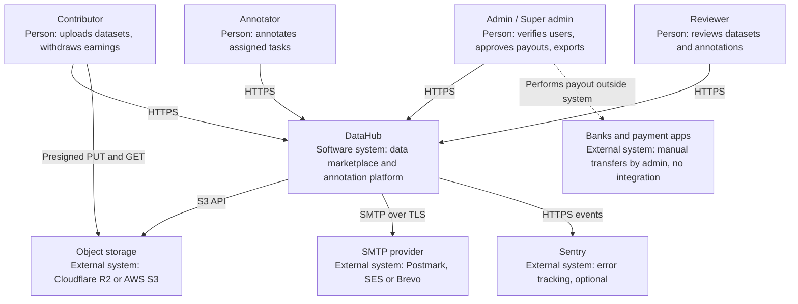
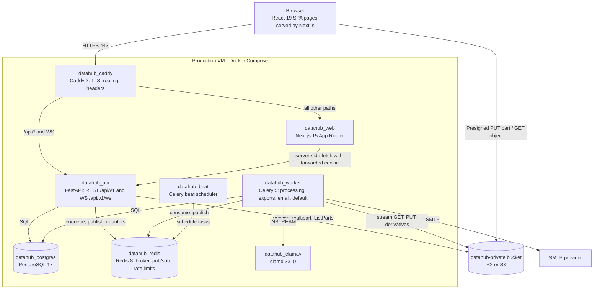

# DataHub — Software Architecture Document (SAD)

## Document control

| Field | Value |
|---|---|
| Document ID | DH-ARCH-SAD |
| Version | 1.1 (baseline §16 AM-01, AM-06, AM-10, AM-13 applied) |
| Date | 2026-10-26 |
| Status | Baseline |
| Owner | CTO role |
| Canonical source | [`../ENGINEERING_BASELINE.md`](../ENGINEERING_BASELINE.md) — wins on any conflict until amended via `DECISION_LOG.md` |
| Related | [HLD](HLD.md) · [SDD](SDD.md) · [DFD](DFD.md) · [ADR index](ADR/README.md) · LLD.md · ERD.md · DATABASE_SCHEMA.md |

## Header

- **Purpose.** Describe the architecture of DataHub v1: its style, technology choices, runtime components, module boundaries, integrations, security boundaries, deployment model, scaling path and constraints, so that every later design, implementation and operations artefact can be traced to an explicit architectural decision.
- **Scope.** The whole v1 system: Next.js web app, FastAPI API (HTTP + WebSocket), Celery workers and beat, PostgreSQL, Redis, S3-compatible object storage, ClamAV, SMTP, Caddy reverse proxy, and the local development and single-VM production environments. Out of scope: v2 `buyer` role and `orders` module (A-01), automated payment rails (A-05), LibreOffice rendering (A-11).
- **Assumptions.** A-01 (single operator organisation), A-02 (Khmer/English, UTF-8), A-03 (≤ 2,000 users, ≤ 200 concurrent sessions, ≤ 50 concurrent uploads, ≤ 20 TB year 1, file ≤ 4 GB = 4,000,000,000 B per AM-01, dataset ≤ 50 GB), A-04 (integer micro-USD), A-05 (manual payouts), A-10 (ClamAV fail-closed), A-11 (no LibreOffice), A-12 (any SMTP provider), A-13 (UTC timestamps), A-15 (retention defaults).
- **Decisions.** ADR-0001 … ADR-0015 (see [ADR/README.md](ADR/README.md)). This SAD summarises them; each ADR holds the rationale.
- **Dependencies.** `ENGINEERING_BASELINE.md` §§3–14; MASTER_PROMPT Parts 6, 16, 17, 21, 23, 24; HA-05 (production hosting, domain, SMTP, storage credentials) for go-live.
- **Acceptance criteria.**
  1. Every runtime component in baseline §5 appears in the component catalogue with container name, port and responsibility.
  2. Every module in baseline §4 appears with owned tables and allowed dependencies.
  3. Trust zones are defined and each component is placed in exactly one zone.
  4. Deployment model covers dev (compose) and prod (single VM + managed object storage), and the scaling path names concrete steps with triggers.
  5. Quality-attribute scenarios are measurable and trace to baseline §14 NFR targets.
  6. C4 context and container diagrams render as valid Mermaid.

---

## 1. Architectural drivers

| Driver | Source | Architectural consequence |
|---|---|---|
| Large documents (≤ 4 GB per file — AM-01, clamd single-stream limit — ≤ 50 GB per dataset) uploaded over unreliable links | A-03, MASTER Part 9 | Browser uploads directly to object storage using S3 multipart with presigned part URLs; API never proxies file bytes (ADR-0006). |
| Untrusted file content (malware, zip bombs, polyglots) | MASTER Part 16 | All content inspection happens in isolated workers; fail-closed scanning (ADR-0010); server-side rendered previews only (ADR-0007). |
| Money must be exact, traceable, never double-spent | Baseline §8, MASTER Part 11 | Integer micro-USD, append-only double-entry ledger, idempotency keys, row locks (ADR-0009). |
| Small team, small initial scale, low ops budget | A-03, MASTER Part 6 | Modular monolith (ADR-0001) on a single VM with Docker Compose and Caddy (ADR-0013); no Kubernetes. |
| Strong session security, admin MFA, CSRF protection | MASTER Part 16 | Opaque DB-backed sessions in HttpOnly cookies, double-submit CSRF, TOTP for admins (ADR-0008); same-origin `/api` (ADR-0003). |
| Concurrent annotation editing must never lose work | MASTER Part 12 | Optimistic locking with `If-Match` versions (ADR-0011). |
| Important emails must be delivered even if the browser is closed | MASTER Part 13 | Transactional outbox + Celery email queue (ADR-0012). |
| Realtime chat and notifications | MASTER Part 13 | WebSocket + Redis pub/sub, messages persisted in Postgres first (ADR-0015). |
| Khmer text fidelity | A-02, baseline §11 | Transcriptions stored verbatim; NFC normalisation only on export copy; Noto Sans Khmer self-hosted. |

## 2. Architecture style

DataHub v1 is a **modular monolith** with **asynchronous workers** (ADR-0001):

- One Python package `datahub` (in `apps/api`) is deployed as three process types from the **same image**: `api` (Uvicorn/FastAPI), `worker` (Celery worker consuming `default`, `processing`, `exports`, `email`), `beat` (Celery beat scheduler).
- One Next.js application (`apps/web`) serves all UI routes. It holds no business logic and no database credentials; it is a client of the API.
- One PostgreSQL 17 database is the system of record. Redis 8 is used for the Celery broker, pub/sub fan-out, rate-limit counters and short-lived caches — never as a system of record.
- One private S3 bucket `datahub-private` stores every object (originals, archive members, previews, attachments, payout proofs, exports) under server-generated keys.

Style rules:

1. **Synchronous request path is short.** Handlers do validation, authorisation, a single DB transaction and return. Anything that reads file bytes, renders, scans, builds exports or sends email runs in a worker.
2. **Database transaction = unit of consistency.** Business invariants (ledger balance, one open payout, status transitions) are enforced inside one Postgres transaction with constraints and row locks, not across services.
3. **Side effects after commit.** Pub/sub publishes and Celery enqueues happen after the transaction commits; durable side effects (email) go through the outbox row written inside the transaction (ADR-0012).
4. **Idempotency everywhere it matters.** Workers use status guards and unique keys; financial endpoints accept `Idempotency-Key`; ledger journals carry unique `idempotency_key`.

## 3. Technology choices

| Layer | Technology (pinned major) | Notes / ADR |
|---|---|---|
| Web UI | Next.js 15 App Router, React 19, TypeScript 5 | ADR-0003. Node.js 22 LTS runtime in `datahub_web`. |
| Styling / components | Tailwind CSS 4, shadcn/ui (Radix) vendored in `apps/web/src/components/ui`, lucide-react, next-themes | Fonts Inter + Noto Sans Khmer via `next/font` (self-hosted, no third-party font CDN). |
| Forms / data | React Hook Form + Zod, TanStack Query 5, Recharts | API types generated with openapi-typescript into `packages/shared`. |
| Document viewing | Server-rendered PNG/WebP page images | ADR-0007; PDF.js not used in v1. |
| API | Python 3.13, FastAPI, Pydantic v2 | Sync handlers on threadpool; WebSocket endpoint async with `redis.asyncio` (ADR-0002, ADR-0015). |
| ORM / DB driver | SQLAlchemy 2.0 (sync ORM), psycopg 3, Alembic | ADR-0002. Dependencies managed with uv. |
| Tasks | Celery 5 + Celery beat, Redis broker | Queues `default`, `processing`, `exports`, `email`; `acks_late=True` (ADR-0004). |
| Database | PostgreSQL 17 | citext, exclusion constraints, deferred constraint triggers for ledger balance. |
| Cache / broker / pub/sub / rate limits | Redis 8 | Ephemeral; loss of Redis loses no committed business data. |
| Object storage | S3 API — dev SeaweedFS (`chrislusf/seaweedfs`), prod Cloudflare R2 or AWS S3 | ADR-0005. Bucket `datahub-private`, private; object backup per AM-13 (S3: versioning + 30-day noncurrent lifecycle; R2: nightly `rclone sync` to a separate backup bucket, deleted objects kept 30 days). |
| Malware scanning | ClamAV `clamav/clamav:stable`, clamd INSTREAM on 3310 | ADR-0010. Internal only. |
| File handling | python-magic (libmagic), pypdfium2, Pillow, python-docx, openpyxl, striprtf, zipfile, defusedxml | Worker image only needs these at runtime; the API image is the same image. |
| Mail | SMTP — Mailpit in dev; Postmark / SES / Brevo SMTP in prod | A-12, ADR-0012. |
| Auth | Argon2id, opaque 256-bit session token in cookie `dh_session`, CSRF cookie `dh_csrf` + `X-CSRF-Token`, TOTP via pyotp | ADR-0008. |
| Authorisation | Postgres-backed RBAC: `roles.permissions text[]`, `user_roles` | ADR-0014. |
| Reverse proxy | Caddy 2 (prod, automatic HTTPS) | ADR-0013. Dev uses Next.js rewrites. |
| Observability | structlog JSON logs with `request_id`, Prometheus `/metrics` (internal), Sentry SDK optional via `SENTRY_DSN` | MASTER Part 24. |
| Testing | pytest with real Postgres, Vitest + Testing Library, Playwright E2E | TEST_PLAN.md. |

## 4. Component catalogue

| Component | Container | Dev host port | Internal port | Zone | Responsibility | Stateful |
|---|---|---|---|---|---|---|
| web | `datahub_web` | 3410 | 3000 | Z2 App | Next.js UI; in dev rewrites `/api/*` to `datahub_api`. No secrets beyond public config. | No |
| api | `datahub_api` | 8410 | 8000 | Z2 App | REST `/api/v1`, WebSocket `/api/v1/ws`, health `/healthz` `/readyz`, internal `/metrics`. Issues presigned URLs. | No |
| worker | `datahub_worker` | – | – | Z3 Processing | Celery tasks: processing, archive expansion, duplicates, exports, email, finance jobs, retention. Only component that reads untrusted file bytes. | No |
| beat | `datahub_beat` | – | – | Z3 Processing | Celery beat schedule (`uploads.expire_sessions`, `finance.release_pending`, `finance.reconcile`, `exports.expire`, `retention.purge`, `admin.requeue_stalled` every 5 min — AM-10). Exactly one instance. | Schedule file only |
| postgres | `datahub_postgres` | 5440 | 5432 | Z4 Data | System of record for all entities, ledger, audit, outbox. | Yes (volume) |
| redis | `datahub_redis` | 6390 | 6379 | Z4 Data | Celery broker/result backend, pub/sub channels, rate-limit counters. | Ephemeral (AOF optional) |
| s3 | `datahub_s3` (dev) / R2 or S3 (prod) | 9410 S3 API, 9411 filer UI (dev only) | 8333 S3, 8888 filer | Z4 Data (dev) / Z5 External (prod) | Private object storage for all binary content. | Yes |
| clamav | `datahub_clamav` | – | 3310 | Z3 Processing | clamd INSTREAM scanning; signature updates via freshclam. | Signature DB volume |
| mail | `datahub_mailpit` (dev) / SMTP provider (prod) | 8425 UI, 1035 SMTP | 8025 UI, 1025 SMTP | Z3 (dev) / Z5 External (prod) | Outbound email delivery. | Dev only |
| caddy | `datahub_caddy` (prod only) | 80, 443 public | – | Z1 Edge | TLS termination (ACME), HTTP→HTTPS redirect, security headers, routing `/api/*` (incl. WS upgrade) → api, everything else → web, request size limits. | Certificates volume |

Internal ports are the image defaults used on the compose network; only the host ports in baseline §5 are published in dev, and only 80/443 are published in prod.

## 5. Module boundaries

The backend package `datahub` contains `core/` (cross-cutting infrastructure) and nine business modules under `modules/`. Each module has `router.py`, `service.py` (owns transactions), `models.py`, `schemas.py`, optional `repository.py`, and `tasks.py`.

| Module | Responsibility | Owned tables | May call services of |
|---|---|---|---|
| `identity` | Registration, login, sessions, MFA, users, roles, profiles, verification, payout methods, agreements, security events | `users`, `user_profiles`, `roles`, `user_roles`, `user_sessions`, `email_verifications`, `contributor_verifications`, `payout_methods`, `agreement_acceptances`, `security_events`, `mfa_recovery_codes` | `messaging` (notify/email) |
| `datasets` | Datasets, versions, metadata, licences, uploads, files, duplicates registry, previews registry | `datasets`, `dataset_versions`, `dataset_files`, `dataset_metadata`, `upload_sessions`, `upload_parts`, `dataset_licenses`, `dataset_duplicates`, `file_previews` | `identity` (eligibility), `messaging` |
| `processing` | Worker-side sniffing, hashing, scanning, previews, archive expansion, duplicate detection | none (writes through `datasets` service functions) | `datasets`, `messaging` |
| `review` | Review queue, claims, per-file decisions, quality scores, finalisation | `dataset_reviews`, `dataset_file_reviews`, `dataset_quality_scores` | `datasets`, `finance`, `messaging` |
| `finance` | Pricing rules, wallets, ledger, earnings, payouts, approvals, adjustments, reconciliation | `pricing_rules`, `wallets`, `ledger_journals`, `wallet_transactions`, `earning_records`, `payout_requests`, `payout_approvals`, `payout_records`, `payout_adjustments` | `identity` (verification status), `messaging` |
| `annotation` | Projects, task generation, assignments, drafts, submissions, reviews, rewards | `annotation_projects`, `annotation_project_datasets`, `annotation_tasks`, `annotation_assignments`, `annotations`, `annotation_versions`, `annotation_reviews`, `annotation_feedback`, `annotation_rewards` | `datasets` (accepted files, previews), `finance` (reward journal), `messaging` |
| `messaging` | Conversations, messages, attachments, notifications, WebSocket hub, email outbox | `conversations`, `conversation_participants`, `messages`, `message_attachments`, `notifications`, `email_outbox` | `identity` (participant lookup) |
| `exports` | Export jobs and export files | `export_jobs`, `export_files` | `datasets`, `annotation`, `messaging` |
| `admin` | Analytics, audit-log view, settings, takedown and deletion requests, background job records | `system_settings`, `takedown_requests`, `deletion_requests`, `background_job_records` (shared write via `core`) | all modules (read-only service calls) |
| `core` | Config, DB session, security primitives, errors, logging, storage client, permissions, audit writer, rate limiter | `audit_logs` (append-only, written via `core.audit`) | — |

Boundary rules (enforced by import-linter in CI, see DOCKER_CICD.md):

1. A module calls another module **only through its `service.py` public functions**; it never imports another module's `models.py` for writes or queries.
2. Exception: read-only joins for admin search and analytics in `admin`, each documented in LLD.md.
3. The caller's transaction is passed explicitly (`session` argument); a service function never commits a transaction it did not open. The outermost service (the one invoked by the router or task) owns commit/rollback.
4. No circular dependencies; `messaging` and `core` are leaves. The dependency graph above is acyclic.
5. Celery tasks live in the module that owns the state they change and call that module's service.
6. `core.storage` is the only code that talks to S3; `core.audit` is the only code that writes `audit_logs`.

All modules depend on `core` (edges omitted except `messaging` for readability).

## 6. Integrations

| Integration | Protocol | Direction | Credentials | Failure behaviour |
|---|---|---|---|---|
| Object storage (SeaweedFS / R2 / S3) | S3 API over HTTPS (HTTP inside dev network) | API → S3 (presign, multipart create/complete/abort, ListParts, HEAD); Worker → S3 (GET stream, PUT derivatives/members/exports); Browser → S3 (presigned PUT part, presigned GET) | Access key pair in env (`S3_ACCESS_KEY_ID`, `S3_SECRET_ACCESS_KEY`), bucket `datahub-private` | `/readyz` reports degraded; uploads fail with `storage_unavailable`; worker tasks retry with backoff. |
| ClamAV | clamd INSTREAM over TCP 3310 | Worker → clamav | none (internal network only) | Fail-closed: file stays `processing`/`scan_status=error`, task retries; never becomes payable (ADR-0010). |
| SMTP provider | SMTP submission with STARTTLS (587) or SMTPS (465) | Worker (`email` queue) → SMTP | `SMTP_HOST`, `SMTP_USER`, `SMTP_PASSWORD` | Outbox row stays `pending`, retried with backoff; after max attempts `failed` and surfaced in admin job view. |
| Sentry (optional) | HTTPS | api, worker, web → Sentry | `SENTRY_DSN` | Best-effort; never blocks requests. PII scrubbing enabled. |
| Prometheus scraper (ops) | HTTP `/metrics` on internal network | Monitoring → api, worker exporter | network restriction | Not exposed via Caddy. |
| ACME (Let's Encrypt / ZeroSSL) | HTTPS | Caddy → ACME CA | none | Caddy keeps existing certificate and retries. |

No inbound integrations exist in v1 (no webhooks, no public API keys, no payment provider callbacks).

## 7. Security boundaries (trust zones)

| Zone | Members | Trust | Controls at the boundary |
|---|---|---|---|
| Z0 Internet | Browsers of contributors, annotators, reviewers, admins; anonymous visitors | Untrusted | TLS 1.2+, HSTS, rate limiting, CSRF, input validation, CSP. |
| Z1 Edge | Caddy | Trusted to terminate TLS | Only ports 80/443 open on the VM firewall; body size limits; `/metrics` blocked; security headers. |
| Z2 Application | `datahub_web`, `datahub_api` | Trusted code, handles untrusted input | Session auth, permission checks, resource ownership checks, audit; never parses file content beyond size/metadata. |
| Z3 Processing | `datahub_worker`, `datahub_beat`, `datahub_clamav`, dev mail | Trusted code, handles **hostile content** | No published ports; streaming parsing with size/time limits; defusedxml; no shell-out with user input; uploaded content never executed or written to executable paths; per-task time limits. |
| Z4 Data | `datahub_postgres`, `datahub_redis`, dev `datahub_s3` | Highest-value stores | Not published in prod; credentials via env/secrets; Postgres role least privilege; Redis password + internal network only. |
| Z5 External services | R2/S3, SMTP provider, Sentry, ACME CA | Third-party, contractually trusted | TLS, scoped credentials (bucket-scoped keys), no PII in Sentry events. |

Cross-boundary flow worth noting: the **browser writes and reads object storage directly** (Z0 → Z5/Z4) but only with short-lived presigned URLs scoped to one object/part and method (PUT part 15 min, GET 5 min). Object keys are server-generated (`datasets/{dataset_id}/files/{file_id}/original`, etc.) and never contain user-supplied names. See [DFD.md](DFD.md) for classification per flow and THREAT_MODEL.md for STRIDE analysis.

## 8. Deployment model

### 8.1 Development (Docker Compose, `compose.yaml`)

All services from §4 run on one compose network `datahub_net`, with named volumes for Postgres, SeaweedFS, ClamAV signatures and Mailpit. Host ports exactly as baseline §5: web 3410, api 8410, postgres 5440, redis 6390, s3 9410 (API) / 9411 (filer UI), mailpit 8425 (UI) / 1035 (SMTP). The browser reaches the API through Next.js rewrites at `http://localhost:3410/api/*` so cookies are first-party; it reaches object storage directly at `http://localhost:9410` (public S3 endpoint) while containers use `http://datahub_s3:8333` (internal endpoint). Every service has a healthcheck; `api` and `worker` wait for `postgres`, `redis`, `s3` to be healthy; `worker` additionally waits for `clamav`.

### 8.2 Production (single VM + managed object storage) — ADR-0013

- **Host:** one Linux VM (baseline sizing 8 vCPU / 32 GB RAM / 400 GB SSD; final provider per DEPLOYMENT_PLAN.md, HA-05). Firewall allows 22 (admin IPs only), 80, 443.
- **Containers:** `datahub_caddy`, `datahub_web`, `datahub_api` (2+ Uvicorn workers), `datahub_worker` (processing + default + email), `datahub_worker` replica for `exports` if needed, `datahub_beat` (single), `datahub_postgres`, `datahub_redis`, `datahub_clamav`, all from versioned images (`ghcr.io/<org>/datahub-api:<git-sha>`, `datahub-web:<git-sha>`).
- **Managed storage:** Cloudflare R2 (preferred: no egress fees) or AWS S3; bucket `datahub-private` with lifecycle rules (abort incomplete multipart uploads after 1 day, expire `exports/` after 7 days per A-15).
- **Email:** external SMTP provider. **Error tracking:** Sentry (optional).
- **Backups:** nightly `pg_dump` to a separate backup bucket (RPO 24 h), optional WAL archiving for 15 min RPO; object storage per baseline AM-13 — on AWS S3 bucket versioning + lifecycle (noncurrent versions kept 30 days); on Cloudflare R2 (no versioning) a nightly `rclone sync` of `datahub-private` to a separate backup bucket/provider with 30-day retention of deleted objects; restore drill per BACKUP_DISASTER_RECOVERY.md (RTO 4 h).
- **Releases:** CI builds images, migrations run as a one-off `api` container (`alembic upgrade head`) before rolling `api`/`worker` restart; rollback = previous image tag + backward-compatible migrations (expand/contract).

## 9. Scaling path

Initial capacity (A-03) fits one VM. Each step below is triggered by a measurable signal and requires no architectural rewrite.

| Step | Trigger | Change |
|---|---|---|
| S1 Vertical | CPU > 70 % sustained or p95 > 300 ms | Bigger VM; more Uvicorn workers and Celery concurrency. |
| S2 Split workers | `processing` queue backlog > 15 min or export starves processing | Separate worker containers per queue (`-Q processing`, `-Q exports`, `-Q default,email`), then a second VM running only workers + ClamAV. Workers are stateless; they only need Postgres, Redis, S3 and clamd. |
| S3 Horizontal API | > 400 concurrent sessions or API CPU-bound | Several `datahub_api` replicas behind Caddy (`lb_policy least_conn`). Sessions are in Postgres and WebSocket fan-out uses Redis pub/sub, so no sticky sessions are needed. |
| S4 Managed data tier | DB size > 200 GB, need for PITR/HA | Move Postgres to managed Postgres 17 (PITR), Redis to managed Redis. |
| S5 Read replica | Analytics/admin search > 20 % of DB load | Postgres streaming replica; `admin` analytics and exports read from a replica session factory. |
| S6 CDN | Preview image traffic dominates egress | Serve preview derivatives through a CDN with signed URLs/tokens (R2 custom domain + Cloudflare signed URLs); originals never cached publicly. |
| S7 Extract service | A module needs independent scaling or release cadence | Module boundaries (§5) allow extracting e.g. `processing` or `exports` into a separate deployable that talks to the same DB through its service API first, then its own schema. |

## 10. Technical constraints

1. No Kubernetes in v1 (MASTER Part 6); container orchestration is Docker Compose.
2. MinIO images are not freely distributed any more; dev object storage is SeaweedFS (ADR-0005). Code must use only the S3 API subset supported by SeaweedFS, R2 and S3: multipart create/upload-part/list-parts/complete/abort, presigned PUT/GET, HEAD, DELETE, ListObjectsV2. No S3 Object Lambda, no SSE-C, no bucket notifications.
3. R2 presigned URLs do not support `x-amz-checksum-*` trailer headers on all clients; part integrity relies on ETags returned by `UploadPart`, plus a full-file SHA-256 computed by the worker.
4. No LibreOffice (A-11): DOC files have no preview; DOCX/ODT/RTF get extracted text only.
5. No floating point for money anywhere (A-04); Python `int` and Postgres `bigint` only.
6. Dev host ports 3200, 5434, 8000, 8080 are busy and must not be used (baseline §5).
7. Celery beat must run as exactly one instance.
8. All timestamps are `timestamptz` UTC (A-13); IDs are app-generated time-ordered UUIDs (baseline §10).
9. Payouts are never executed automatically (A-05).
10. Browser support: current Chrome, Edge, Firefox, Safari (last two majors); folder upload via `webkitdirectory` where supported.

## 11. Quality attribute scenarios

| ID | Attribute | Stimulus | Environment | Response | Measure (baseline §14) |
|---|---|---|---|---|---|
| QAS-01 | Performance | 200 concurrent users browse datasets, wallet, tasks | Normal load, prod VM | Non-file endpoints answer from indexed queries with pagination | p95 < 300 ms (NFR-PERF) |
| QAS-02 | Upload reliability | Contributor uploads a 4 GB PDF; network drops twice | Normal load | Client resumes from `GET /uploads/{id}` ListParts, re-uploads only missing parts | ≥ 99 % completion for files ≤ 4 GB (NFR-UPL) |
| QAS-03 | Throughput | 100 GB of files complete in one hour | Peak | Processing workers hash+scan in streaming fashion | ≥ 2 GB/min per worker; backlog alert at 15 min |
| QAS-04 | Integrity (money) | Reviewer double-clicks Finalize; network retries the request | Normal | Second request returns the original result; one `ledger_journals` row with key `dataset_review:{review_id}:earning` | Zero duplicate journals (unique constraint); nightly reconcile mismatch = 0 |
| QAS-05 | Integrity (concurrency) | Two withdrawal requests for the full available balance arrive within 10 ms | Normal | Wallet `FOR UPDATE` serialises; second fails `insufficient_balance` or `open_payout_exists` | Never negative `available`; one open payout per user |
| QAS-06 | Security | Uploaded ZIP is a 42 KB bomb expanding to 4.5 PB | Any | Expansion stops at ratio/size limit; file `failed` | No worker OOM; ratio ≤ 100:1, total ≤ 20 GB enforced |
| QAS-07 | Security | Infected file uploaded; ClamAV down | Degraded | File remains unscanned (`scan_status=error`) and non-payable; task retries | 0 non-clean files accepted for payment (A-10) |
| QAS-08 | Availability | API container crashes | Prod | Docker restart policy restarts; Caddy retries upstream | 99.5 % monthly availability (NFR-AVL) |
| QAS-09 | Recoverability | VM disk lost | Prod | Rebuild VM from IaC, restore latest `pg_dump`; objects already in managed storage | RPO 24 h, RTO 4 h |
| QAS-10 | Collaboration | Same annotation opened in two tabs, both autosave | Normal | Second save gets 409 with server copy; no silent overwrite | 0 lost submitted versions |
| QAS-11 | Observability | Email provider rejects credentials | Prod | Outbox rows accumulate as `pending`/`failed`; alert fires | Alert within 10 min of first failure |
| QAS-12 | Accessibility | Keyboard-only user completes upload and payout flows | Any | All controls reachable and labelled | WCAG 2.2 AA (NFR-ACC) |

## 12. C4 diagrams

### 12.1 C4 Level 1 — System context

### 12.2 C4 Level 2 — Containers

## 13. Traceability

| Requirement area | Section | ADR |
|---|---|---|
| Modular monolith, no k8s | §2, §8 | ADR-0001, ADR-0013 |
| Upload system (MASTER Part 9) | §3, §6, §7 | ADR-0005, ADR-0006, ADR-0010 |
| Review & earnings (Parts 10–11) | §2 rules 2–4 | ADR-0009 |
| Annotation (Part 12) | §5 | ADR-0007, ADR-0011 |
| Messaging (Part 13) | §4, §6 | ADR-0012, ADR-0015 |
| Security (Part 16) | §7 | ADR-0008, ADR-0010, ADR-0014 |
| Performance & reliability (Part 17) | §9, §11 | ADR-0004 |
| Production & monitoring (Parts 23–24) | §6, §8 | ADR-0013 |
