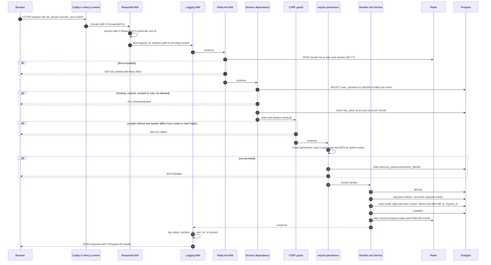
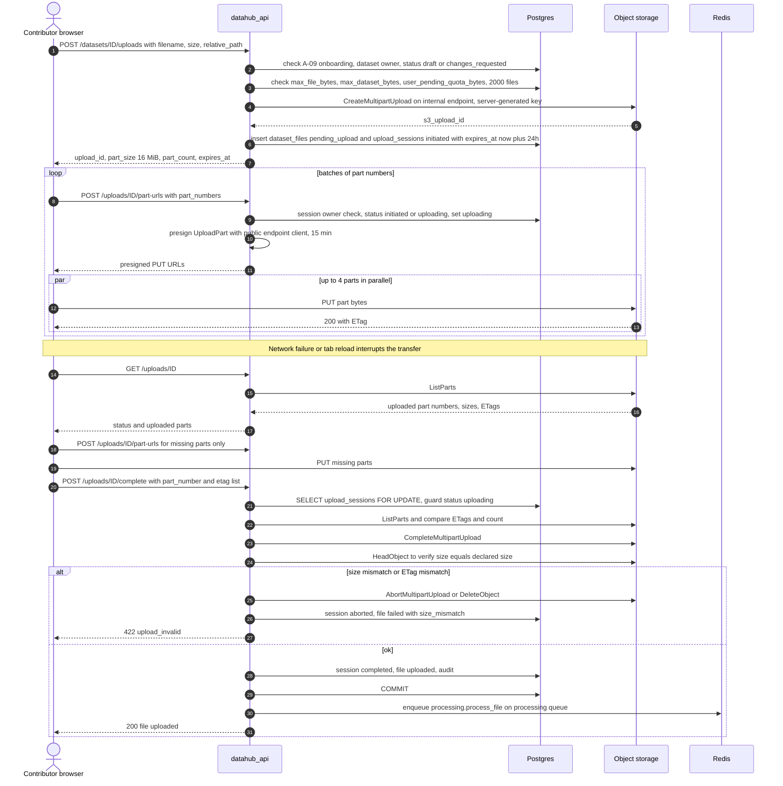
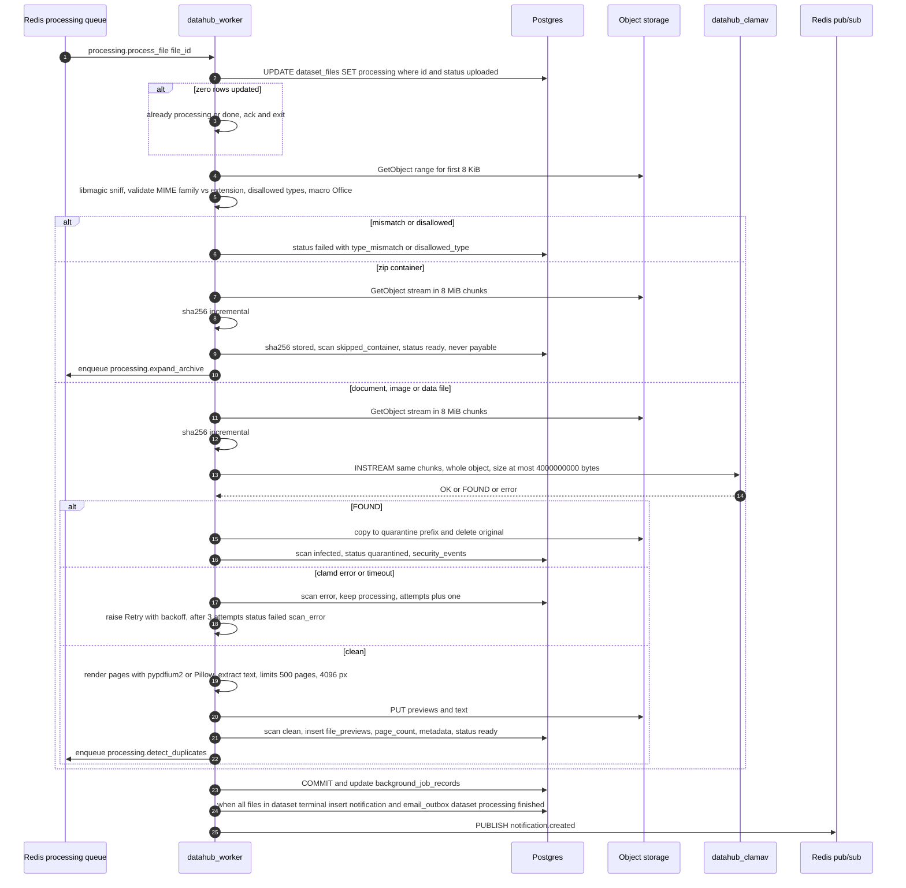
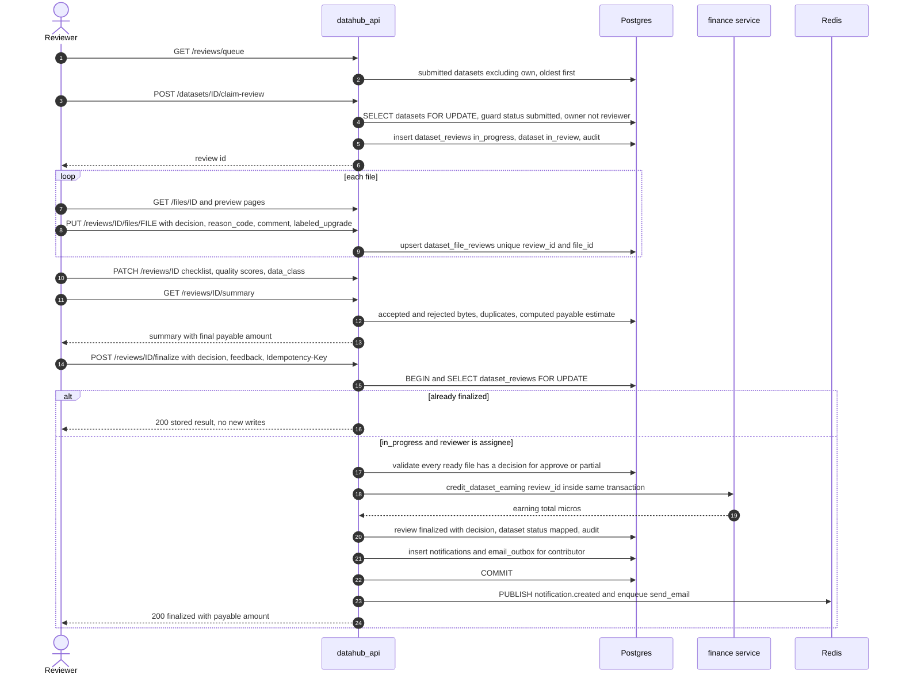
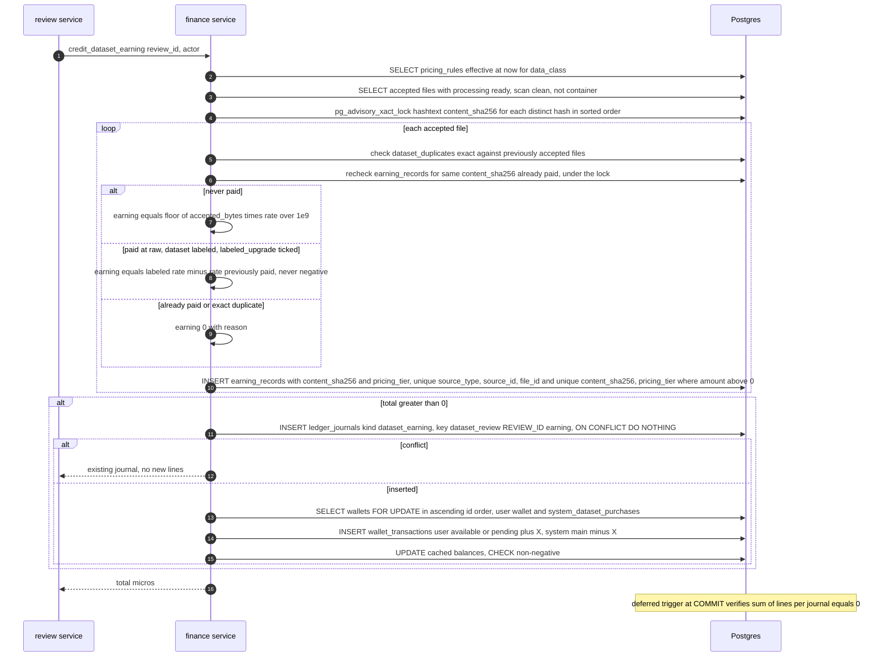
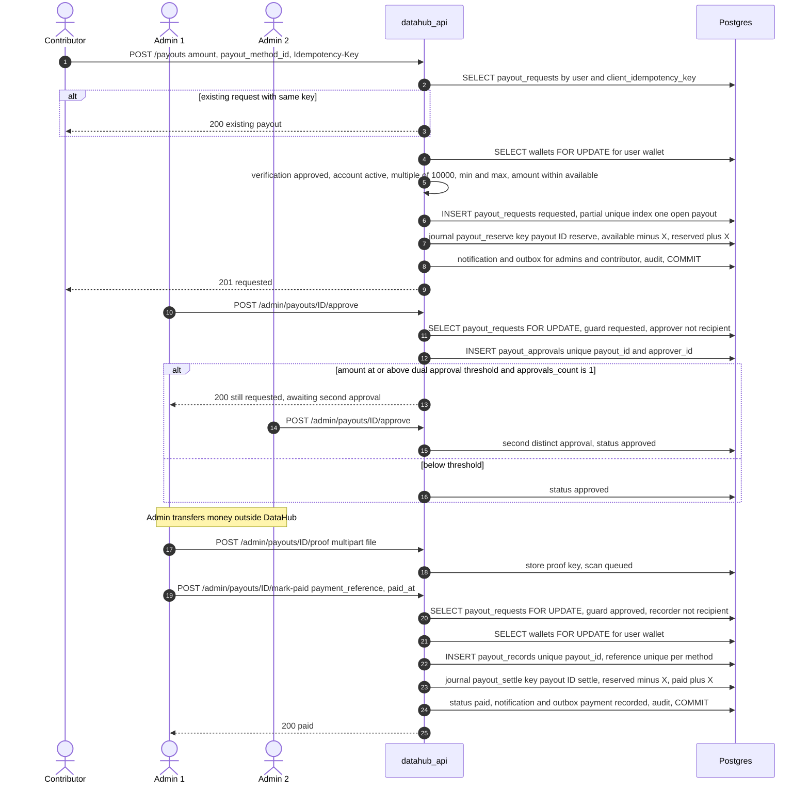
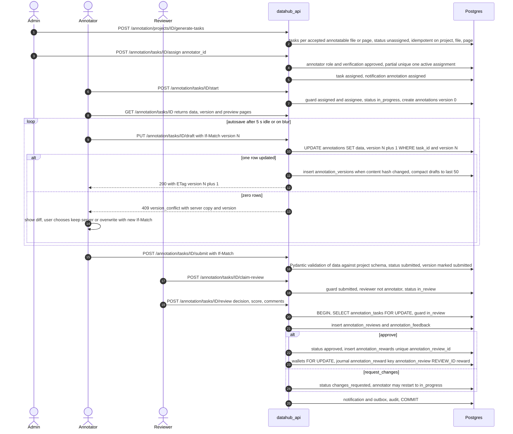
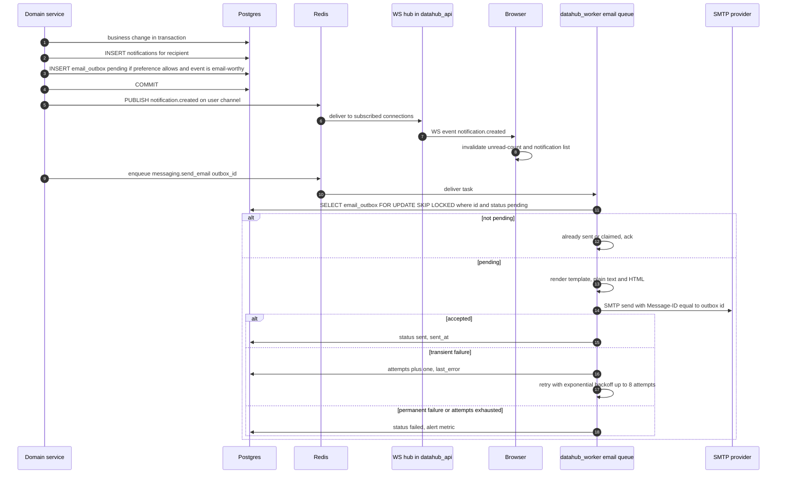

# DataHub — System Design Document (SDD)

## Document control

| Field | Value |
|---|---|
| Document ID | DH-ARCH-SDD |
| Version | 1.1 (baseline §16 AM-01, AM-02, AM-03, AM-06, AM-10 applied) |
| Date | 2026-10-26 |
| Status | Baseline |
| Owner | CTO role |
| Canonical source | [`../ENGINEERING_BASELINE.md`](../ENGINEERING_BASELINE.md) |
| Related | [SAD](SAD.md) · [HLD](HLD.md) · [DFD](DFD.md) · [ADR index](ADR/README.md) · LLD.md · DATABASE_SCHEMA.md · `../01-business-product/PRICING_PAYOUT_POLICY.md` |

## Header

- **Purpose.** Specify how DataHub's components interact at runtime: the request pipeline and every critical business lifecycle (upload, review, earnings, payout, annotation, notification), plus error recovery, scalability, concurrency control and reliability patterns, precisely enough to implement and test against.
- **Scope.** Runtime behaviour of `datahub_web`, `datahub_api`, `datahub_worker`, `datahub_beat`, `datahub_postgres`, `datahub_redis`, object storage, `datahub_clamav` and SMTP. Class-level design is in LLD.md; table definitions in DATABASE_SCHEMA.md.
- **Assumptions.** A-03 (scale), A-04 (micro-USD), A-06 (withdrawal min/max), A-07 (hold period default 0), A-08 (verification gates withdrawals and annotation assignment), A-09 (upload preconditions), A-10 (fail-closed scan), A-12 (SMTP), A-14 (annotation reward), A-15 (retention).
- **Decisions.** ADR-0004 (Celery), ADR-0006 (multipart uploads), ADR-0008 (sessions + CSRF), ADR-0009 (ledger), ADR-0010 (ClamAV fail-closed), ADR-0011 (optimistic locking), ADR-0012 (outbox), ADR-0014 (RBAC), ADR-0015 (realtime).
- **Dependencies.** Baseline §§6–13 (permissions, formats, money rules, state machines, tables, API, jobs); HA-07 (dual-approval threshold), HA-08 (labeled upgrade).
- **Acceptance criteria.**
  1. Each lifecycle named in MASTER Part 5 item 10 has a sequence diagram whose status values match baseline §9 exactly.
  2. Every money-moving step names its journal kind and idempotency key from baseline §8.5.
  3. Every concurrency hazard identified has a named control (lock, constraint, version, guard).
  4. Every background task in baseline §13 has a retry/idempotency rule.
  5. All Mermaid diagrams render.

---

## 1. Component interactions

| From → To | Mechanism | Purpose | Sync/async |
|---|---|---|---|
| Browser → Caddy (prod) / Next.js (dev) | HTTPS | Pages and `/api/v1` | Sync |
| Browser → Object storage | Presigned PUT part / GET (public endpoint) | Upload bytes, view previews, download | Sync, direct |
| Browser ↔ API | WebSocket `/api/v1/ws` | Realtime events | Async push |
| Next.js server → API | HTTP to `http://datahub_api:8000` with forwarded cookie | Server-rendered shells (`/auth/me`) | Sync |
| API → Postgres | psycopg 3 pool | All reads/writes in one transaction per request | Sync |
| API → Redis | redis-py | Rate limits, enqueue tasks, PUBLISH events | Sync, after commit for enqueue/publish |
| API → Object storage | S3 API (internal endpoint) | Multipart control, ListParts, HEAD, small PUTs (attachments, proofs), presign (public endpoint client) | Sync |
| Worker → Object storage | S3 API (internal endpoint) | Stream originals, write derivatives, members, exports | Sync within task |
| Worker → ClamAV | clamd INSTREAM TCP 3310 | Malware scan | Sync within task |
| Worker → SMTP | SMTP + TLS | Send outbox email | Sync within task |
| Worker → Redis | PUBLISH | `notification.created` after job commits | Async |
| Beat → Redis | Enqueue periodic tasks | Schedules | Async |
| API process ↔ API process | Redis pub/sub channels `user:{user_id}`, `session:{session_id}` | WebSocket fan-out across replicas | Async |

## 2. Request lifecycle

Middleware and dependency order (outermost first): **request id → structured logging → rate limit → session auth → CSRF → permission → handler (service, transaction) → audit**. Audit rows are written by the service **inside** the handler transaction so the change and its audit trail commit atomically; the audit stage after the handler records security events for denied/failed requests.

Rules:

- Public endpoints (`/public/*`, `/auth/register`, `/auth/login`, `/auth/forgot-password`, `/auth/reset-password`, `/auth/verify-email`, `/auth/csrf`, `/healthz`, `/readyz`) skip the session dependency but not rate limiting; unsafe ones still require the CSRF double-submit token (obtained from `GET /auth/csrf`).
- Unhandled exceptions → 500 `internal_error` with `request_id`, transaction rolled back, Sentry event (PII scrubbed).
- Request timeouts: Caddy upstream 60 s for API JSON routes; DB `statement_timeout` 15 s for request sessions, 10 min for worker sessions.

## 3. Upload lifecycle

States: `upload_sessions.status` `initiated → uploading → completed | aborted | expired`; `dataset_files.processing_status` `pending_upload → uploaded → processing → ready | failed | quarantined`; `scan_status` `pending | clean | infected | error | skipped_container`.

### 3.1 Init, parts, resume, complete

`DELETE /uploads/{id}` aborts the multipart upload and marks the session `aborted` and the file row deleted. `uploads.expire_sessions` (beat 15 min) finds `initiated|uploading` sessions past `expires_at`, calls `AbortMultipartUpload`, sets `expired` (status guard makes reruns harmless).

### 3.2 Processing and archive expansion

Archive expansion (`processing.expand_archive`): reads the central directory first and rejects if members > 10,000, Σ uncompressed > 20 GB, any member ratio > 100:1, absolute paths, `..`, symlinks or device entries; a member whose uncompressed size exceeds `max_file_bytes` (4,000,000,000 B, AM-01) is not extracted and is recorded `failed: archive_limit_exceeded`. Each accepted member is streamed (decompressed with a byte counter that aborts at the declared size + 1) into `datasets/{dataset_id}/files/{file_id}/members/{member_file_id}` and inserted as a `dataset_files` row with `parent_file_id` and `member_path` (unique pair → rerun-safe), status `uploaded`, then `processing.process_file` is enqueued for it. Nested ZIP members are inserted as `failed: nested_archive`. The container itself is hashed but not scanned: it ends `ready` with `scan_status=skipped_container` and is never payable; every member is scanned whole on its own (AM-01 — there is no windowed scanning).

`processing.detect_duplicates`: exact = same `sha256` as any file in another dataset whose review decision was `accepted` (or in the same dataset) → `dataset_duplicates(kind=exact)`; near = same normalised-text SimHash within distance 3 or same perceptual image hash → `kind=near` for reviewer attention. Upsert on `(file_id, matched_file_id, kind)`.

Submit: `POST /datasets/{id}/submit` requires all files terminal (`ready|failed|quarantined`) and ≥ 1 `ready`; sets `submitted`, creates a `dataset_versions` row, notifies the contributor ("dataset received").

## 4. Dataset review lifecycle

`datasets.status`: `submitted → in_review → approved | partially_approved | rejected | changes_requested`; `dataset_reviews.status`: `in_progress → finalized | released`.

Decision → dataset status mapping: `approve` → `approved` (all ready files accepted); `partial` → `partially_approved` (≥ 1 accepted, ≥ 1 rejected); `reject` → `rejected` (no earnings); `request_changes` → `changes_requested` (no earnings; contributor edits and resubmits, which creates a new `dataset_versions` row and returns to `submitted`). `POST /reviews/{id}/release` sets the review `released` and the dataset back to `submitted`. Takedown (`taken_down`) is an admin action independent of review.

## 5. Earnings lifecycle

- Bucket: `available` when `earning_hold_days = 0` (A-07 default), else `pending` with `earning_records.hold_until = finalized_at + earning_hold_days`. `finance.release_pending` (hourly) posts one `earning_release` journal per matured earning record (user.pending −X, user.available +X) keyed `earning_release:{earning_record_id}` (baseline AM-02).
- Annotation rewards follow the same pattern — including the hold rule (`pending` + `hold_until` when `earning_hold_days > 0`, AM-02) — with kind `annotation_reward`, key `annotation_review:{review_id}:reward`, system wallet `system_annotation_labor` (§7).
- Adjustments (`POST /admin/adjustments`, `finance.adjust`, super_admin) post `adjustment_credit|adjustment_debit` keyed `adjustment:{adjustment_id}`; debits cannot drive `available` negative.
- All amounts are Python `int` micro-USD; display rounds down to cents.

## 6. Payout lifecycle

`payout_requests.status`: `requested → approved → paid`; `requested → rejected | cancelled`; `approved → cancelled | failed`; `paid → reversed`.

Alternative paths (each in one transaction with wallet lock and status guard):

| Action | From status | Journal | Key |
|---|---|---|---|
| Reject (admin) | `requested` | `payout_release` reserved −X, available +X | `payout:{payout_id}:release` |
| Cancel (contributor) | `requested` | `payout_release` | `payout:{payout_id}:release` |
| Cancel (admin) | `approved` | `payout_release` | `payout:{payout_id}:release` |
| Mark failed | `approved` | `payout_release` | `payout:{payout_id}:release` |
| Reverse (super_admin) | `paid` | `payout_reversal` paid −X, available +X | `payout:{payout_id}:reversal` |

## 7. Annotation lifecycle

`annotation_tasks.status`: `unassigned → assigned → in_progress → submitted → in_review → approved | changes_requested → in_progress`; reassign `assigned|in_progress → unassigned`; close project → `cancelled`.

Reward = `reward_per_task_micros` + `reward_per_page_micros × pages` (A-14). Only the active assignee may write drafts; an unassigned annotator's open editor receives 403 on the next save.

## 8. Notification lifecycle (transactional email outbox)

Crash window between COMMIT and enqueue: the outbox row stays `pending`. Recovery is a periodic sweep `admin.requeue_stalled` (beat every 5 min) that re-enqueues `email_outbox` rows `pending` for > 2 min, `dataset_files` stuck in `uploaded` for > 5 min, and `export_jobs` `queued` for > 5 min. Because every target task is guarded by status, a duplicate enqueue is harmless. The sweep was adopted as baseline amendment AM-10 (`DECISION_LOG.md` D-023). Duplicate SMTP delivery is possible only if the worker dies after SMTP accept and before the status update; the stable `Message-ID` lets receiving providers de-duplicate.

## 9. Error recovery

| Failure | Detection | Recovery | Data safety |
|---|---|---|---|
| Browser loses network mid-upload | Part PUT fails | Retry part 5× with backoff; on reload resume via `GET /uploads/{id}` (ListParts) | Parts already in S3 kept until session expiry (24 h) |
| Presigned URL expired (15 min) | 403 from S3 | Client requests new part URLs | None lost |
| Upload never completed | `uploads.expire_sessions` | AbortMultipartUpload, session `expired`; lifecycle rule backstop | No orphan parts after 1 day |
| Worker killed mid-task | `acks_late` + `reject_on_worker_lost` | Task redelivered; status guard / upserts make rerun safe | Idempotent |
| File stuck in `processing` | `background_job_records` heartbeat older than hard limit | Admin `POST /admin/files/{id}/rescan` resets to `uploaded` and re-enqueues | Previews overwritten at same keys |
| ClamAV unavailable | Connection error / `/readyz` of worker | Retry ×3, then `failed: scan_error`; admin rescan later | Never payable (fail-closed) |
| SMTP failure | Exception / non-2xx | Outbox retry up to 8 attempts, then `failed` + alert; admin can requeue | Notification still in-app |
| Redis restart | Connection errors | Celery reconnects; pub/sub clients reconnect; queued but unstarted tasks may be lost → `admin.requeue_stalled` re-enqueues from DB state | DB is source of truth |
| Postgres unavailable | `/readyz` fails | Caddy returns 503 from API; workers retry; restore from backup if corrupt | RPO 24 h (15 min with WAL) |
| Finalize/payout request retried by client | Same `Idempotency-Key` or finalized status | Return stored result | Unique keys prevent duplicates |
| Ledger cache drift | `finance.reconcile` nightly | Alert; super_admin investigates; cache recomputed from lines (lines are authoritative) | Lines immutable |
| Payment bounced after `paid` | Admin report | `POST /admin/payouts/{id}/reverse` (`payout_reversal`) | Full trail retained |
| Export fails | Task exception | Status `failed` with error; admin re-requests; rebuild overwrites same key | No partial download exposed |

## 10. Scalability

- **Stateless tiers:** `datahub_web`, `datahub_api` and `datahub_worker` hold no local state (sessions in Postgres, fan-out in Redis, files in S3), so replicas can be added behind Caddy or on additional VMs (SAD §9).
- **No bytes through the API:** uploads and downloads go browser ↔ S3; API CPU/bandwidth scale with request count, not data volume.
- **Queue isolation:** `processing`, `exports`, `email`, `default` can be consumed by separate worker pools so long exports cannot starve file processing or email.
- **Streaming everywhere:** hashing, scanning, ZIP expansion and export building stream in 8 MiB chunks with bounded memory (< 512 MiB per task).
- **Database:** every list endpoint is paginated (max 100) on indexed columns; hot paths (`user_sessions.token_hash`, `dataset_files.sha256`, `ledger_journals.idempotency_key`, status + created_at composite indexes) are indexed; analytics move to a read replica at step S5.
- **WebSocket:** each API process holds ≤ 2,000 sockets; per-user Redis channels keep fan-out O(recipients).

## 11. Concurrency control

| Hazard | Control |
|---|---|
| Two withdrawals spending the same balance | `SELECT … FROM wallets WHERE id = :id FOR UPDATE` before balance check; partial unique index one open payout per user; CHECK `available ≥ 0` on cached balance |
| Duplicate earnings on retried finalize | Review row `FOR UPDATE` + status guard; `earning_records (source_type, source_id, file_id)` unique; `ledger_journals.idempotency_key` unique |
| Same content paid twice by concurrent finalizations of different datasets | `pg_advisory_xact_lock(hashtext(content_sha256))` per file in sorted order before the eligibility recheck; partial unique index `earning_records (content_sha256, pricing_tier) WHERE amount_micros > 0` (AM-03) |
| Pending earnings released twice | One `earning_release` journal per earning record, key `earning_release:{earning_record_id}` (AM-02) + `released_at IS NULL` guard |
| Deadlock between wallets | Lock all wallets touched by a journal in ascending `wallets.id` order |
| Two reviewers claiming the same dataset | `datasets` row `FOR UPDATE` + guard `status = 'submitted'`; per-reviewer cap `review_max_active_claims` (AM-09) |
| Double approval by same admin | `payout_approvals (payout_id, approver_id)` unique |
| Two `mark-paid` calls | `payout_records.payout_id` unique + status guard `approved` |
| Concurrent annotation saves | Optimistic locking: `If-Match` version, conditional UPDATE, 409 with server copy (ADR-0011) |
| Two active assignees for one task | Partial unique index one active `annotation_assignments` row per task |
| Double processing of a file | Conditional UPDATE `uploaded → processing`; zero rows → exit |
| Duplicate archive members on rerun | Unique `(parent_file_id, member_path)` |
| Outbox email sent twice by two workers | `FOR UPDATE SKIP LOCKED` + `status = 'pending'` guard |
| Overlapping pricing rules | Exclusion constraint on `pricing_rules` per `data_class` |
| Concurrent settings edits | `system_settings.version` optimistic check |

## 12. Reliability patterns

1. **Retries with exponential backoff and jitter** — Celery `autoretry_for` transient errors (S3 5xx, clamd connection, SMTP 4xx, DB serialization/deadlock), bounded attempts per task (HLD §5).
2. **Idempotent tasks** — every task re-reads state and acts only if the guard holds; side-effects use deterministic keys (preview keys, member keys, export keys, journal keys).
3. **`acks_late` + `reject_on_worker_lost` + prefetch 1** — a task is acknowledged only after success, so a crashed worker's task is redelivered.
4. **Status guards** — conditional UPDATEs (`WHERE status = :expected`) for every state transition in baseline §9; affected-row count checked.
5. **Transactional outbox** — durable intent written in the business transaction (ADR-0012); delivery retried independently.
6. **Reconciliation** — `finance.reconcile` nightly recomputes Σ lines per (wallet, bucket), compares with cached balances, checks every journal sums to 0 and every `earning_records` row has a journal; mismatches → alert + `GET /admin/finance/reconciliation` report. Read-only.
7. **Timeouts everywhere** — HTTP upstream, DB statement timeouts, S3 client connect/read timeouts (5 s / 60 s), clamd socket timeout 120 s, SMTP 30 s, Celery soft/hard limits.
8. **Health checks** — `/healthz` (process alive), `/readyz` (DB, Redis, S3 HEAD bucket); compose healthchecks gate dependent services; Docker `restart: unless-stopped`.
9. **Fail-closed security dependencies** — scanning errors never produce `clean`; missing CSRF or session store errors deny the request.
10. **Observability for recovery** — `background_job_records`, Prometheus metrics (queue depth, task failures, outbox pending age, upload failures, reconcile mismatches) and alerts as specified in the monitoring runbooks.
