# DataHub — User Flow Diagrams

| Field | Value |
|---|---|
| Document | #17 — User Flow Diagram |
| Path | `docs/03-ui-ux-design/USER_FLOWS.md` |
| Version | v1.0 |
| Date | 2026-10-26 |
| Status | Baseline |
| Owner | Design lead (CTO role) |
| Related | [`UI_UX_DESIGN.md`](UI_UX_DESIGN.md) (routes, confirmations), [`DESIGN_SYSTEM.md`](DESIGN_SYSTEM.md), [`WIREFRAMES/`](WIREFRAMES/README.md), [`../ENGINEERING_BASELINE.md`](../ENGINEERING_BASELINE.md) §8–§12 |

## 0. Document header

**Purpose.** Describe, as Mermaid flowcharts, the twelve end-to-end user journeys required by the master prompt, showing screens (with route and page number), decisions, API calls and state transitions, so that UI, API and tests share one understanding of each journey.

**Scope.** Registration, contributor onboarding, dataset upload (including resume after disconnect), quality review, earnings approval, withdrawal, payment recording, annotation assignment, annotation completion, annotation review, dataset export, support messaging.

**Assumptions.** State machines, permissions and money rules exactly as in the engineering baseline (§6, §8, §9). Routes and page numbers exactly as in `UI_UX_DESIGN.md` §3. Notifications are created server-side on the listed events and delivered in-app (WS) and by email via the outbox.

**Decisions.**
- Flowchart notation: rectangles = screens/steps (route in label), diamonds = decisions, stadiums = start/end, subroutine shapes `[[…]]` = server/background processing, hexagons `{{…}}` = notifications.
- All node and edge labels are double-quoted for Mermaid validity with special characters.
- Each flow lists the requirement hooks (status transitions) it exercises so test cases (#29) can trace to it.

**Dependencies.** Baseline §6 (permissions & separation of duties), §7 (formats), §8 (earnings/ledger/payout rules), §9 (states), §11 (annotation concurrency), §12 (endpoints), §13 (jobs).

**Acceptance criteria.**
1. All twelve diagrams render with Mermaid ≥ 10 (validated with `mermaid.parse`).
2. Every screen node references a route that exists in `UI_UX_DESIGN.md` §3.
3. Every state transition shown is legal under baseline §9.
4. Financial flows show the ledger journal kind created at each step (baseline §8.5).
5. E2E scenarios in the test plan can be mapped 1:1 onto at least one path of these diagrams.

---

## 1. Registration

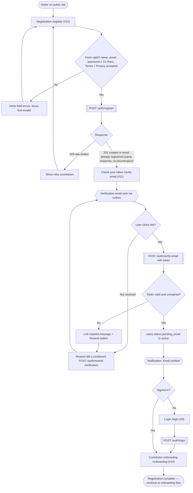

Notes: a session created while `pending_email` may only reach `/verify-email` (resend, logout). Admin accounts are created by script/super_admin, never via `/register`; admin login adds the MFA step (`/login?step=mfa`, `POST /auth/mfa/verify`).

## 2. Contributor onboarding

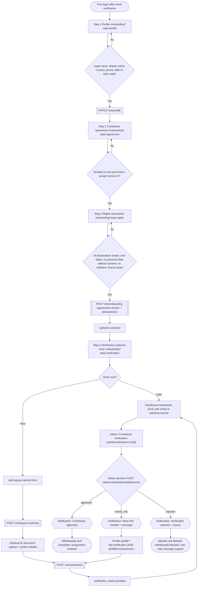

## 3. Dataset upload (including resume after disconnect)

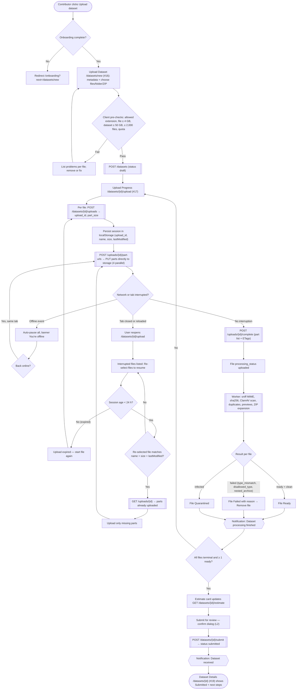

Cancel path: "Cancel" on a file calls `DELETE /uploads/{id}` (session `aborted`); abandoned sessions are expired by `uploads.expire_sessions` after 24 h.

## 4. Quality review (dataset)

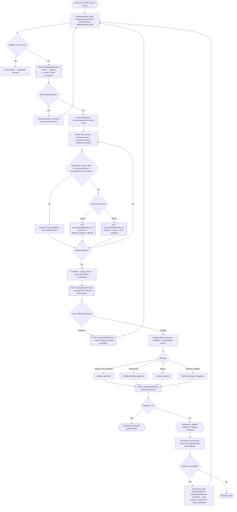

## 5. Earnings approval

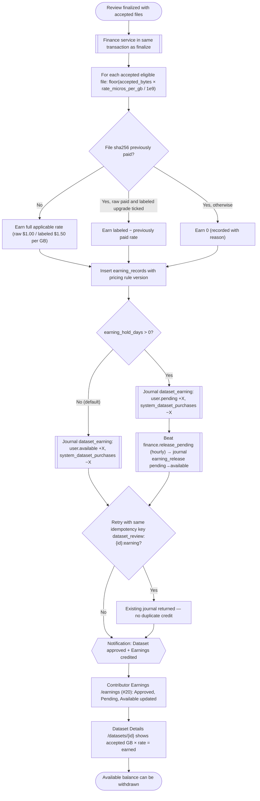

Annotation rewards follow the same pattern with journal `annotation_reward` (see flow 10).

## 6. Withdrawal (contributor request)

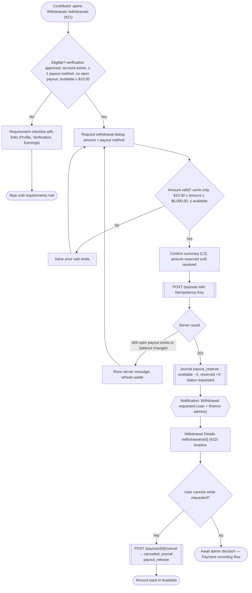

## 7. Payment recording (admin)

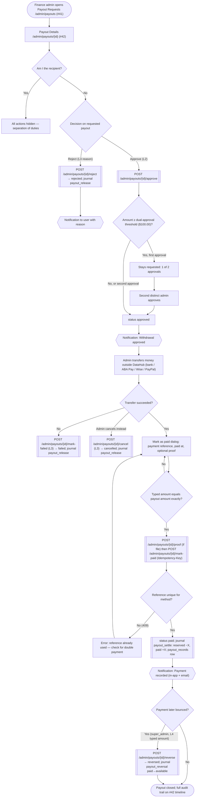

## 8. Annotation assignment (admin)

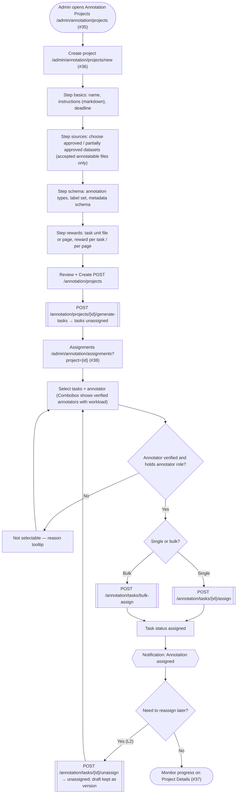

## 9. Annotation completion (annotator)

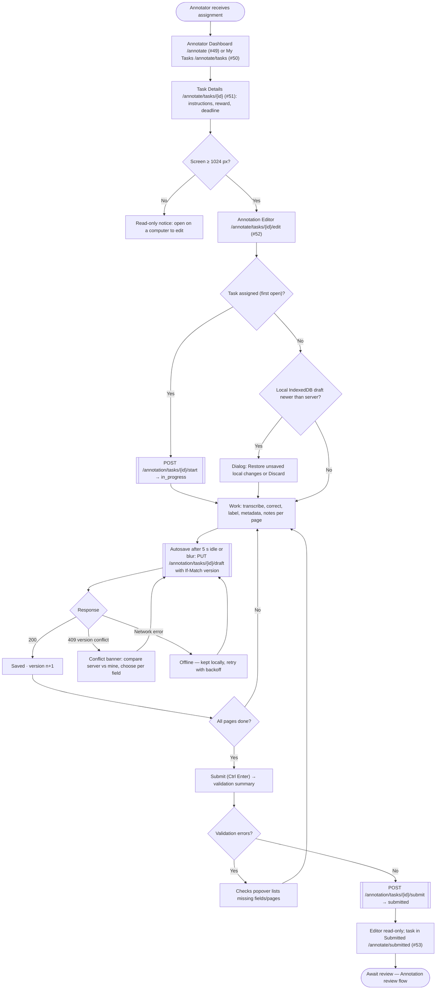

## 10. Annotation review

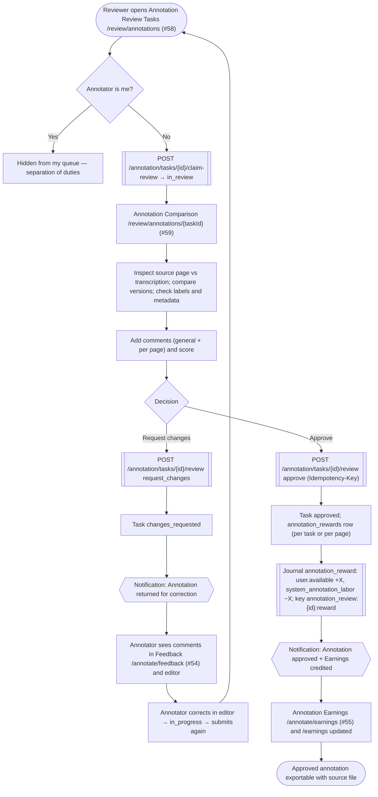

## 11. Dataset export

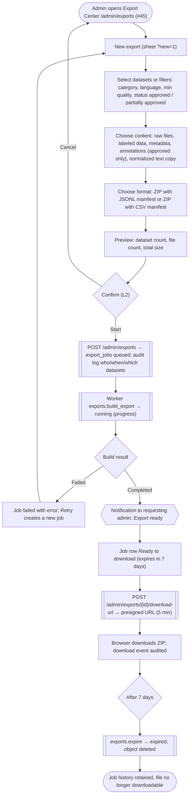

## 12. Support messaging

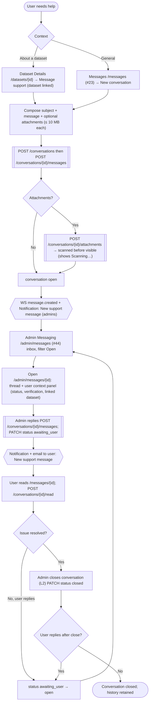
