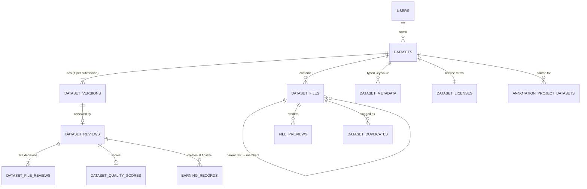
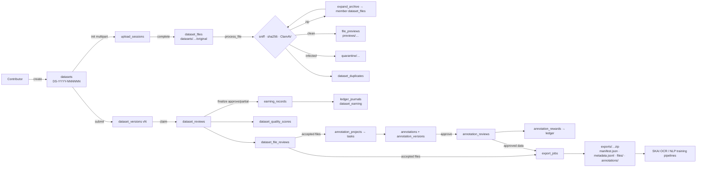

# DataHub — Dataset Documentation

## 0. Document header

| Field | Content |
|---|---|
| **Purpose** | Defines what a DataHub dataset is: its structure, identifiers, metadata schema, category taxonomy, supported file types, versioning, provenance, storage layout, language information, quality status, export package format, and lineage. Backend models, upload/review UI, exports and downstream SKAI AI pipelines (Khmer OCR and NLP) must all use these definitions. |
| **Scope** | Contributor datasets from creation to export, including ZIP-expanded members and the annotation outputs attached at export. Pricing is out of scope (see PRICING_PAYOUT_POLICY.md), and so is the review procedure (see DATA_QUALITY_REVIEW.md). |
| **Assumptions** | A-02 (km and en primary; UTF-8; NFC except annotation transcription), A-03 (≤ 5 GB per file, ≤ 50 GB per dataset), A-10 (fail-closed scanning), A-11 (no LibreOffice; text previews for DOC-family files), A-13 (UTC timestamps), A-15 (retention). |
| **Decisions** | UUID primary keys plus a human code `DS-YYYY-NNNNNN`; one dataset has one `data_class` and one primary category; a new `dataset_versions` row is created on every (re)submission; object keys never contain user-supplied filenames; the export ZIP contains `manifest.json` + `metadata.jsonl` + `files/` + `annotations/`, with an optional `manifest.csv`. |
| **Dependencies** | `docs/ENGINEERING_BASELINE.md` §4, §7, §9, §10, §11, §13; File Upload & Storage Specification (doc 22); Database Schema Documentation (doc 12); ANNOTATION_GUIDELINES.md; DATA_QUALITY_REVIEW.md; DATA_PRIVACY_OWNERSHIP.md; DATA_RETENTION_DELETION.md. |
| **Acceptance criteria** | (1) Every metadata field has a type, a requirement level and a validation rule. (2) The category and language code lists are closed and machine-readable. (3) The export format is specified precisely enough for a consumer to parse it without reading DataHub code. (4) Lineage from upload to export is traceable through IDs. |

**Document control**

| Version | Date | Status | Owner | Change |
|---|---|---|---|---|
| v1.0 | 2026-10-26 | Baseline | Data lead | First baseline |

---

## 1. Dataset structure

A **dataset** is a contributor's submission unit. It contains one or more files that share metadata (title, languages, category, data class, source, licence). A contributor should put material into one dataset when it has a common origin and a single data class (for example, "Phnom Penh Post scans 1995–1999, raw").



| Entity | Role |
|---|---|
| `datasets` | Header: identity, owner, status, current metadata, `data_class`, category, counters (`file_count`, `total_bytes`, `accepted_bytes`, `rejected_bytes`), `current_version_no`. |
| `dataset_versions` | Immutable snapshot taken at each submission: metadata JSON, file manifest (file IDs + sha256 + size), rights declaration, `submitted_at`. |
| `dataset_files` | One row per uploaded file and per extracted ZIP member (`parent_file_id` set). Holds `ordinal`, `original_name` (sanitised display name), `member_path`, `size_bytes`, `sha256`, `detected_mime`, `ext`, `processing_status`, `scan_status`, `page_count`, `storage_key`. |
| `dataset_metadata` | Typed extension fields (`key`, `value_type`, `value_text/num/date/json`) for the optional fields in §3.3. |
| `dataset_licenses` | Licence under which the platform holds the data, plus the licence of the underlying work (§3.4). |
| `file_previews` | Derived page images or extracted text (`kind`, `page`, `storage_key`, `width`, `height`). |
| `dataset_duplicates` | `(file_id, matched_file_id, kind exact|near, score)`. |

## 2. Identifiers

| Object | Primary key | Human code | Format and rules |
|---|---|---|---|
| Dataset | `uuid` (v7-style, app-generated) | `DS-YYYY-NNNNNN` | `YYYY` = UTC year of creation; `NNNNNN` = per-year counter, zero-padded to 6 digits, allocated in the create transaction from `dataset_code_counters(year PK, last_value)` with a row lock. Example `DS-2026-000123`. The code is unique, immutable and never reused (a withdrawn or deleted dataset keeps its code). If a year exceeds 999,999 datasets, the counter grows to 7 digits. |
| Dataset version | `uuid` | `DS-2026-000123/v2` | `version_no` starts at 1 and increments on each resubmission. |
| File | `uuid` | `DS-2026-000123/F00042` | `F` + per-dataset `ordinal` zero-padded to 5 digits (upload order). ZIP members receive ordinals after their container at expansion time. |
| Export | `uuid` | `EX-YYYY-NNNNNN` | Same counter scheme, kind `export`. |
| Annotation project | `uuid` | `AP-YYYY-NNNN` | Same counter scheme, kind `annotation_project`. |

- The API accepts the UUID in paths. Admin search (`GET /admin/datasets?q=`) also matches human codes exactly.
- The content identifier is the lowercase hex **sha256** of the stored bytes. Dedup, pricing (PP-19) and exports use it.

## 3. Metadata schema

### 3.1 Core fields (columns on `datasets`; snapshotted on each version)

| Field | Type | Required | Validation / notes |
|---|---|---|---|
| `title` | text | ✓ | 3–200 characters, NFC, trimmed; Khmer allowed. |
| `description` | text (markdown, rendered sanitised) | ✓ | 20–5,000 characters. Describe content, origin, period and any known defects. |
| `languages` | text[] | ✓ | ≥ 1 code from §6; the first element is the **primary** language. |
| `scripts` | text[] | – | ISO 15924 (`Khmr`, `Latn`, `Hani`, `Thai`, `Laoo`, `Arab`, `Deva`, `Cham`). Inferred from languages if empty (Vietnamese uses `Latn`). |
| `category` | enum | ✓ | One code from §3.2. |
| `tags` | text[] | – | ≤ 20 free tags, each 2–40 characters, lowercase. |
| `data_class` | enum `raw`, `labeled` | ✓ | Declared by the contributor; can be changed by the reviewer at finalize. |
| `label_format` | enum | if `labeled` | `paired_text` (file.txt next to file.jpg), `sidecar_json`, `csv_mapping`, `jsonl`, `other_documented`. |
| `label_description` | text | if `labeled` | ≤ 2,000 characters: what the labels are and how they map to files. |
| `source_type` | enum | ✓ | `own_creation`, `scanned_physical_original`, `photographed`, `born_digital_own`, `public_domain`, `government_publication`, `licensed_from_rights_holder`, `web_collected`, `other`. |
| `source_description` | text | ✓ | 10–2,000 characters: where the material came from (archive, library, office, website). |
| `source_url` | url | – | `https`/`http` only; stored, never fetched by the server. |
| `original_publisher` | text | – | ≤ 200 characters. |
| `original_author` | text | – | ≤ 200 characters. |
| `publication_date_from` / `_to` | date (partial allowed: YYYY, YYYY-MM) | – | Period of the original documents. |
| `collection_date_from` / `_to` | date | ✓ | When the contributor scanned, photographed or collected the material. `from ≤ to ≤ today`. |
| `geographic_origin` | text[] | – | Country ISO 3166-1 alpha-2 (`KH`) plus optional Cambodian province name. |
| `licence_code` | enum | ✓ | §3.4. |
| `contains_personal_data` | enum `no`, `yes`, `unsure` | ✓ | `yes`/`unsure` routes the dataset to privacy review (DATA_PRIVACY_OWNERSHIP.md §6). |
| `personal_data_types` | text[] | if `yes` | `names`, `contact_details`, `id_numbers`, `signatures`, `faces`, `financial`, `health`, `biometric`, `minors`, `other`. |
| `rights_declaration` | object | ✓ (at submit) | `{agreement_version, declaration_version, checkbox_ids[], accepted_at, ip, user_agent_hash}`. Exact texts are in DATA_PRIVACY_OWNERSHIP.md §2. |
| `estimated_page_count` | int | – | Contributor estimate. The system computes the actual count. |

### 3.2 Category taxonomy (closed list, `category` enum)

| Code | Label | Typical content | Primary AI use |
|---|---|---|---|
| `books` | Books | Printed books, novels, textbooks, monographs | OCR, language modelling |
| `newspapers` | Newspapers & magazines | Newspapers, periodicals, bulletins | OCR (multi-column layout), NLP |
| `government_documents` | Government documents | Prakas, sub-decrees, royal gazettes, official letters, public reports | OCR, formal-register NLP |
| `legal_documents` | Legal documents | Laws, contracts (de-identified), court judgements | NLP, OCR |
| `academic` | Academic | Theses, research papers, journals, conference proceedings | NLP, terminology |
| `educational` | Educational material | School textbooks, exam papers, worksheets | OCR, QA datasets |
| `religious_cultural` | Religious & cultural texts | Buddhist texts, palm-leaf manuscript scans, literature, songs | OCR (historic scripts), NLP |
| `forms_receipts` | Forms & receipts | Invoices, receipts, application forms, tickets | Key-value extraction, OCR |
| `business_documents` | Business documents | Reports, letters, menus, brochures, product catalogues | OCR, NLP |
| `handwriting` | Handwriting | Handwritten letters, notes, forms, exercise books | Handwriting recognition (HTR) |
| `signage_photos` | Signage & scene-text photos | Shop signs, street signs, banners, product labels | Scene-text OCR |
| `web_text` | Web text | Articles, blogs, forum text collected with rights | NLP, language modelling |
| `parallel_text` | Parallel / bilingual text | Aligned km–en (or other) sentence pairs, bilingual documents | Machine translation |
| `structured_data` | Structured data | CSV/JSON/XML/XLSX: dictionaries, word lists, gazetteers, tables | Lexicons, NLP resources |
| `other` | Other | Anything else, explained in `description` | Reviewer decides |

Rules: exactly one category per dataset. Mixed material goes under the dominant category, and the description explains the rest. Reviewers correct a wrong category through the review checklist (reason `metadata_mismatch` if the contributor must fix it). Adding a category is a minor change to this document plus a migration of the enum or lookup table.

### 3.3 Extension metadata (`dataset_metadata`, optional, typed)

| Key | Type | Meaning |
|---|---|---|
| `print_or_handwritten` | select `printed`, `handwritten`, `mixed` | Helps route data to OCR or HTR. |
| `scan_dpi` | number | Scanner resolution (≥ 300 recommended). |
| `capture_device` | text | Scanner or phone model. |
| `font_family_notes` | text | E.g. "Khmer OS Battambang", "Limon legacy font in source". |
| `historic_orthography` | select `yes`, `no` | Pre-1970s spelling or unusual characters. |
| `page_layout` | select `single_column`, `multi_column`, `table`, `form`, `mixed` | Layout complexity. |
| `transcription_available` | select `none`, `partial`, `full` | For raw datasets that also contain text. |
| `domain` | text | Subject area (health, agriculture, law…). |

### 3.4 Licence codes

`dataset_licenses` stores two things: (a) the **platform licence** granted by the contributor, always `datahub_contributor_licence_v1` (perpetual, worldwide, non-exclusive; HA-02; DATA_PRIVACY_OWNERSHIP.md §3), and (b) the `licence_code` of the **underlying work**:

| `licence_code` | Meaning |
|---|---|
| `own_work` | The contributor created the content and holds all rights. |
| `rights_holder_permission` | The contributor has written permission from the rights holder (evidence may be requested). |
| `public_domain` | Copyright has expired or never existed (contributor states the basis in `source_description`). |
| `government_open` | Government publication that may be reused (basis stated). |
| `cc0` | Creative Commons Zero. |
| `cc_by_4_0` | CC BY 4.0 (attribution kept in the metadata and exported). |
| `cc_by_sa_4_0` | CC BY-SA 4.0. The reviewer flags `copyright_concern` if the share-alike terms conflict with intended use. ⚖️ legal review of SA terms for model training, HA-02. |
| `other_open` | Another open licence, named in the description. |
| `unknown` | Not allowed at submit: a dataset with `unknown` cannot be submitted. |

### 3.5 JSON Schema (metadata payload, abbreviated to the normative part)

```json
{
  "$schema": "https://json-schema.org/draft/2020-12/schema",
  "$id": "https://datahub.skai.com.kh/schemas/dataset-metadata-v1.json",
  "type": "object",
  "required": ["title", "description", "languages", "category", "data_class", "source_type",
               "source_description", "collection_date_from", "collection_date_to",
               "licence_code", "contains_personal_data"],
  "properties": {
    "title": {"type": "string", "minLength": 3, "maxLength": 200},
    "description": {"type": "string", "minLength": 20, "maxLength": 5000},
    "languages": {"type": "array", "minItems": 1, "maxItems": 10,
                  "items": {"type": "string", "pattern": "^([a-z]{2}|[a-z]{3})$"}},
    "scripts": {"type": "array", "items": {"type": "string", "pattern": "^[A-Z][a-z]{3}$"}},
    "category": {"enum": ["books", "newspapers", "government_documents", "legal_documents",
                          "academic", "educational", "religious_cultural", "forms_receipts",
                          "business_documents", "handwriting", "signage_photos", "web_text",
                          "parallel_text", "structured_data", "other"]},
    "data_class": {"enum": ["raw", "labeled"]},
    "label_format": {"enum": ["paired_text", "sidecar_json", "csv_mapping", "jsonl", "other_documented"]},
    "source_type": {"enum": ["own_creation", "scanned_physical_original", "photographed",
                             "born_digital_own", "public_domain", "government_publication",
                             "licensed_from_rights_holder", "web_collected", "other"]},
    "source_description": {"type": "string", "minLength": 10, "maxLength": 2000},
    "source_url": {"type": "string", "format": "uri"},
    "collection_date_from": {"type": "string", "format": "date"},
    "collection_date_to": {"type": "string", "format": "date"},
    "licence_code": {"enum": ["own_work", "rights_holder_permission", "public_domain",
                              "government_open", "cc0", "cc_by_4_0", "cc_by_sa_4_0", "other_open"]},
    "contains_personal_data": {"enum": ["no", "yes", "unsure"]},
    "personal_data_types": {"type": "array", "items": {"enum": ["names", "contact_details",
        "id_numbers", "signatures", "faces", "financial", "health", "biometric", "minors", "other"]}}
  },
  "allOf": [
    {"if": {"properties": {"data_class": {"const": "labeled"}}},
     "then": {"required": ["label_format", "label_description"]}},
    {"if": {"properties": {"contains_personal_data": {"const": "yes"}}},
     "then": {"required": ["personal_data_types"]}}
  ]
}
```

Pydantic models in `datahub.modules.datasets.schemas` are the executable form. This JSON Schema is published at `GET /public/formats` for external tooling.

## 4. Supported document types

Source: baseline §7. "Annotatable" means the file can be a source for annotation tasks. "Payable" follows PRICING_PAYOUT_POLICY.md §3.

| Ext | Detected MIME | Allowed | Preview | Annotatable | Payable | Typical categories |
|---|---|:-:|---|:-:|:-:|---|
| pdf | application/pdf | ✓ | page images (≤ 500 pages) | ✓ page | ✓ | books, government, newspapers |
| docx | …wordprocessingml.document | ✓ | extracted text | ✓ text | ✓ | academic, business |
| doc | application/msword | ✓ | none (download) | ✗ | ✓ | legacy office documents |
| odt | application/vnd.oasis.opendocument.text | ✓ | extracted text | ✓ text | ✓ | academic |
| rtf | text/rtf | ✓ | extracted text | ✓ text | ✓ | business |
| txt | text/plain | ✓ | first 1 MB | ✓ text | ✓ | web_text, parallel_text, labels |
| jpg/jpeg, png, bmp | image/* | ✓ | WebP ≤ 4096 px | ✓ page | ✓ | handwriting, signage, forms |
| tiff/tif | image/tiff | ✓ | page images | ✓ page | ✓ | archival scans |
| csv | text/csv | ✓ | 200 rows | ✗ | ✓ | structured_data, labels |
| json/jsonl | application/json | ✓ | first 1 MB | ✗ | ✓ | labels, structured_data |
| xml | text/xml | ✓ | text | ✗ | ✓ | structured_data |
| xlsx | …spreadsheetml.sheet | ✓ | first sheet, 200 rows | ✗ | ✓ | structured_data |
| zip | application/zip | ✓ container | member list | ✗ | container ✗, members ✓ | any |
| other | — | only if in `extra_allowed_extensions` | none | ✗ | reviewer decides | — |

Never accepted: executables, scripts, HTML/SVG, macro-enabled Office files (`docm`, `xlsm`), and nested archives deeper than ZIP-in-ZIP depth 1 (`disallowed_type` / `nested_archive`). Uploaded files are **never executed** (Part 3).

Text encodings: TXT/CSV/JSON/XML must be UTF-8 (with or without BOM) or UTF-16 with a BOM. Other encodings are previewed with replacement characters, and the reviewer may reject with `wrong_format`. Text in **legacy Khmer font encodings** (Limon, ABC) is technically valid ASCII but is not Khmer Unicode. Contributors must label it with `font_family_notes`, and it is priced as raw only if the reviewer judges it useful (ANNOTATION_GUIDELINES.md §4.6).

## 5. Dataset versioning

- A dataset is mutable only in `draft` and `changes_requested` (add or remove files, edit metadata).
- **Each submission** (`POST /datasets/{id}/submit`) creates an immutable `dataset_versions` row with `version_no = previous + 1`, a metadata snapshot, a file manifest (`[{file_id, ordinal, sha256, size_bytes, processing_status, scan_status}]`), the rights declaration, and `submitted_at`. Reviews attach to a version (`dataset_reviews.dataset_version_id`).
- **Resubmission after `changes_requested`.** Unchanged files keep their `dataset_files` rows (same UUID and storage object, no re-upload). Removed files are soft-deleted (`deleted_at`) and purged under the retention policy. New files are processed normally. The new review starts with no file decisions, and the previous review's decisions are shown as read-only hints.
- **After finalization** (`approved`, `partially_approved`, `rejected`) the dataset is terminal. More material from the same source goes into a **new dataset**, which may reference the earlier one through the metadata key `related_dataset_codes` (text[]). Earnings for repeated content follow the duplicate rules.
- A `taken_down` dataset keeps all its versions for audit. Its file objects are handled by DATA_RETENTION_DELETION.md §5.

## 6. Language information

- Codes are ISO 639: **ISO 639-1** (two letters) where one exists, otherwise **ISO 639-3**. Special codes: `mul` (multiple, when more than 10 languages), `und` (undetermined), `zxx` (no linguistic content, e.g. numeric tables).
- Seed list for the selector (others can be typed if they validate against the ISO 639-3 table bundled with the API):

| Code | Language | Script(s) |
|---|---|---|
| `km` | Khmer | Khmr |
| `en` | English | Latn |
| `fr` | French | Latn |
| `zh` | Chinese | Hani |
| `th` | Thai | Thai |
| `vi` | Vietnamese | Latn |
| `lo` | Lao | Laoo |
| `pi` | Pali | Khmr (in Khmer-script Buddhist texts), Latn |
| `sa` | Sanskrit | Khmr, Deva |
| `cja` | Western Cham | Cham, Arab, Latn |
| `cmo` | Central Mnong (Bunong) | Latn, Khmr |
| `krr` | Kru'ng (Krung) | Latn, Khmr |

- Order matters: `languages[0]` is the primary language (more than 50 % of the text) and drives task routing to annotators with the matching skill.
- Datasets that include `km` show a Khmer-specific checklist in review: Unicode vs legacy encoding, script legibility, diacritic clarity.

## 7. Provenance

Provenance answers four questions: who supplied the data, where it came from, under what rights, and what DataHub did to it.

| Layer | Recorded in |
|---|---|
| Contributor identity | `datasets.owner_id`, the verification state at submit, and the `agreement_acceptances` row (agreement version). |
| Declared source | `source_type`, `source_description`, `source_url`, publisher/author, publication and collection dates, `licence_code`. |
| Rights declaration | `dataset_versions.rights_declaration` (exact checkbox IDs and versions). |
| Upload facts | `upload_sessions` (started/completed, client IP hash), `dataset_files.sha256`, `size_bytes`, `detected_mime`, original filename (sanitised), `member_path` for ZIP members, `parent_file_id`. |
| Processing facts | `processing_status`, `scan_status` + ClamAV signature version, preview generation, duplicate matches. |
| Review facts | Reviewer ID, file decisions with reason codes, quality scores, `data_class` at finalize, `finalized_at`. |
| Commercial facts | `earning_records` (rate snapshot) and the journal ID. |
| Downstream use | `annotation_project_datasets`, `export_files` manifests (which export included which file). |

Provenance is exported with every file (`metadata.jsonl`, §9.3). DataHub never removes provenance fields from exports, even when an export is "content only".

## 8. Storage layout

All objects live in the private bucket `datahub-private` (baseline §3). Keys are generated by the server from UUIDs only. User filenames never appear in keys, which prevents path injection and personal data in keys.

| Prefix / key pattern | Content | Written by | Lifecycle |
|---|---|---|---|
| `datasets/{dataset_id}/files/{file_id}/original` | Uploaded file bytes (multipart target) | API (presigned multipart PUT) | Kept per DATA_RETENTION_DELETION.md |
| `datasets/{dataset_id}/files/{member_file_id}/original` | Extracted ZIP member (its own file row, `parent_file_id` set) | worker `expand_archive` | as above |
| `previews/{file_id}/page-{NNNNN}.webp` | Rendered page image (1-based page, 5 digits) | worker | Deleted with the file |
| `previews/{file_id}/thumb.webp` | Thumbnail | worker | Deleted with the file |
| `previews/{file_id}/text.txt` | Extracted text (DOCX/ODT/RTF/TXT) | worker | Deleted with the file |
| `quarantine/{file_id}/original` | Infected file moved out of `datasets/` | worker | 30 days, then purged |
| `exports/{export_job_id}/{export_file_id}.zip` | Export package | worker `build_export` | 7 days (A-15) |
| `finance/payout-proofs/{payout_id}/{uuid}` | Payment proof | API | 7 years |
| `identity/verifications/{verification_id}/{uuid}` | ID documents | API | See retention policy |
| `messages/{conversation_id}/{attachment_id}` | Message attachments | API | See retention policy |

- Server-side encryption is enabled (SSE-S3 or the provider default). Bucket versioning is on where the provider supports it (backups and deletion: DATA_RETENTION_DELETION.md §8).
- Access is only through presigned URLs valid for 5 minutes (GET) or 15 minutes (PUT parts), issued after a permission check. Downloads are served with `Content-Disposition: attachment` and a sanitised filename.
- The database stores `storage_key` and `storage_version_id` (when versioning is on) for every object.

## 9. Export formats

Exports are admin-only (`dataset.export`), run as background jobs (`exports.build_export`), expire after 7 days, and are logged: who, when, filters, and the dataset and file list. Only **accepted, eligible** files from `approved` / `partially_approved` datasets that are not `taken_down` are exported. Annotation content comes only from **approved** annotations.

### 9.1 Options (`POST /admin/exports`)

`dataset_ids[]` or filters (`category[]`, `languages[]`, `data_class`, `min_quality_overall`, `finalized_from/to`); `include_files` (bool, default true); `include_metadata` (always true); `include_annotations` (bool); `text_normalization` (`verbatim_and_nfc` default, or `verbatim_only`); `include_csv_manifest` (bool); `exclude_personal_data` (bool, default **true**, which excludes datasets with `contains_personal_data = yes` unless redacted annotations exist).

### 9.2 Package layout

```
EX-2026-000045.zip
├── manifest.json
├── metadata.jsonl
├── manifest.csv                       (optional)
├── LICENCE_NOTICE.txt                 (platform licence summary + per-dataset licence codes/attributions)
├── files/
│   └── DS-2026-000123/
│       ├── F00001__ledger_1960.pdf
│       └── F00006__forms_receipt_001.png
└── annotations/
    └── DS-2026-000123/
        ├── F00001.json
        └── F00006.json
```

Export filenames are `{file_code}__{sanitised original name}`. Sanitising keeps NFC, replaces `/ \ : * ? " < > |` and control characters with `_`, and truncates to 120 bytes while preserving the extension.

### 9.3 `manifest.json`

```json
{
  "format": "datahub-export",
  "format_version": "1.0",
  "export_id": "0192f3a4-7c1e-7d2a-9b44-1e2f3a4b5c6d",
  "export_code": "EX-2026-000045",
  "created_at": "2026-10-26T08:15:00Z",
  "created_by": "0192f1aa-0000-7000-8000-000000000001",
  "filters": {"category": ["government_documents"], "languages": ["km"], "data_class": "raw",
              "min_quality_overall": 3.5},
  "options": {"include_annotations": true, "text_normalization": "verbatim_and_nfc",
              "exclude_personal_data": true},
  "datasets": [
    {"dataset_id": "0192e0b1-1111-7aaa-8bbb-123456789abc", "code": "DS-2026-000123",
     "version_no": 2, "title": "Royal Gazette 1993–1995", "data_class": "raw",
     "category": "government_documents", "languages": ["km", "fr"],
     "licence_code": "government_open", "quality_overall": 4.15, "file_count": 2}
  ],
  "totals": {"datasets": 1, "files": 2, "bytes": 2600000000, "annotations": 2},
  "checksums": {"algorithm": "sha256", "metadata.jsonl": "f3485775238d36bbc09f686407a3d1ff7dbff6e5d7a52a6411cbb56061879fc0"}
}
```

### 9.4 `metadata.jsonl` (one JSON object per exported file)

```json
{"file_id":"0192e0b2-2222-7aaa-8bbb-000000000001","file_code":"DS-2026-000123/F00001","dataset_code":"DS-2026-000123","path":"files/DS-2026-000123/F00001__ledger_1960.pdf","original_name":"ledger_1960.pdf","member_path":null,"parent_file_code":null,"sha256":"af7f7574432a145f8493e3ad8df2c259d580b603cbd20a86e4d9043231599b74","size_bytes":2000000000,"mime":"application/pdf","page_count":412,"languages":["km"],"category":"government_documents","data_class":"raw","source_type":"scanned_physical_original","source_description":"National Archives reading room copy","licence_code":"government_open","contains_personal_data":"no","collection_date_from":"2026-05-01","collection_date_to":"2026-06-30","review":{"decision":"accepted","finalized_at":"2026-10-20T03:10:00Z","quality_overall":4.15},"annotation_path":"annotations/DS-2026-000123/F00001.json"}
```

### 9.5 `annotations/{dataset_code}/{file_code_suffix}.json`

An annotation file contains the baseline §11 `data` object for each approved annotation of that file, plus provenance and an NFC-normalised copy of the text fields:

```json
{
  "file_code": "DS-2026-000123/F00006",
  "annotations": [
    {
      "annotation_id": "0192f0c3-3333-7aaa-8bbb-000000000010",
      "project_code": "AP-2026-0007",
      "task_unit": "file",
      "annotation_types": ["transcription", "classification", "metadata"],
      "version": 7,
      "approved_at": "2026-10-24T09:00:00Z",
      "annotator_ref": "ann-7f3c",
      "reviewer_ref": "rev-19a2",
      "data": {
        "pages": [{"page": 1, "transcription": "បង្កាន់ដៃ\nតម្លៃ ១២.០០០ រៀល", "page_label": "receipt", "regions": []}],
        "classification": ["forms_receipts.receipt"],
        "metadata": {"date": "2026-03-14", "currency": "KHR"},
        "notes": ""
      },
      "normalized": {"pages": [{"page": 1, "transcription": "បង្កាន់ដៃ\nតម្លៃ ១២.០០០ រៀល"}]}
    }
  ]
}
```

`annotator_ref` and `reviewer_ref` are stable pseudonyms (`HMAC(user_id, export_pepper)`, first 4 hex characters plus prefix). Exports never include names or email addresses.

### 9.6 Optional `manifest.csv`

UTF-8 with BOM (so that Excel shows Khmer correctly), RFC 4180 quoting, one row per file, columns:
`file_code,dataset_code,path,sha256,size_bytes,mime,page_count,languages,category,data_class,licence_code,quality_overall,annotation_path`. `languages` is `;`-separated.

## 10. Quality status

| Level | Field | Values |
|---|---|---|
| File (system) | `processing_status` / `scan_status` | baseline §9 |
| File (review) | `dataset_file_reviews.decision`, `reason_code` | `accepted` / `rejected` + codes (DATA_QUALITY_REVIEW.md §8) |
| File (duplicates) | `dataset_duplicates.kind` | `exact`, `near` |
| Dataset (review) | `datasets.status` | `approved`, `partially_approved`, `rejected`, `changes_requested`, … |
| Dataset (score) | `dataset_quality_scores` | 5 dimensions (1–5), `overall` 1.00–5.00 |
| Dataset (tier, derived) | `quality_tier` | `A` overall ≥ 4.00; `B` 3.00–3.99; `C` below 3.00 (C can only occur on partial approvals with a justification) |
| Dataset (counters) | `accepted_bytes`, `rejected_bytes`, `accepted_file_count` | Set at finalize |
| Annotation | task status + review score | ANNOTATION_GUIDELINES.md §12 |

## 11. Data lineage



Every arrow writes `audit_logs` or carries the upstream ID (`dataset_id`, `file_id`, `review_id`, `task_id`, `export_job_id`). This lets any training sample be traced back to its upload, rights declaration and reviewer.
