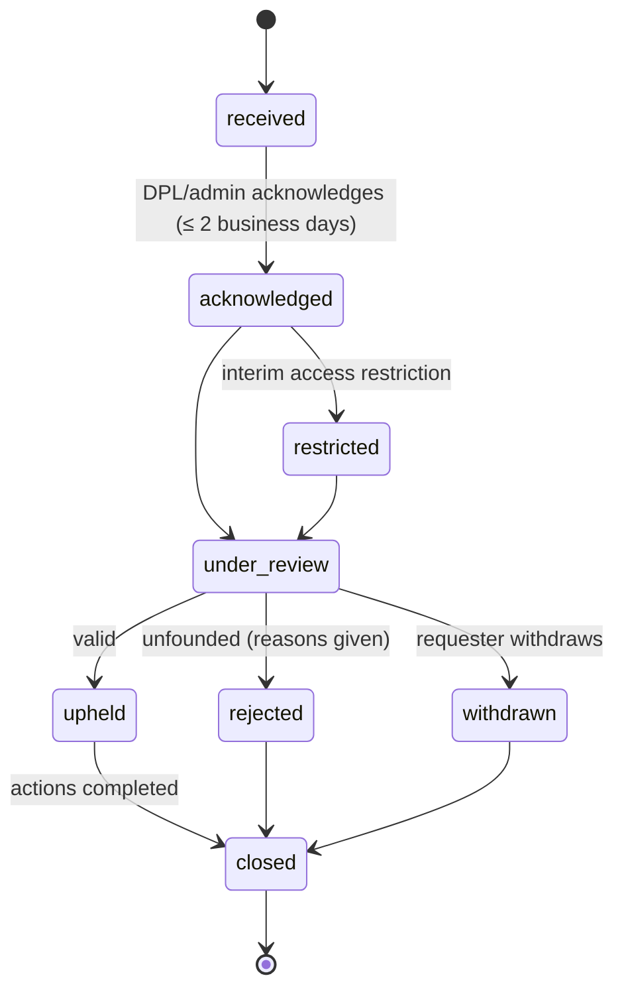

# DataHub — Data Privacy, Ownership & Licensing Policy

## 0. Document header

| Field | Content |
|---|---|
| **Purpose** | Sets the operational policy for the rights contributors grant, how SKAI Technology may use contributed data, how personal, confidential and sensitive data is handled, who can access what, and how disputes and takedowns are processed. These are **draft operational policies, not legal advice**. Clauses that need qualified legal review before production are marked ⚖️ **LEGAL REVIEW REQUIRED (HA-xx)**. |
| **Scope** | Contributor datasets, annotation outputs, contributor and annotator account data relevant to datasets, access control, takedowns and disputes. Account-data privacy notices for website visitors are in the Privacy Policy (HA-01). Retention periods are in DATA_RETENTION_DELETION.md. |
| **Assumptions** | A-01 (SKAI Technology is the single operator and data user; no external buyers in v1), A-02, A-08 (verification: legal name, country, 18+), A-09 (onboarding: agreement + rights declaration before upload), A-10, A-15. |
| **Decisions** | Contributors keep ownership and grant a **perpetual, worldwide, non-exclusive licence** on acceptance and payment (HA-02); this is **not an assignment**, and purchase does not transfer all IP. Rights declarations are captured per dataset as versioned checkbox IDs. Personal data is declared, routed to privacy-trained reviewers, minimised, and excluded from exports by default. Takedowns go through `takedown_requests` with fixed service levels. |
| **Dependencies** | `docs/ENGINEERING_BASELINE.md` §1, §2 (HA-01–HA-04), §6, §9, §10; DATASET_DOCUMENTATION.md §3, §7, §8; DATA_QUALITY_REVIEW.md §8; ANNOTATION_GUIDELINES.md §1, §7.3; PRICING_PAYOUT_POLICY.md §13; DATA_RETENTION_DELETION.md; Security Requirements Document (doc 30). |
| **Acceptance criteria** | (1) The exact declaration texts and IDs are defined. (2) Licence scope lists permitted and prohibited uses. (3) Every clause that depends on law is marked with an HA reference. (4) The takedown workflow has states, actors and service levels that can be implemented. (5) No clause implies that purchase transfers ownership of all IP. |

**Document control**

| Version | Date | Status | Owner | Change |
|---|---|---|---|---|
| v1.0 | 2026-10-26 | Baseline (pending legal review) | Product owner + Data Protection Lead | First baseline |

Rule identifiers: `PO-nn`. "Data Protection Lead" (DPL) means the SKAI staff member the owner designates to handle privacy and takedowns. The DPL holds the `admin` role, and `super_admin` for financial consequences.

---

## 1. Principles

1. **Rights before value.** Uploading a document does not make it lawful to buy. DataHub buys a licence only where the contributor credibly holds the rights (Part 16).
2. **Ownership stays with the owner.** Contributors keep their copyright and other rights. SKAI receives a licence (§3).
3. **Least data, least access.** Personal data is collected only where it serves the declared AI purpose, and access is limited by role, assignment and claim.
4. **Traceability.** Every dataset carries provenance and declarations that link to a contributor identity and an agreement version (DATASET_DOCUMENTATION.md §7).
5. **Responsiveness.** Rights holders and data subjects have a clear route to complain, with defined response times (§12).

## 2. Contributor rights declarations

### 2.1 Onboarding (once per agreement version; `POST /me/onboarding`)
Stored in `agreement_acceptances` (user, document, version, accepted_at, IP, user-agent hash). All boxes are required.

| ID | Exact checkbox text (en) |
|---|---|
| `OB-1` | I have read and agree to the DataHub Contributor Agreement (version 1.0), the Terms of Service and the Privacy Policy. |
| `OB-2` | I am at least 18 years old. |
| `OB-3` | I understand that I will only be paid for files that SKAI Technology accepts, and that the licence described in the Contributor Agreement applies to files that are accepted and paid for. |

### 2.2 Per-dataset rights declaration (at every submit or resubmit)
Shown on the submit dialog. **All six boxes must be ticked.** The IDs, declaration version (`RD-v1.0`), timestamp, IP and user-agent hash are stored in `dataset_versions.rights_declaration` (DATASET_DOCUMENTATION.md §3.1).

| ID | Exact checkbox text (en) |
|---|---|
| `RD-1` | I created these files, or I own them, or I have written permission from the rights holder, and I have the right to grant SKAI Technology the licence described in the Contributor Agreement. |
| `RD-2` | I obtained these files lawfully. They are not stolen, leaked or hacked, and sharing them does not break any contract, workplace rule or duty of confidentiality. |
| `RD-3` | I have answered the personal-data question for this dataset truthfully. If the files contain information about identifiable people, I have a lawful right to share it (for example, their consent), and I have described the kind of information involved. |
| `RD-4` | The files do not contain classified government material, trade secrets, or documents marked confidential, unless I am authorised to share them for this purpose. |
| `RD-5` | I have not knowingly included malware, and I have not padded, duplicated or altered any file to increase payment. |
| `RD-6` | I understand that SKAI Technology may reject or remove any file, that only accepted, unique and eligible files are paid, and that false declarations may lead to removal of the data, recovery of payments and suspension of my account. |

- **PO-01** If the declaration text changes, its version is incremented (`RD-v1.1` …). Datasets already submitted keep the version they accepted.
- **PO-02** A Khmer translation of §2.1–§2.2 is shown alongside the English text once it has been approved. The English text prevails until the legal review decides otherwise.

> ⚖️ **LEGAL REVIEW REQUIRED (HA-01)** — Confirm the declaration wording, its enforceability under Cambodian contract law, the effect of click-through acceptance, which language prevails, and whether specific evidence (e.g. a permission letter) must be collected for `rights_holder_permission` datasets above a size or value threshold.

## 3. Dataset licensing

### 3.1 Licence granted by the contributor (`datahub_contributor_licence_v1`)
- **PO-03** For each file that is **accepted and paid** (earning > 0, or accepted as part of a labeled upgrade), the contributor grants SKAI Technology a **perpetual, worldwide, non-exclusive, royalty-free (beyond the price paid), irrevocable licence**. The licence covers using, reproducing, storing, adapting, translating, annotating and transcribing the content, and creating derivative works from it, for the permitted uses in §4. It may be sublicensed to SKAI's affiliates, successors, and contractors acting on SKAI's behalf.
- **PO-04 Not an assignment.** The contributor keeps ownership of copyright and other rights, and may continue to use, publish or license the same content to anyone else. Payment buys a **licence**, never the underlying intellectual property. Nothing in DataHub's UI, emails or documents may say "you sell your data/rights to SKAI" or "SKAI owns your files".
- **PO-05 Before acceptance.** From upload until finalize (and for rejected files until they are purged), the contributor grants a **limited licence** to store, scan, preview, review and evaluate the files only to decide on acceptance. Rejected files are never used for training or annotation and are deleted per DATA_RETENTION_DELETION.md.
- **PO-06 Underlying licences.** If the content is under a third-party licence (`cc_by_4_0`, `cc_by_sa_4_0`, `government_open`, `other_open`), SKAI also respects that licence's conditions: attribution metadata is preserved and exported in `LICENCE_NOTICE.txt` (DATASET_DOCUMENTATION.md §9.2).

> ⚖️ **LEGAL REVIEW REQUIRED (HA-02)** — Confirm the licence model (non-exclusive perpetual licence versus assignment or exclusive licence); irrevocability once paid; sublicensing scope; whether trained models and their outputs are free of licence conditions; compatibility of CC BY-SA and other share-alike licences with model training and commercial use; and treatment of moral rights under the Cambodian Law on Copyright and Related Rights (2003).

### 3.2 Annotation outputs (annotators)
- **PO-07** Transcriptions, corrections, labels and metadata produced by annotators in paid annotation projects are made for SKAI. The draft Annotator Terms provide that copyright in these outputs is **assigned to SKAI Technology** on approval and payment of the task reward. The source documents remain under the contributor's licence (§3.1).

> ⚖️ **LEGAL REVIEW REQUIRED (HA-01, HA-02)** — Confirm the assignment of annotation outputs (or an exclusive licence as the alternative) and the classification of annotators (independent contractors, not employees).

### 3.3 Labeled data supplied by contributors
Labels supplied in a `labeled` dataset are covered by the same non-exclusive licence (§3.1). They are **not** assigned to SKAI.

## 4. Allowed uses

| Allowed (v1) | Not allowed (v1) without new terms |
|---|---|
| Training, fine-tuning, evaluating and testing SKAI's OCR, handwriting recognition, NLP, translation and related AI models | Selling, publishing or redistributing the files themselves (in original or near-original form) to third parties |
| Creating derived datasets (transcriptions, normalised text, labels) for SKAI's own model work | Public release of contributed files or full-text derivatives |
| Commercial use of the resulting models and their outputs in SKAI products and services | Using personal data in files to identify, contact, profile, monitor or make decisions about the people concerned |
| Internal quality analysis and statistics; publishing aggregate statistics with no file content | Marketing to people who appear in documents |
| Sharing with contracted processors (cloud hosting, storage) under confidentiality and data-processing terms | Uses unrelated to AI development (e.g. records research about individuals) |
| Short, non-identifying excerpts in research papers or technical reports about SKAI's models | Any use after a takedown is upheld (§12.5) |

- **PO-08** External buyers (v2, A-01) need new contributor licence terms and a fresh opt-in before any dataset is made available to them.

> ⚖️ **LEGAL REVIEW REQUIRED (HA-02)** — Confirm the scope of "excerpts in publications", whether model outputs may reproduce memorised content, and whether redistribution of derived text corpora needs separate consent.

## 5. Copyright considerations

- Typical risk sources: commercial books and e-books, newspapers less than 50 years old, academic publisher PDFs, stock photos, scanned textbooks, and website text collected without permission.
- **PO-09** Reviewers apply AC-4 (DATA_QUALITY_REVIEW.md §3). Indicators of a rights problem include a publisher watermark, "© All rights reserved" with no permission evidence, DRM-stripped e-book signatures, and a mismatch between the declared `own_work` and an obviously published work. When any appear, the reviewer rejects with `copyright_concern` (comment required) or requests evidence through `request_changes`.
- **PO-10** `public_domain` claims must state the basis in `source_description` (for example "author died 1950", "pre-1940 government gazette"). Government documents are not automatically public domain. The contributor must state the reuse basis (`government_open`).
- **PO-11** Web-collected text (`web_collected`) is accepted only where the site's terms or licence permit reuse (named in the description) or the contributor is the site owner.

> ⚖️ **LEGAL REVIEW REQUIRED (HA-02)** — Confirm the copyright term and public-domain rules in Cambodia (and in the countries where works were first published), the status of official texts, any text-and-data-mining exceptions relevant to Cambodia, and which evidence standards reviewers must apply.

## 6. Personal-data protection

### 6.1 Definitions and declaration
- Personal data is any information about an identified or identifiable living person: names with context, ID or passport numbers, phone numbers, addresses, faces, signatures, account numbers, and so on. **Special categories** (higher risk): health, biometric data, data about children under 18, national ID images, financial account details, religious or political affiliation linked to a person, and criminal records.
- Contributors set `contains_personal_data` (`no` / `yes` / `unsure`) and `personal_data_types` (DATASET_DOCUMENTATION.md §3.1).

### 6.2 Handling rules
- **PO-12 Routing.** Datasets marked `yes` or `unsure` can only be claimed by `privacy_trained` reviewers (DATA_QUALITY_REVIEW.md §9.1).
- **PO-13 Acceptance.** Files with personal data are accepted only when **all** of these hold:
  1. the personal data is incidental to the document's language or layout value, or is needed for it (e.g. realistic forms);
  2. the contributor declared it (RD-3);
  3. no special category is present, **unless** the DPL has approved a specific project need in writing (recorded in the review internal notes);
  4. the dataset is marked for redaction during annotation (ANNOTATION_GUIDELINES.md §7.3) where the project uses its text.
  Otherwise the file is rejected with `personal_data` (comment required).
- **PO-14 Undeclared personal data** found in review leads to rejection of the affected files (or `request_changes` with the instruction to declare or remove them) and is recorded internally. Repeated undeclared special-category data leads to account suspension.
- **PO-15 Minimisation in use.**
  - Exports exclude `contains_personal_data = yes` datasets by default (DATASET_DOCUMENTATION.md §9.1).
  - Annotation projects using such datasets enable redaction.
  - Annotators work on such tasks only after accepting the confidentiality undertaking (§11.3).
- **PO-16 Data subjects' requests.** A person who appears in a document can ask for removal through the takedown route (§12, basis `personal_data`). Requests about one's own DataHub account (access, correction, deletion) follow DATA_RETENTION_DELETION.md §7.

> ⚖️ **LEGAL REVIEW REQUIRED (HA-03)** — Cambodia's Law on Personal Data Protection was in draft at the time of this baseline. Counsel must confirm its status and obligations at launch (lawful bases, consent form, special categories, cross-border transfer, breach notification, data-subject rights, registration). Counsel must also confirm related existing provisions (for example, personal-data provisions in the 2019 Law on E-Commerce) and whether GDPR applies to contributors or data subjects in the EU (Art. 3(2) targeting), including transfer mechanisms and the role allocation (controller or processor) for personal data inside contributed documents.

## 7. Confidential data and sensitive documents

| Document type | Default policy |
|---|---|
| Classified or "secret" government documents; internal government drafts not published | **Prohibited**. Reject with `copyright_concern` or `other`; DPL notified; possible account suspension. |
| Company-internal documents marked confidential, trade secrets, client files | **Prohibited** unless the contributor is the company or has its written authorisation (evidence required). |
| National ID cards, passports, driving licences, birth or family books | **Prohibited by default.** Accepted only for a DPL-approved, documented ID-OCR project with consent evidence or synthetic specimens. |
| Medical records, prescriptions, lab results | **Prohibited by default.** Only fully de-identified material, DPL-approved. |
| Bank statements, payslips, tax returns, loan documents | **Prohibited by default.** Receipts and invoices from businesses are allowed (merchant data is not personal data; personal names and phones are redacted in annotation). |
| Documents about children (school reports, exam scripts with names) | Accepted only if names and IDs are removed or redacted, or with guardian consent evidence, and DPL approval. |
| Court and legal case files naming private persons | Published judgements are allowed. Unpublished case files are prohibited. |

- **PO-17** If annotators or reviewers find sensitive material that is not covered by an approval, they stop and use **Report problem** (ANNOTATION_GUIDELINES.md §7.3) or reject the file. The DPL decides within 2 business days whether to take it down (§12).

> ⚖️ **LEGAL REVIEW REQUIRED (HA-03)** — Confirm the prohibited and conditional categories and the consent evidence needed for any ID, health, financial or minor-related project.

## 8. Data access controls

| Actor | Can access | Mechanism |
|---|---|---|
| Contributor | Own datasets, files, versions, reviews (pseudonymised reviewer), earnings | `dataset.read.own`; owner check in service |
| Annotator | Only pages or files of **assigned** tasks while the assignment is active; no download button | `annotation.work` + `assignment.annotator_id == actor.id` |
| Reviewer | Queue metadata; file content only for **claimed** reviews; read-only for reviews they finalized; annotation tasks they review | `dataset.review` / `annotation.review` + claim check |
| Admin | All datasets (admin views), exports, takedowns; MFA required | `dataset.read.any`, `dataset.export`; `mfa_verified_at` |
| Super admin | As admin + audit logs, settings, roles, finance adjustments | MFA required |
| Processors (hosting, storage, email) | Encrypted storage and transport only, under contract | Contract + infrastructure controls |

- **PO-18** All objects are private. Access is only through presigned URLs valid for 5 minutes, issued after the permission check. There are no public or permanent links, including for exports (Part 14).
- **PO-19** Every file preview, download and export is logged with actor, file and time. Admins review the access-anomaly report weekly (e.g. more than 500 file opens per day by one reviewer).
- **PO-20** Annotator and reviewer UIs disable download and context-menu saving for source pages. This is a deterrent, not a guarantee, so the binding control is the confidentiality undertaking (§11.3).

## 9. Consent and lawful processing

| Data | Purpose | Proposed basis (draft) |
|---|---|---|
| Account and verification data of contributors/annotators | Operating accounts, paying, fraud prevention | Contract; legal obligation (accounting, tax); legitimate interest (fraud) |
| Contributed documents without personal data | AI development | Contributor licence (contract) |
| Personal data inside contributed documents | AI development (incidental) | Contributor's warranty of lawful basis (RD-3) + SKAI legitimate interest with minimisation and redaction; consent where required for special categories |
| Communications, audit logs, security events | Support, security, accountability | Legitimate interest; legal obligation |

- **PO-21** Consent records: agreement and declaration acceptances are stored with version, timestamp and IP (§2). Where a project needs consent evidence from data subjects, the evidence files are uploaded as a separate restricted dataset attachment and are never exported.

> ⚖️ **LEGAL REVIEW REQUIRED (HA-03)** — Confirm the lawful bases in the table under Cambodian law and GDPR (where applicable), and whether reliance on the contributor's warranty is sufficient for third-party personal data.

## 10. Provenance requirements

- **PO-22** Every dataset must carry: `source_type`, `source_description`, `licence_code` (not `unknown`), collection dates, and the rights declaration (§2.2). Datasets without these cannot be submitted.
- **PO-23** For `licensed_from_rights_holder` / `rights_holder_permission`, the reviewer may request the permission document (uploaded through messaging as a private attachment). Requesting it is mandatory when the dataset is above 5 GB or the rights holder is a publisher or institution.
- **PO-24** Provenance travels with the data into exports (`metadata.jsonl`) and is never stripped (DATASET_DOCUMENTATION.md §7).

## 11. Security obligations

### 11.1 Platform (SKAI)
- TLS 1.2+ for all traffic; encryption at rest for database and object storage; private bucket; malware scanning, fail-closed; MFA for admins; audit logging; least-privilege roles; nightly ledger reconciliation; backups per the Backup & DR Plan.
- **Incident response:** suspected breaches involving dataset content or personal data are escalated to the DPL within 24 hours of detection. Notification of affected contributors and authorities follows the law confirmed under HA-03 (the draft target is notification without undue delay, within 72 hours where required).

### 11.2 Contributors
Keep account credentials secure. Upload only data they are entitled to share. Report any mistaken upload immediately: the dataset can be withdrawn before review, or a takedown requested after.

### 11.3 Annotators and reviewers (confidentiality undertaking, accepted before first task or claim)
Exact text, ID `CU-1`, version `CU-v1.0`:
> "I will keep all documents and data I see in DataHub confidential. I will use them only to perform my assigned tasks, and I will not copy, download, photograph, share, or enter them into any external tool or service. I will report any suspected data leak or sensitive content to SKAI Technology within 24 hours. I understand that breaking this undertaking can lead to removal from DataHub, withholding of unpaid rewards for affected tasks, and legal action."

> ⚖️ **LEGAL REVIEW REQUIRED (HA-01)** — Confirm the enforceability of the undertaking and of the consequences listed.

## 12. Dispute and takedown procedure

### 12.1 Who can request
Rights holders (copyright), data subjects (personal data), contributors (their own data: mistaken upload or withdrawal of consent), authorities (legal order), and internal staff (a reviewer or annotator finding).

### 12.2 Intake
- Public: `POST /public/contact` with topic `takedown` (form fields: name, email, relationship, dataset or file reference if known, basis, description, sworn statement checkbox: "The information in this notice is accurate, and I am the rights holder or the person concerned, or I am authorised to act for them."), or email to the published takedown address.
- Internal: an admin creates the request from a review, an annotation report, or messaging.
- Each request creates a `takedown_requests` row: `id`, `code` (`TD-YYYY-NNNN`), `requester_type` (`rights_holder`, `data_subject`, `contributor`, `authority`, `internal`), requester contact (encrypted), `basis` (`copyright`, `personal_data`, `confidential`, `illegal_content`, `contributor_request`, `other`), target `dataset_id` / `file_ids[]`, `description`, evidence attachments (private), `status`, `sla_due_at`, `assigned_to`, `decision`, `decision_reason`, `actions_taken jsonb`, timestamps.

### 12.3 Workflow

### 12.4 Service levels

| Step | Target |
|---|---|
| Acknowledge to requester | ≤ 2 business days |
| Interim restriction (`restricted`) for `personal_data`, `illegal_content`, `confidential`, `authority` | ≤ 24 hours from receipt |
| Interim restriction for credible `copyright` claims | ≤ 2 business days |
| Notify contributor (with the substance of the claim, without the requester's personal details unless consented) | at restriction, or at `under_review` if not restricted |
| Contributor response (counter-statement) window | 10 business days |
| Decision | ≤ 10 business days after acknowledgement (one extension of 10 business days, with notice to both parties) |
| Execute upheld actions | ≤ 2 business days after decision |

### 12.5 Actions
- **Interim restriction:** affected files are hidden from reviewers and annotators, open annotation tasks on them are paused (`unassigned` with a hold flag), and they are excluded from new exports. Nothing is deleted.
- **Upheld:**
  - The dataset or files are set to `taken_down` (admin `POST /admin/datasets/{id}/takedown` with `takedown_request_id`).
  - Open tasks are cancelled, and approved annotations on those files are excluded from future exports.
  - Active (unexpired) exports containing them are expired immediately.
  - Object purge follows DATA_RETENTION_DELETION.md §5 (immediate secure deletion for `personal_data`, `illegal_content` and `confidential`; 30 days otherwise, unless a legal hold applies).
  - Financial consequences follow PRICING_PAYOUT_POLICY.md §13 when the contributor's declaration was false.
  - The requester is told the outcome.
- **Rejected:** restrictions are lifted, and both parties receive the reasons.
- **PO-25 Trained models.** Removing data stops all **future** use (storage, annotation, export, training runs started after the decision). Models already trained on the data are not automatically retrained or deleted. The DPL records whether a model retraining or filtering action is required case by case.

> ⚖️ **LEGAL REVIEW REQUIRED (HA-02, HA-03)** — Confirm whether data subjects or rights holders can require removal of their data's influence from trained models, any statutory takedown deadlines, and whether contributors may revoke the licence for content already paid for (the draft position is that they cannot, except where the law requires it).

### 12.6 Contributor disputes with SKAI
Disputes about review outcomes or payments follow PRICING_PAYOUT_POLICY.md §13. Unresolved disputes are escalated to the owner, and then to the dispute mechanism in the Contributor Agreement.

> ⚖️ **LEGAL REVIEW REQUIRED (HA-01)** — Confirm the governing law (Kingdom of Cambodia proposed), the forum or arbitration choice, and limitation of liability.

## 13. Register of clauses requiring legal review

| Section | HA | Topic |
|---|---|---|
| §2 | HA-01 | Declaration wording, enforceability, language |
| §3.1 | HA-02 | Licence model, irrevocability, CC-SA compatibility, moral rights |
| §3.2 | HA-01, HA-02 | Assignment of annotation outputs; annotator status |
| §4 | HA-02 | Excerpts, memorisation, derived corpora |
| §5 | HA-02 | Copyright term, official texts, TDM exceptions |
| §6 | HA-03 | Cambodian PDP law status, E-Commerce Law, GDPR applicability |
| §7 | HA-03 | Sensitive categories and consent evidence |
| §9 | HA-03 | Lawful bases |
| §11.3 | HA-01 | Confidentiality undertaking |
| §12.5–12.6 | HA-01–HA-03 | Model unlearning, statutory deadlines, governing law |
| Tax (PRICING_PAYOUT_POLICY.md §15) | HA-04 | Withholding and KYC |
