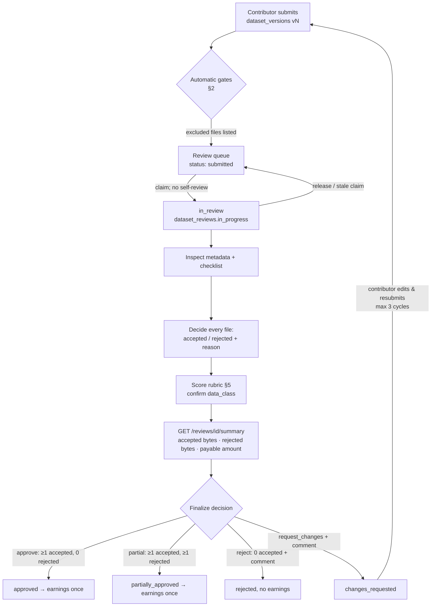

# DataHub — Data Quality & Review Specification

## 0. Document header

| Field | Content |
|---|---|
| **Purpose** | Defines how a submitted dataset is checked, scored and decided at file level and dataset level, how contributors receive feedback and resubmit, and how annotation output is quality-assured. The review module, the reviewer workspace UI, the finalize/earning logic and the review test cases are built from this document. |
| **Scope** | Automatic gates (processing, scanning, duplicates), human dataset review (claim, inspect, decide per file, score, finalize), the rejection reason catalogue, feedback, resubmission, QA sampling of annotation work, and the audit trail. Pricing arithmetic is in PRICING_PAYOUT_POLICY.md. Annotation review mechanics are in ANNOTATION_GUIDELINES.md §12. |
| **Assumptions** | A-03 (scale), A-08 (verification does not gate uploads), A-10 (fail-closed scanning), A-11 (DOC files have no preview), A-15 (audit retention 7 years). |
| **Decisions** | File-level partial approval; claim-based queue with no self-review; five-dimension 1–5 rubric with weighted overall; closed reason-code catalogue (§8); mandatory comment for dataset `reject` and `request_changes`; each resubmission is a new `dataset_versions` row; at most 3 change-request cycles; 10 % blind QA sampling of approved annotation tasks. |
| **Dependencies** | `docs/ENGINEERING_BASELINE.md` §6, §7, §8.3, §9, §12 (Review endpoints), §13; DATASET_DOCUMENTATION.md; ANNOTATION_GUIDELINES.md; DATA_PRIVACY_OWNERSHIP.md §5–§7; PRICING_PAYOUT_POLICY.md §3–§5, §11, §13. |
| **Acceptance criteria** | (1) Each decision has machine-checkable preconditions. (2) Each reason code has a fixed contributor-facing message. (3) The rubric gives a deterministic overall score. (4) The workflow is expressed as states that match baseline §9. (5) Every review action is auditable. |

**Document control**

| Version | Date | Status | Owner | Change |
|---|---|---|---|---|
| v1.0 | 2026-10-26 | Baseline | Data lead + Review lead | First baseline |

Rule identifiers: `DQ-nn`.

---

## 1. Reviewer roles and permissions

| Capability | reviewer | admin | super_admin |
|---|:-:|:-:|:-:|
| See review queue (metadata summary: code, title, category, languages, data_class, size, file count, submitted_at; no file access) | ✓ | ✓ | ✓ |
| Claim a dataset review (`dataset.review`) | ✓ | ✓ | ✓ |
| Preview / download files of a **claimed** dataset | ✓ (claimed only) | ✓ any | ✓ any |
| Decide files, score, finalize | ✓ (own claim) | ✓ (own claim) | ✓ (own claim) |
| Release own claim | ✓ | ✓ | ✓ |
| Release someone else's claim | ✗ | ✓ | ✓ |
| Read finalized reviews they performed (`GET /reviews/history`) | ✓ | ✓ all | ✓ all |
| Take down a dataset | ✗ | ✓ | ✓ |
| Correct a finalized outcome (financial adjustment) | ✗ | ✗ | ✓ (`finance.adjust`) |
| Claim annotation reviews (`annotation.review`) | ✓ | ✓ | ✓ |

- **DQ-01 No self-review.** `claim-review` returns `403 separation_of_duties` when `dataset.owner_id == actor.id`. Reviewers must also declare conflicts of interest (family member, employer, or their own source material uploaded by someone else) by releasing the claim with reason `conflict_of_interest`.
- **DQ-02** Reviewer access to file content exists only while the reviewer holds the claim, and read-only afterwards for reviews they finalized. Presigned URLs are issued per request (5 min) and every file open is logged (`audit_logs.action = 'file.preview'`).
- **DQ-03** Concurrent claims per reviewer are limited by `review_max_active_claims` (default 3).

## 2. Automatic gates (before a human sees the dataset)

| Gate | Rule | Result if failed |
|---|---|---|
| Type detection | Magic-byte MIME must agree with the extension family (baseline §7) | file `failed: type_mismatch` |
| Allowed type | Not executable/script/HTML/SVG/macro-Office | file `failed: disallowed_type` |
| Archive safety | ZIP limits: ≤ 10,000 members, ≤ 20 GB uncompressed, ratio ≤ 100:1, depth ≤ 1, safe names | member or container `failed` (`nested_archive`, `zip_limits_exceeded`, `unsafe_member_path`) |
| Integrity | File parses or renders (PDF opens, image decodes, DOCX/XLSX zip valid, JSON/XML parses) | file `failed: corrupt` |
| Malware | ClamAV clean (fail-closed) | `quarantined` (infected) or `scan_status=error` (rescan by admin) |
| Hash and duplicates | sha256 is computed and `dataset_duplicates` populated | flags for the reviewer |
| Submit precondition | All files terminal and ≥ 1 `ready` (baseline §9) | Submit blocked with list of offending files |

- **DQ-04** Files that fail any gate are **excluded automatically**. They have no review decision, are shown to the reviewer and the contributor under "Excluded by system" with the system code, and are never payable.

## 3. File acceptance criteria (reviewer)

A file is **accepted** only if **all** of the following hold:

| # | Criterion | Guidance |
|---|---|---|
| AC-1 | **Readable / usable** | For images and scans, text is legible at 100 % zoom (≈ ≥ 200 DPI equivalent; ≥ 300 recommended). For digital text, a real encoding (Unicode, or legacy Khmer when declared and useful). |
| AC-2 | **Relevant** | Contains text-bearing content useful for SKAI's Khmer-first OCR/NLP (any language listed in the dataset; Khmer prioritised), consistent with the dataset category. |
| AC-3 | **Unique** | Not an exact duplicate of previously accepted content (auto-flagged), and not a near duplicate adding no value (reviewer judgement). |
| AC-4 | **Lawful and permitted** | The rights declaration is plausible for this file (no obvious commercial e-book rip, watermarked stock material or "confidential" markings without evidence). Personal data is handled per DATA_PRIVACY_OWNERSHIP.md §6. |
| AC-5 | **Matches metadata** | Language, category and period are consistent with the dataset metadata. |
| AC-6 | **Honest size** | No padding, embedded junk, upscaled images, repeated pages, or uncompressed re-encodes made to inflate bytes. |
| AC-7 | **Complete for its kind** | Not truncated (missing pages mid-document, cut-off scans) unless the description says it is a fragment. |

- **DQ-05** Files with an extension in `extra_allowed_extensions` ("other") are accepted only if the reviewer can open them in a safe viewer outside DataHub and they satisfy AC-1–AC-7. Otherwise reject them with `wrong_format`.
- **DQ-06** DOC files (no preview, A-11) are downloaded by the reviewer and opened in a sandboxed viewer with macros disabled. If the reviewer cannot open one safely, it is rejected `wrong_format` with a comment asking for DOCX or PDF.

## 4. Labeled-data acceptance (data_class = labeled)

The dataset is confirmed **labeled** only if:

1. Labels exist for ≥ 95 % of the content files they claim to describe (unlabeled files must be split into a raw dataset).
2. The label format is one of `paired_text`, `sidecar_json`, `csv_mapping`, `jsonl` or `other_documented`, and is described in `label_description`.
3. A spot check of at least 10 labeled items (or all, if fewer) finds ≤ 2 % CER for transcriptions (as in ANNOTATION_GUIDELINES.md §12.3) and ≥ 95 % correct for classification-type labels.
4. Khmer label text is Unicode, not legacy-font encoded.

If these are not met, the reviewer either **changes `data_class` to `raw`** (and explains this in the feedback) or **requests changes** (`metadata_mismatch` / `low_quality`). The labeled-upgrade tick (PRICING_PAYOUT_POLICY.md §5.4) is allowed only for files whose labels pass item 3.

## 5. Quality scoring rubric

Scores are required when finalizing `approve` or `partial`, and optional for `reject` and `request_changes`. They describe the **accepted portion** of the dataset and are stored in `dataset_quality_scores`.

| Dimension (key) | Weight | 1 | 2 | 3 | 4 | 5 |
|---|---|---|---|---|---|---|
| Legibility (`legibility`) | 0.25 | Mostly unreadable | Frequent blur, low resolution | Readable with effort in places | Clear; minor defects | Crisp, high-resolution, clean scans or native text |
| Completeness (`completeness`) | 0.15 | Fragments only | Many missing pages or parts | Some gaps, documented | Near complete | Complete as described |
| Relevance (`relevance`) | 0.25 | Off-topic | Marginal value | Useful, common material | Valuable (Khmer, uncommon domain) | High value (rare Khmer content, handwriting, historic, gold-standard labels) |
| Metadata accuracy (`metadata_accuracy`) | 0.15 | Wrong or misleading | Several fields wrong | Minor corrections needed | Accurate | Accurate and rich (source, dates, extension fields) |
| Labeling accuracy (`labeling_accuracy`) | 0.20 | Unusable labels | CER > 5 % / < 85 % correct | ≤ 5 % / ≥ 90 % | ≤ 2 % / ≥ 95 % | ≤ 0.5 % / ≥ 99 % |

- **DQ-07** `labeling_accuracy` is scored only for `labeled` datasets. For `raw` datasets it is `NULL`, and the remaining weights are renormalised.
- **DQ-08** `overall = round_half_up( Σ(weightᵢ × scoreᵢ) / Σ(weightᵢ for scored dimensions), 2 )`, computed with `Decimal` and stored as `numeric(3,2)`.
  - Raw example: L4, C5, R4, M3 → (1.00 + 0.75 + 1.00 + 0.45) / 0.80 = **4.00** (tier A).
  - Labeled example: the same plus LA3 → (3.20 + 0.60) / 1.00 = **3.80** (tier B).
- **DQ-09** Guidance: `approve` needs overall ≥ 3.00 and no dimension below 2. A `partial` with overall below 3.00 (tier C) needs a written justification in the internal review notes. Scores never change pricing in v1. They drive export filters (`min_quality_overall`) and contributor statistics.

## 6. Duplicates

| Situation | System behaviour | Reviewer action |
|---|---|---|
| Exact duplicate of **previously accepted** content (any owner) | Pre-marked `rejected / duplicate`; ineligible (PP-15) | Leave rejected. Only for labeled upgrades (PP-23): accept and tick "labeled upgrade". |
| Exact duplicate **within the same dataset** | Later copies pre-marked `rejected / duplicate` (PP-18) | Leave rejected. |
| Exact duplicate of content **pending elsewhere** | Flag only | Decide normally. Finalize re-checks under lock: whoever finalizes first wins (PP-16). |
| Near duplicate (perceptual or text similarity) | Flag with score and side-by-side link | Reject `near_duplicate` if it adds no new information (re-scan of the same page, resized copy). Accept if it is a genuinely different page or edition. |
| Same contributor resubmitting rejected files in a new dataset | Flag "previously rejected sha256 (reason X)" | Reject again with the same reason unless the reason no longer applies. |

- **DQ-10** Feedback for duplicates never reveals another user's dataset, name or file name. The message is only "This file duplicates content already held by the platform."

## 7. Corrupted files and incomplete datasets

- **Corrupted** files are excluded automatically (`failed: corrupt`, §2). If a file passes the automatic checks but the reviewer finds damage (blank renders, garbled pages, truncated text), it is rejected `corrupt`.
- **Incomplete datasets** are datasets that do not match their description (e.g. "complete 1995 volume" with half the issues, a labeled dataset missing labels, multi-part ZIP members missing). The reviewer:
  - requests changes (`incomplete`) if the contributor can plausibly supply the missing part; or
  - partially approves the usable files, with feedback stating what was missing; or
  - rejects (`incomplete`) if the remainder has no standalone value.
- A dataset where all files were excluded by the system cannot be submitted (§2). The contributor fixes or deletes the files, or withdraws the dataset.

## 8. Rejection reason code catalogue (closed list)

Used for file decisions (`PUT /reviews/{id}/files/{file_id}` → `reason_code`) and for dataset-level `reject` / `request_changes` feedback (`reason_codes[]`). The codes are stable API values. Labels and messages live in the message catalogue (en; km to follow).

| Code | Label | Level | Contributor message (default) | Comment required |
|---|---|---|---|---|
| `duplicate` | Duplicate | file | This file duplicates content already held by the platform or appears more than once in this dataset. | No |
| `near_duplicate` | Near duplicate | file | This file is a near copy (e.g. re-scan or resized version) of content already held. | No |
| `corrupt` | Corrupt or damaged | file | The file is damaged or cannot be read completely. | No |
| `illegible` | Illegible | file | Text in this file cannot be read reliably (blur, low resolution, damage). | No |
| `off_topic` | Off-topic | file / dataset | The content is not text-bearing or not relevant to Khmer/English document AI. | No |
| `personal_data` | Personal data | file / dataset | The file contains personal data that was not declared or cannot be accepted. | **Yes** |
| `copyright_concern` | Copyright / rights concern | file / dataset | We could not confirm you have the right to license this content. | **Yes** |
| `malware` | Malware / unsafe content | file | The file was flagged as unsafe. | No (admin notified automatically) |
| `wrong_format` | Wrong or unsupported format | file | The format is unsupported, cannot be previewed safely, or the encoding is wrong. | No |
| `low_quality` | Low quality | file / dataset | Quality is below our acceptance threshold (see comment). | **Yes** |
| `incomplete` | Incomplete | file / dataset | The file or dataset is incomplete compared to its description. | **Yes** |
| `metadata_mismatch` | Metadata mismatch | dataset (file allowed) | Title, language, category, data class or source does not match the content. | **Yes** |
| `size_inflation` | Size inflation | file | The file appears padded, duplicated internally, or re-encoded to inflate its size. | **Yes** |
| `other` | Other | file / dataset | See reviewer comment. | **Yes** |

System exclusion codes (not chosen by reviewers; shown under "Excluded by system"): `type_mismatch`, `disallowed_type`, `nested_archive`, `zip_limits_exceeded`, `unsafe_member_path`, `corrupt`, `infected`, `scan_error`. The full processing list is in the File Upload & Storage Specification (doc 22).

- **DQ-11** `malware` chosen by a reviewer (suspicious content the scanner missed) automatically opens an admin alert, revokes the reviewer's preview URLs, and asks an admin to quarantine the file (`POST /admin/files/{id}/rescan` or takedown).
- **DQ-12** `personal_data` and `copyright_concern` rejections are also flagged to admins for privacy/rights follow-up (DATA_PRIVACY_OWNERSHIP.md §6, §12).

## 9. Review assignment and workflow

### 9.1 Queue and claiming
- `GET /reviews/queue` lists `submitted` datasets, oldest `submitted_at` first. Resubmissions show a "Returning (vN)" badge and the previous reviewer's pseudonym. Datasets that need privacy review (`contains_personal_data ∈ {yes, unsure}`) show a badge, and only reviewers with the `privacy_trained` flag (a `user_profiles` attribute set by admins) can claim them.
- `POST /datasets/{id}/claim-review` creates `dataset_reviews(status=in_progress)` and moves the dataset `submitted` → `in_review`. Claiming is atomic (`UPDATE datasets SET status='in_review' WHERE id=:id AND status='submitted'`), so two reviewers cannot claim the same dataset.
- `POST /reviews/{id}/release` (by the reviewer, or by an admin for someone else's claim, with reason) → review `released`, dataset back to `submitted`. Draft file decisions are discarded (kept in audit).
- The admin dashboard highlights claims with no activity for over **72 h**, and admins release them. Service target: first claim within **5 business days** of submission, finalize within **10 business days**.

### 9.2 Workflow

### 9.3 Review procedure (reviewer)
1. **Metadata and checklist** (`PATCH /reviews/{id}` → `checklist`). Each item is `pass`, `fail` or `n/a`:
   `CL-01` title/description match content · `CL-02` languages correct · `CL-03` category correct · `CL-04` data_class correct (§4) · `CL-05` source and licence plausible · `CL-06` personal-data flag correct · `CL-07` no sensitive documents without basis · `CL-08` duplicates resolved · `CL-09` sampling coverage met · `CL-10` Khmer text is Unicode (when text files are present) · `CL-11` no size inflation.
2. **Sampling coverage (DQ-13).** For datasets with ≤ 50 reviewable files, open every file. For larger datasets, open at least max(50, 10 %) of files, chosen by the system's "random sample" button plus every flagged file (near-duplicate, personal data, "other" extension, low resolution) and at least one member of each ZIP. Unopened files can be decided in bulk (`POST /reviews/{id}/files/bulk`) **only if** ≤ 5 % of opened files were rejected. Otherwise every file must be opened. The system records which files were opened.
3. **Decide each file** (`accepted` / `rejected` + `reason_code` + optional or required comment per §8). Pre-marked duplicates already carry a decision.
4. **Score** (§5) and confirm or change `data_class`. A change requires a comment.
5. **Summary**: the system shows accepted and rejected bytes and counts, excluded files, and the payable amount calculated exactly as at finalize (current rate, marked "will be fixed at finalize").
6. **Finalize** (`POST /reviews/{id}/finalize {decision, feedback, reason_codes[]}` + `Idempotency-Key`).

### 9.4 Finalize preconditions and effects (DQ-14)

| Decision | Preconditions | Dataset status | Earnings |
|---|---|---|---|
| `approve` | Every reviewable file decided; all `accepted`; checklist complete; scores present | `approved` | Yes (once) |
| `partial` | Every reviewable file decided; ≥ 1 accepted and ≥ 1 rejected; checklist complete; scores present | `partially_approved` | Yes (once), accepted eligible files only |
| `reject` | ≥ 1 reason code; feedback ≥ 30 characters; undecided files are bulk-set to `rejected` with the dataset-level reason | `rejected` | No |
| `request_changes` | ≥ 1 reason code; feedback ≥ 30 characters; cycle count < 3 | `changes_requested` | No |

In one database transaction, finalize: guards `dataset_reviews.status='in_progress'`; freezes file decisions; re-evaluates eligibility under the sha256 advisory locks (PRICING_PAYOUT_POLICY.md §11); writes `earning_records` and at most one `dataset_earning` journal; updates dataset counters (`accepted_bytes`, `rejected_bytes`, `accepted_file_count`) and status; stores scores; enqueues the contributor notification and email (transactional outbox); writes audit rows. A retry with the same `Idempotency-Key` returns the stored result. A finalized review cannot be changed.

### 9.5 Partial approval at file level
- Decisions are per file, including each ZIP member. A ZIP container has no decision (never payable). Its members are listed under it.
- Partial approval pays only accepted, eligible files (PRICING_PAYOUT_POLICY.md §3). Rejected files of a partially approved dataset are retained per the retention policy for rejected objects and are never exported.

## 10. Feedback, correction and resubmission

### 10.1 Feedback requirements (DQ-15)
- Dataset-level `feedback` is **mandatory (≥ 30 characters)** for `reject` and `request_changes`, and optional for `approve` and `partial` (the system adds an automatic summary of accepted and rejected counts and bytes).
- File-level: `reason_code` is mandatory for every rejected file. A comment is mandatory where §8 says so.
- Feedback must be specific (name the file code and page), actionable (say what would make the file acceptable), and courteous. It must not contain personal remarks, other users' information, or internal fraud suspicions. Fraud suspicions go in internal notes (`review_internal_notes`, visible to admins only).
- The contributor sees each file's decision, reason message, comment and quality scores, and the reviewer as a pseudonym ("Reviewer 19a2"), never by name.

### 10.2 Correction and resubmission
- `changes_requested` reopens the dataset for editing: metadata edits, file deletions, new uploads. Resubmission creates a **new `dataset_versions` row** (DATASET_DOCUMENTATION.md §5) and returns the dataset to the queue.
- The new review starts without decisions. The previous decisions and feedback are shown read-only as context.
- **DQ-16** At most **3** `request_changes` cycles per dataset. On the fourth review, the reviewer must choose approve, partial or reject.
- `rejected` is terminal. The contributor may create a new dataset (duplicates of rejected files are flagged, §6) or dispute within 60 days (PRICING_PAYOUT_POLICY.md §13).
- The contributor can `withdraw` a dataset while it is `submitted` or `changes_requested`, not while it is `in_review`.

### 10.3 Dataset-review QA
- Each month an admin re-examines a random 5 % of finalized dataset reviews (minimum 2 per reviewer). Disagreements are discussed with the reviewer. Contributor-impacting errors are corrected **only** through adjustments (PRICING_PAYOUT_POLICY.md §12.4). A finalized review is never reopened.

## 11. Annotation QA

- **Primary review.** Every submitted annotation task is reviewed (`review_required` is always true in v1), following ANNOTATION_GUIDELINES.md §12.
- **DQ-17 Sampling.** When a task is approved, the system selects it for a **blind QA second review** with probability `annotation_qa_sample_rate` (default **0.10**), using a cryptographically random draw recorded in the audit log. The weekly admin report lists annotators with no QA sample that week, and admins add one manually.
- **QA reviewer:** must hold `annotation.review` and differ from the annotator and the first reviewer. The QA reviewer does not see the first reviewer's score or comments until submitting.
- **Record.** The QA review is stored as an `annotation_reviews` row with `review_kind = 'qa'` (primary reviews use `'primary'`; a required column in the Database Schema Documentation). QA reviews **never** change the task status and **never** create rewards.
- **Outcome.** QA computes CER against the approved version, as in ANNOTATION_GUIDELINES.md §12.2, and re-checks labels.
  - **Pass**: CER ≤ 2 % and labels correct.
  - **Fail**: the annotation gets the flag `qa_failed`. The admin may create a follow-up `text_correction` task for the affected pages, and approved data with `qa_failed` is excluded from exports until the follow-up task is approved.
- **Calibration.**
  - An annotator whose rolling 30-day QA pass rate falls below **80 %** (minimum 5 samples) is not assigned new tasks until an admin retrains them.
  - A reviewer whose approvals fail QA more than **20 %** of the time in 30 days (minimum 5 samples) is recalibrated.
- **Rewards and QA.** Rewards are not clawed back for ordinary QA failures. For zero-tolerance fraud (invented text, pasted external machine output), a super_admin may post an `adjustment_debit` with reason `review_error` or `other` and a full justification, and the annotator may be suspended.

## 12. Audit history

- **DQ-18** Each event below writes an `audit_logs` row (actor, action, entity, before/after diff, IP, `request_id`). Review rows themselves are never deleted.

| Event | Entity | Key data |
|---|---|---|
| Submit / resubmit | dataset, dataset_version | version_no, file manifest hash |
| Claim / release (with reason) | dataset_review | reviewer, timestamps |
| File opened / downloaded | dataset_file | reviewer, page |
| File decision set / changed (before finalize) | dataset_file_review | old → new decision, reason, comment |
| Checklist / scores / data_class change | dataset_review | diff |
| Finalize | dataset_review, dataset | decision, feedback, totals, journal_id |
| Takedown | dataset | admin, reason, takedown_request_id |
| Annotation submit / claim / review / QA | annotation_task, annotation_review | versions, CER, score, decision |

- Contributors see their own dataset's history: versions, decisions, feedback, and pseudonymised reviewers. Admins see everything. `audit.read` (super_admin) sees raw audit logs.
- Retention: review records and audit logs are kept for **7 years** (A-15). They survive dataset object purges and account anonymisation (DATA_RETENTION_DELETION.md).
