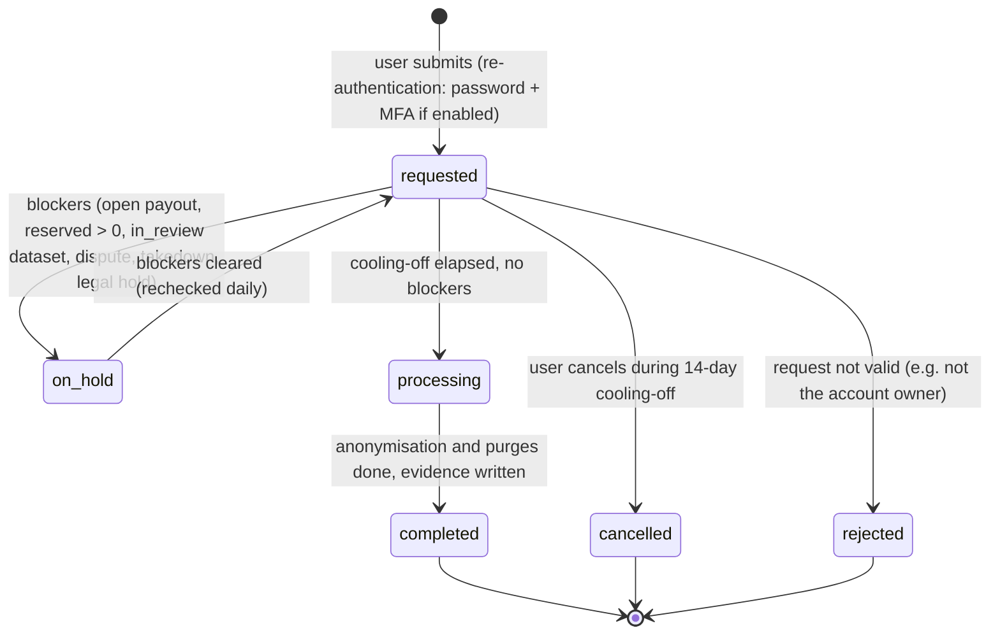

# DataHub — Data Retention & Deletion Policy

## 0. Document header

| Field | Content |
|---|---|
| **Purpose** | Defines how long DataHub keeps each kind of data, when and how it is deleted or anonymised, how deletion requests and legal holds work, how backups affect deletion, and what evidence of deletion is kept. The `retention.purge` job, the account-deletion flow and the storage lifecycle configuration are built from this document. |
| **Scope** | All data in PostgreSQL and in the object store `datahub-private` (datasets, previews, quarantine, exports, finance proofs, identity documents, message attachments), application logs, and backups. Excludes copies already incorporated into trained models (DATA_PRIVACY_OWNERSHIP.md §12.5). |
| **Assumptions** | A-13 (UTC), **A-15 retention defaults (pending legal review)**: rejected dataset objects 90 days; withdrawn drafts 30 days; abandoned upload sessions 24 h; exports 7 days; audit and financial records 7 years; security events 1 year. Backup retention is 35 days (Backup & DR Plan; baseline §14 RPO). |
| **Decisions** | Periods are configurable in `system_settings` (`retention_*` keys) but default to the table in §2. Account deletion is **anonymisation**: financial, audit and licensed-data records are kept and the person is de-identified. Deletion removes all object versions. Backups are not edited; they expire after 35 days, and deletions are re-applied after any restore. Legal holds override every purge. |
| **Dependencies** | `docs/ENGINEERING_BASELINE.md` §1 (A-15), §9 (users, datasets, export states), §10 (`deletion_requests`, `takedown_requests`, `audit_logs`), §13 (`retention.purge`, `exports.expire`, `uploads.expire_sessions`); DATASET_DOCUMENTATION.md §8; DATA_PRIVACY_OWNERSHIP.md §6, §12; PRICING_PAYOUT_POLICY.md §14; Backup & Disaster Recovery Plan (doc 34). |
| **Acceptance criteria** | (1) Every data class has a period, a trigger event and a deletion mechanism. (2) The account-deletion flow is specified field by field. (3) Backup persistence is disclosed in user-facing wording. (4) Secure-deletion steps cover object versions and derived artefacts. (5) Each deletion leaves auditable evidence that does not itself keep the deleted content. |

**Document control**

| Version | Date | Status | Owner | Change |
|---|---|---|---|---|
| v1.0 | 2026-10-26 | Baseline (pending legal review, A-15) | Data Protection Lead + CTO role | First baseline |

Rule identifiers: `RT-nn`.

> ⚖️ **LEGAL REVIEW REQUIRED (HA-03, HA-04)** — All periods are operational defaults. Before launch, counsel must confirm statutory minimums and maximums: accounting and tax record periods in Cambodia, personal-data retention limits under the PDP law once in force, and GDPR storage limitation where applicable.

---

## 1. Principles

1. Keep data only as long as there is a purpose: an active licence, an obligation, a dispute, or security.
2. Financial and audit records are kept for the full period even after an account is deleted. They are de-identified where possible and restricted to `finance.read` / `audit.read`.
3. Deletion is real: every object version and every derived artefact is deleted, and the deletion is recorded as evidence.
4. Legal holds stop deletion. Nothing on hold is purged.
5. Be honest with users. Tell them what is kept, why, and when backups expire.

## 2. Retention periods

| # | Data | Retention | Starts at | Mechanism |
|---|---|---|---|---|
| R-01 | Abandoned or expired upload sessions (incomplete multipart uploads) | **24 h** | `upload_sessions.expires_at` | `uploads.expire_sessions` (every 15 min) aborts the S3 multipart upload; bucket lifecycle AbortIncompleteMultipartUpload after 1 day as a backstop |
| R-02 | Withdrawn datasets (draft, submitted or changes_requested → `withdrawn`): files, previews | **30 days** | `withdrawn_at` | `retention.purge` |
| R-03 | Files deleted by the owner from a draft or changes_requested dataset | **30 days** | `deleted_at` | `retention.purge` |
| R-04 | Drafts inactive for 180 days | Notice at 180 days; auto-withdraw at **194 days**; then R-02 | `updated_at` | `retention.purge` (notification, then withdraw) |
| R-05 | `changes_requested` datasets not resubmitted | Reminder at 60 days; auto-withdraw at **90 days**; then R-02 | review `finalized_at` | `retention.purge` |
| R-06 | Rejected dataset objects (whole rejected datasets, and rejected files of partially approved datasets) | **90 days** | review `finalized_at` | `retention.purge` |
| R-07 | Accepted files, ZIP members, previews, extracted text | **For the licence term** (perpetual, HA-02) while needed for SKAI AI work; need reviewed **every 3 years** by the data lead | `finalized_at` | Manual decision → purge via admin action |
| R-08 | ZIP container objects whose members were extracted | 90 days after finalize (the container is never payable or exported; its members persist) | `finalized_at` | `retention.purge` |
| R-09 | Quarantined (infected) objects | **30 days** (scan result, signature name and sha256 kept for 7 years) | `quarantined_at` | Bucket lifecycle on `quarantine/` + `retention.purge` |
| R-10 | Taken-down data | Immediate secure deletion for `personal_data`, `illegal_content`, `confidential`; **30 days** for other bases | decision `upheld` | §5 |
| R-11 | Export packages | **7 days** | `completed_at` | `exports.expire` (status → `expired`, object deleted); lifecycle backstop 8 days |
| R-12 | Dataset, version, file **metadata rows** (incl. sha256, sizes, decisions) | **7 years** after the dataset's objects are purged, or indefinitely while the objects exist | purge date | `retention.purge` (rows hard-deleted) |
| R-13 | Annotations of approved tasks + submitted versions | Same as their source file (R-07) | — | Purged with the source file |
| R-14 | Draft annotation versions | Last 50 drafts + all submitted versions (baseline §11) | per save | Compaction on save |
| R-15 | Annotations of cancelled tasks | **1 year** | `cancelled_at` | `retention.purge` |
| R-16 | Audit logs (`audit_logs`) | **7 years** | event | `retention.purge` (partition drop by month) |
| R-17 | Financial records: journals, lines, earning records, payout requests, approvals, records, adjustments, payout proofs | **7 years** from the end of the fiscal year of creation | fiscal year end | `retention.purge` (rows and `finance/` objects) |
| R-18 | Security events | **1 year** | event | `retention.purge` |
| R-19 | Contributor verification records and ID documents | Rejected or superseded submissions: **90 days**. Current approved record: while the account is active. At anonymisation: documents deleted; legal name, country and DOB kept only if payouts exist, as part of R-17 | decision / anonymisation | `retention.purge` |
| R-20 | Support conversations, messages, attachments | **3 years** after the conversation is `closed` | `closed_at` | `retention.purge` |
| R-21 | Notifications | **1 year** | `created_at` | `retention.purge` |
| R-22 | Email outbox rows (rendered emails) | **90 days** after send | `sent_at` | `retention.purge` |
| R-23 | Sessions and tokens (`user_sessions`, `email_verifications`, password reset) | **30 days** after expiry or revocation | expiry | `retention.purge` |
| R-24 | Takedown requests and evidence | **7 years** after `closed` | `closed_at` | `retention.purge` |
| R-25 | Deletion requests (evidence of erasure) | **7 years** after `completed` | `completed_at` | `retention.purge` |
| R-26 | `background_job_records` | **90 days** | `finished_at` | `retention.purge` |
| R-27 | Application logs (structlog JSON) | **30 days** (logs must not contain document content or secrets) | write | Log platform retention |
| R-28 | Backups (database dumps, object-store backup copies or noncurrent versions) | **35 days** | backup time | §8 |

- **RT-01** Each period above is stored as a `system_settings` key (e.g. `retention_rejected_objects_days = 90`). Changing one requires `settings.manage` (super_admin) and writes an audit row. A shorter period applies to existing data from the next purge run. A longer period cannot bring back data that has already been purged.
- **RT-02** `retention.purge` runs daily (beat). It processes due items in batches of 500 and skips anything under legal hold (§10). It is idempotent: a status guard plus `purged_at` prevents repeat work, and a partly purged item is resumed on the next run.

## 3. Rejected datasets

- Rejected files and datasets are never used for training, annotation or export (DATA_PRIVACY_OWNERSHIP.md PO-05).
- Their objects (originals and previews) are kept **90 days** (R-06) so that disputes (PRICING_PAYOUT_POLICY.md §13, 60-day window) can be examined, then securely deleted (§9).
- Metadata rows, review decisions and sha256 hashes are kept 7 years (R-12). The hashes are used to flag repeat submissions of rejected content (DATA_QUALITY_REVIEW.md §6).
- A contributor may ask for earlier deletion of their rejected data (§7). The request is honoured unless a dispute, takedown or legal hold is open.

## 4. Accepted datasets

- Accepted content is held under the perpetual licence (HA-02) and kept for as long as it is needed for SKAI's AI work (R-07). The data lead re-confirms the need every 3 years and records the decision in the audit log. Content no longer needed is purged through an admin action, which follows §9.
- Accepted data survives the contributor's account deletion. The licence continues, and the owner reference points to the anonymised user (§6).
- Accepted data leaves storage only through: (a) a retention decision (R-07), (b) an upheld takedown (§5), or (c) a legal order.

## 5. Taken-down, withdrawn and abandoned data

| Case | Action | Timing |
|---|---|---|
| Takedown upheld, basis `personal_data`, `illegal_content`, `confidential` | Secure deletion of originals, members, previews, extracted text, annotations and active exports containing them | Within 2 business days of decision (DATA_PRIVACY_OWNERSHIP.md §12.4) |
| Takedown upheld, other bases | Access already blocked (`taken_down`); secure deletion | 30 days after decision |
| Withdrawn by owner | Objects purged | 30 days (R-02) |
| Abandoned uploads | Multipart aborted | 24 h (R-01) |
| Takedown under legal hold | Access blocked, no deletion until the hold is released | §10 |

Metadata needed for audit (dataset code, file IDs, sha256, decision, takedown reference) is kept per R-12 and R-24, without content.

## 6. Contributor account deletion (anonymisation)

### 6.1 Effect
Account deletion moves `users.status` `active|suspended` → `deactivated` → `anonymized` (baseline §9). Login is impossible from `deactivated` onwards. The table shows how each data item is treated.

| Data | Treatment |
|---|---|
| `users.email` | Replaced with `deleted-{user_id}@anonymized.invalid`; the original email is deleted |
| Password hash, MFA secret, recovery codes | Deleted |
| `user_profiles` (display name, phone, address, DOB, bio, avatar object) | Name → `Deleted user {first 8 hex of user_id}`; other fields nulled; avatar object deleted |
| Sessions, tokens, notification preferences | Deleted |
| Verification records and ID documents | Documents deleted (§9). If the user ever received a payout, legal name, country and DOB are kept inside the restricted financial snapshot (R-17); otherwise they are deleted |
| `payout_methods` | Deleted. Payout requests and records keep their **snapshot** (method type, account holder name, account number masked to the last 4 characters, payment reference) for R-17 |
| Wallet, ledger, earning records, payout records, adjustments | **Kept unchanged** (7 years, R-17); linked to the anonymised user ID |
| Accepted datasets, files, approved annotations | **Kept** (licence; §4); owner or annotator shown as the anonymised user |
| Draft, submitted, changes_requested datasets | Withdrawn at deactivation, then purged (R-02) |
| Rejected data | Purged on its normal schedule (R-06), or immediately if the user asked |
| Messages and attachments | Kept until R-20 expiry; sender shown as `Deleted user …` |
| Audit logs, security events | Kept for their periods (R-16, R-18). They are immutable and not rewritten. Access is restricted to `audit.read` |
| `agreement_acceptances`, rights declarations | Kept (proof of licence and declarations) for 7 years after the last accepted dataset is purged |

### 6.2 Balances on deletion
- **RT-03** Deletion is blocked (`on_hold`) while a payout is `requested` or `approved`, the reserved balance is above 0, or a dataset is `in_review`.
- **RT-04** If the available balance is at least the payout minimum ($10.00), the user is asked to withdraw it first. If it is below the minimum, the user may (a) keep the account until the balance reaches the minimum, or (b) explicitly waive it. A waiver is recorded as an `adjustment_debit` by a super_admin (reason code `other`, text "account closure waiver", with the deletion request ID) so that the ledger stays complete.

> ⚖️ **LEGAL REVIEW REQUIRED (HA-01, HA-04)** — Confirm whether a balance below the minimum may be waived at account closure, or whether it must be paid out.

## 7. Deletion requests workflow

Types (`deletion_requests.kind`): `account` (self-service `POST /me/deletion-request`), `dataset_data` (contributor asks for early deletion of their rejected or withdrawn data), `data_subject` (a third party, handled through takedown with basis `personal_data`; see DATA_PRIVACY_OWNERSHIP.md §12).

1. **Submit.** The user re-authenticates and confirms. The system shows what will be deleted, what is kept and why (§6.1), and the backup notice (§8.3). The status is `requested` and a confirmation email is sent.
2. **Cooling-off** of 14 days. The user can cancel from the email link or the settings page.
3. **Checks.** RT-03 blockers move the request to `on_hold`, listing each blocker. The daily job rechecks them.
4. **Processing.** In one transaction: `users.status = 'deactivated'`, all sessions revoked, open datasets withdrawn, and open annotation assignments unassigned. The anonymisation step (§6.1) then runs, and `users.status = 'anonymized'`.
5. **Object purges** (ID documents, avatar, withdrawn and rejected data) follow §9.
6. **Completion.** `completed_at` is set and a deletion confirmation is sent to the original email address (captured in the request before anonymisation and deleted after sending). It lists the categories deleted, the categories kept with their legal reason and period, and the date when backups will have expired.
7. **Service level:** completion within **30 days** of the request, excluding time on hold for blockers the user controls.

- `dataset_data` requests skip the cooling-off. They are completed within 10 business days unless a dispute or hold applies.
- Admins see all requests in `Admin → Deletion requests`. Only a super_admin can reject a request, and the reason is mandatory.

## 8. Backups

### 8.1 What is backed up
Daily `pg_dump` of PostgreSQL (and optional WAL archiving), plus object-store protection: noncurrent object versions where the provider supports versioning, or a daily copy to a separate backup bucket where it does not (see the Backup & DR Plan, doc 34). Backups are encrypted and retained for **35 days** (R-28).

### 8.2 Deletion and backups
- **RT-05** Backups are **not** edited to remove individual records or objects. Deleted data **persists in backups until those backups expire, at most 35 days after the deletion**. Backups are used only for disaster recovery and are accessible only to the operations role.
- **RT-06 Restore re-application.** Every purge and anonymisation writes an evidence row (§11) with timestamp and identifiers. After any restore, before the system returns to service, the restore runbook runs `retention.purge --replay-since <backup_timestamp>`. This re-applies all purges, anonymisations and takedown deletions recorded after the backup point. The evidence rows survive because they are re-exported, in a content-free form, to the backup bucket's append-only `evidence/` log daily.

### 8.3 User-facing disclosure (exact wording, shown on the deletion page and in the Privacy Policy)
> "When we delete your data, it is removed from our live systems straight away or on the schedule shown above. Copies may remain in our encrypted backups for up to 35 days, until those backups expire. We use backups only to recover from a technical failure. If we ever restore a backup, we delete your data again before the system goes back into use."

## 9. Secure deletion procedure

**RT-07** To delete a stored object `key` (and everything derived from it):
1. Collect all keys: `datasets/{dataset_id}/files/{file_id}/original`, `previews/{file_id}/*`, `quarantine/{file_id}/*`, and, for takedowns, active `exports/*` that contain the file (via `export_files` manifests; those exports are set to `expired`).
2. For each key, call `ListObjectVersions(prefix=key)`, then `DeleteObject(Key, VersionId)` for **every version and delete marker**. Where versioning is not supported, call a single `DeleteObject`.
3. Verify: `HeadObject` returns 404 and `ListObjectVersions` returns nothing. On failure, retry with backoff (×5), and if it still fails, alert and keep the item due for the next run.
4. Database: hard-delete preview and annotation rows tied to the file. Set `dataset_files.purged_at`, null `storage_key` and `storage_version_id`, and keep the metadata required by R-12.
5. Write evidence (§11).

- Database rows deleted by purge become unrecoverable through normal operation once PostgreSQL autovacuum reclaims them, and through backups after 35 days.
- Storage is encrypted at rest by the provider. Crypto-shredding (per-object keys) is not used in v1.
- Local temporary files on workers (processing, export staging) are written under a per-task temp directory and removed in a `finally` block. Worker containers have no persistent volume for user content.

## 10. Legal holds

- **RT-08** A super_admin can place a **legal hold** on a user, dataset, file set, takedown request or payout (fields `legal_hold_at`, `legal_hold_reason`, `legal_hold_ref`, `legal_hold_by` on the affected tables, as required in the Database Schema Documentation). Triggers include litigation, a regulator or police request, an internal fraud investigation, and a dispute under the Contributor Agreement.
- While a hold is in place: `retention.purge` skips the item, deletion requests involving it go `on_hold`, and takedowns restrict access without deleting.
- Holds are reviewed every **90 days**, and the release is audited. After release, any overdue retention is executed on the next purge run.

## 11. Payment records

- Financial records (R-17) are kept for **7 years from the end of the fiscal year** in which they were created. This applies even after account anonymisation, because they are needed for accounting, tax (HA-04), dispute handling and audit (PRICING_PAYOUT_POLICY.md §14).
- The ledger is append-only. At the end of the period, whole fiscal years are archived: an encrypted CSV export goes to the finance archive, and then the rows older than the period are deleted. Payout proofs under `finance/payout-proofs/` are deleted at the same time.
- Personal details inside financial snapshots (legal name, masked account) are only accessible with `finance.read`.

## 12. Storage lifecycle rules (bucket `datahub-private`)

| Rule | Scope | Setting |
|---|---|---|
| L-1 Abort incomplete multipart uploads | whole bucket | `AbortIncompleteMultipartUpload` after **1 day** |
| L-2 Export expiry backstop | prefix `exports/` | Expire current objects after **8 days** (the app expires at 7) |
| L-3 Quarantine expiry | prefix `quarantine/` | Expire after **31 days** (the app purges at 30) |
| L-4 Noncurrent versions | whole bucket (if versioning enabled) | `NoncurrentVersionExpiration` **35 days** |
| L-5 Delete-marker cleanup | whole bucket | `ExpiredObjectDeleteMarker = true` |
| L-6 No age-based expiry | `datasets/`, `previews/`, `finance/`, `identity/`, `messages/` | Managed by `retention.purge` only (event-based periods) |

Lifecycle configuration is kept in `infrastructure/deployment/s3-lifecycle.json`, applied by the deployment script, and verified in the release checklist. Rules on providers that do not support a feature are replaced by the equivalent in `retention.purge` (documented in doc 34).

## 13. Audit evidence

- **RT-09** Every purge, anonymisation, takedown deletion and export expiry writes an `audit_logs` row with action `retention.purge` / `account.anonymize` / `takedown.delete` / `export.expire`. Each row contains: the rule ID (R-xx) or request ID, entity type and IDs, the count of object keys and versions deleted, total bytes, the sha256 list for files, the job ID, the start and end time, and the result. It **never** contains the deleted content or personal fields.
- A daily summary (items purged per rule, failures, items skipped due to holds) appears on the admin dashboard. Failures raise alerts.
- For deletion requests, `deletion_requests` stores the evidence summary that was sent to the user (§7 step 6).
- Each quarter, the DPL samples 10 purged items and checks that the objects (all versions) are absent and that evidence exists. The result is recorded as an audit entry (`retention.verification`).
